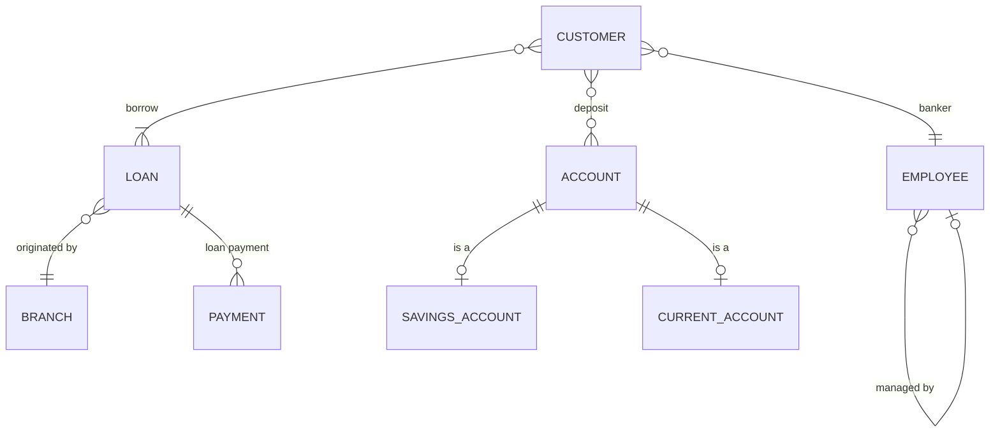

# Lecture 5: How to Think and Formulate ER Diagram

## Recap

1. ER model is used to build the conceptual schema.
2. Lectures 3 and 4 covered: entities, entity sets, relationships, constraints on a relationship (mapping cardinality, participation constraints), ER notations.
3. This lecture: steps to make an ER diagram.
4. Follow the steps and you can make the ER diagram of any system (university, school, banking, any use case).

## Steps to make an ER diagram

1. Identification of entity sets: which entities (entity sets) exist in the system.
2. Identification of attributes and their types: single valued, multi valued, composite, derived. Also decide the primary key of each entity set.
3. Identification of relationships and constraints:
   - What relationship exists between the entity sets; strong or weak relationship.
   - Degree of the relationship.
   - Mapping cardinality.
   - Participation constraint: total or partial.
4. After these are decided, the ER diagram is easy to draw.

## Example: Banking system

### Collecting DB requirements

1. Before drawing, collect DB requirements: what the database user wants stored (customer data separately, loan data, account data).
2. This is the requirement specification, made by requirement engineering (software engineering): interview the DB user and all stakeholders to learn what data they need from the database.
3. Real systems: ambiguity is removed through these interviews.
4. In an interview ("draw the ER diagram of a banking system") there is no time, so you assume many things yourself. Example: entity A participates totally in a relationship, entity B does not.

### Requirements

1. A bank has branches.
2. Each branch is located in a city and has a name. The branch name is its identification name, taken as the primary key.
3. The bank has customers.
4. Customers have accounts.
5. Customers can take loans; lending (credit) is how the bank earns.
6. A customer is associated with a banker (relationship manager / loan manager): the person to contact when a loan is initiated.
7. The bank has employees.
8. Accounts are of two types: savings account and current account.
9. Every loan is originated by a branch.
10. A loan can be held by multiple customers (example: an education loan held by son and father).
11. A loan has a unique id, a loan amount and a payment schedule (loan payments).
12. Loan and loan payment have a weak relationship.

### Step 1: Identify entity sets

1. Branch.
2. Customer: a real-world object, objectified into an entity.
3. Employee.
4. Savings account.
5. Current account: savings and current accounts have different properties.
6. Loan.
7. Payment: payment of a loan; a weak entity because it exists only in association with a loan.
8. Bottom up approach is used here (from the extended ER features): savings account and current account have special attributes of their own but both are also an account type, so generalize them into an Account entity. This is generalization, not specialization.

### Step 2: Identify attributes and their types

1. Branch: name (primary key), city, assets, liabilities. Assets and liabilities are used to count the bank's accounts. All are simple single valued attributes; no multi valued or composite attribute.
2. Customer:
   1. customer id: primary key.
   2. name.
   3. address: composite attribute.
   4. contact number: multi valued attribute (a customer has multiple contact numbers).
   5. age: derived attribute, calculated from the date of birth.
3. Employee:
   1. employee id: primary key.
   2. name.
   3. contact number: assumed single valued (an employee specifies only one contact number).
   4. dependent name: multi valued (many dependents: mother, father, brother, sister).
   5. start date: simple single valued; it must be recorded.
   6. years of service: derived attribute, calculated from the current date and the start date.
4. Savings account: account number (primary key), balance, interest rate, daily withdrawal limit.
5. Current account: account number (primary key), balance, transaction charges, overdraft amount.
6. Generalization: make Account the generalized entity. The common attributes (account number, balance) go on Account; the overlapping ones are deleted from savings and current account, which keep only their specific attributes.
7. Loan: loan number (loan id), primary key; amount.
8. Payment: weak entity, not defined on its own in the banking system. It is associated with a loan and identified by loan together with payment number (payment number is the partial key).

### Step 3: Identify relationships and constraints

1. Customer - Loan: relationship `borrow`.
   1. Mapping cardinality M:N. One customer can take N loans; one loan can be held by M customers.
   2. Participation: total on the loan side. If a loan exists, at least one customer must have taken it.
2. Loan - Branch: relationship `originated by`.
   1. Mapping cardinality N:1. One loan is initiated from one branch only; one branch can initiate many loans.
   2. Participation: total on the loan side. If a loan exists, it was created by some branch.
3. Loan - Payment: relationship `loan payment`, a weak relationship (identifying relationship).
   1. A relationship that exists with a weak entity is a weak relationship, and the weak entity has total participation.
   2. Total participation on the payment side: a payment (weak entity) exists only if a loan exists.
   3. Mapping cardinality: one loan can have N payments (1:N).
4. Customer - Account: relationship `deposit`. A customer deposits money in an account.
   1. Mapping cardinality M:N. One customer can open N accounts and pay or deposit into them; one account can be held by M customers (joint accounts).
5. Customer - Banker (Employee): relationship `banker`.
   1. A customer has a relationship manager, who is an employee of the branch.
   2. Mapping cardinality N:1. N customers can have one relationship manager.
   3. It could also be read the other way: one employee handles many customers, and N customers are handled by one relationship manager.
6. Employee - Employee: relationship `managed by`, a unary relationship (recall lecture 3).
   1. An employee has one manager; multiple employees can have the same manager.
   2. Mapping cardinality N:1. One manager manages many employees.
7. Account - Savings account / Current account: `is a` relationship, generalization of the two into Account.

### The ER diagram

1. Combine the three steps (entity sets, attributes and types, relationships and constraints) to draw the diagram.
2. The diagram on one page looks messy; read it as follows.
3. Relationship `borrow` between customer and loan: mapping cardinality M:N written on the lines; total participation shown on the loan side.
4. Attributes shown by type: address is composite (street is itself composite, the example of composite attributes); age is derived; name is simple single valued (it could be divided into first and last name, or first, middle and last, making it composite, but here it is assumed simple); primary keys are underlined; contact number is multi valued (drawn with a double ellipse).
5. Employee contact number is assumed single valued in the diagram.
6. Extended ER features are used: current account and savings account are joined to account with an `is a` relationship. Account is the generalized entity. Common attributes sit on the account entity; specific attributes stay on the lower entities.
7. Total participation is shown (first at the loan side of borrow).
8. Weak relationship shown: between the weak entity (payment) and its strong entity (loan). Payment has no primary key of its own; the loan number primary key is used for it.
9. Unary relationship shown: employee manages employee, N employees managed by one employee, and one employee manages N employees.

## Homework

1. Make the ER diagram of an online delivery system: payments, orders, customers, products are the entities. Use the same three simple steps.
2. Make the ER diagram of a university: professors, students, courses, departments.
3. Make your own assumptions, then draw the ER diagram.

## Tips

1. The only way to learn ER diagrams is to make many of them; this opens the mind to how to divide a system into entities and how to establish relationships.
2. Advanced concepts such as generalization were applied here as well.
3. The most important and hardest step is the third one: relationships and constraints.
4. Interview perspective: drawing constraints is very important. Always think about mapping cardinality and participation constraints. Many people draw a simple ER diagram but forget the mapping cardinality and participation, or cannot think them through.
5. Practice example: online delivery system. One customer can order N products; N customers can order the same product. Decide the mapping cardinality accordingly.
