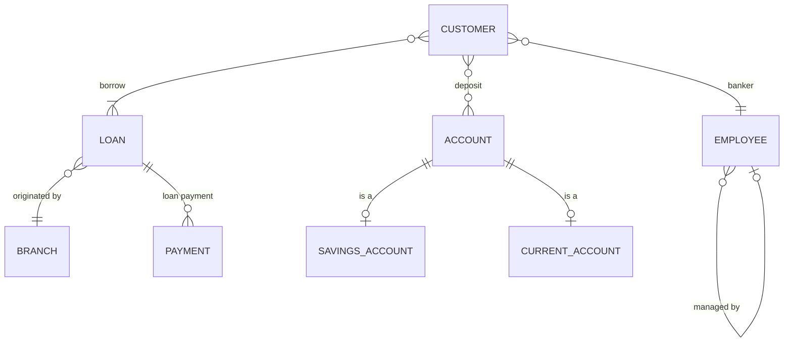

# Lecture 5: How to Think and Formulate ER Diagram

## Recap

1. The ER model is used to build the conceptual schema.
2. Lectures 3 and 4 covered entities, entity sets, relationships, constraints (mapping cardinality, participation), and ER notations.
3. This lecture covers the steps to make an ER diagram.
4. Follow the steps and you can make the ER diagram of any system (university, school, banking, any use case).

## Steps to make an ER diagram

1. **Identify entity sets:** Find which entities (entity sets) exist in the system.
2. **Identify attributes and their types:** The types are single valued, multi valued, composite and derived. Also decide the primary key of each entity set.
3. **Identify relationships and constraints:**
   - **Relationship:** What relationship exists between the entity sets? Is it strong or weak?
   - **Degree:** The degree of the relationship.
   - **Mapping cardinality:** The mapping cardinality.
   - **Participation constraint:** Total or partial.
4. After these are decided, the ER diagram is easy to draw.

## Example: Banking system

### Collecting DB requirements

1. **Collect requirements first:** Find out what the database user wants stored (customer data, loan data, account data).
2. **Requirement specification:** Requirement engineering (software engineering) makes it. You interview the DB user and all stakeholders to learn what data they need.
3. **Real systems:** These interviews remove ambiguity.
4. **Interview setting:** In an interview ("draw the ER diagram of a banking system") there is no time. You assume many things yourself. For example, entity A participates totally in a relationship, and entity B does not.

### Requirements

1. A bank has branches.
2. Each branch is located in a city and has a name. The branch name is its identification name. It is taken as the primary key.
3. The bank has customers.
4. Customers have accounts.
5. Customers can take loans. Lending (credit) is how the bank earns.
6. A customer is associated with a banker (relationship manager or loan manager). This is the person to contact when a loan is initiated.
7. The bank has employees.
8. Accounts are of two types: savings account and current account.
9. Every loan is originated by a branch.
10. A loan can be held by multiple customers. For example, an education loan is held by son and father.
11. A loan has a unique id, a loan amount and a payment schedule (loan payments).
12. Loan and loan payment have a weak relationship.

### Step 1: Identify entity sets

1. **Branch**
2. **Customer:** A real-world object, objectified into an entity.
3. **Employee**
4. **Savings account**
5. **Current account:** Savings and current accounts have different properties.
6. **Loan**
7. **Payment:** The payment of a loan. It is a weak entity because it exists only in association with a loan.
8. **Bottom up approach:** It is used here (from the extended ER features). Savings account and current account have special attributes of their own. But both are also an account type. So generalize them into an Account entity. This is generalization, not specialization.

### Step 2: Identify attributes and their types

1. **Branch:** name (primary key), city, assets, liabilities. Assets and liabilities are used to count the bank's accounts. All are simple single valued.
2. **Customer:**
   1. **customer id:** primary key.
   2. **name**
   3. **address:** composite attribute.
   4. **contact number:** multi valued attribute. A customer has multiple contact numbers.
   5. **age:** derived attribute, calculated from the date of birth.
3. **Employee:**
   1. **employee id:** primary key.
   2. **name**
   3. **contact number:** assumed single valued. An employee specifies only one contact number.
   4. **dependent name:** multi valued. There are many dependents: mother, father, brother, sister.
   5. **start date:** simple single valued. It must be recorded.
   6. **years of service:** derived attribute, calculated from the current date and the start date.
4. **Savings account:** account number (primary key), balance, interest rate, daily withdrawal limit.
5. **Current account:** account number (primary key), balance, transaction charges, overdraft amount.
6. **Generalization:** Make Account the generalized entity.
   - The common attributes (account number, balance) go on Account.
   - The overlapping ones are deleted from savings and current account. They keep only their specific attributes.
7. **Loan:** loan number (loan id) as primary key, and amount.
8. **Payment:** a weak entity. It is associated with a loan. Loan together with payment number identifies it. The payment number is the partial key.

### Step 3: Identify relationships and constraints

1. **Customer - Loan:** relationship `borrow`.
   1. **Mapping cardinality:** M:N. One customer can take N loans. One loan can be held by M customers.
   2. **Participation:** Total on the loan side. If a loan exists, at least one customer must have taken it.
2. **Loan - Branch:** relationship `originated by`.
   1. **Mapping cardinality:** N:1. One loan is initiated from one branch only. One branch can initiate many loans.
   2. **Participation:** Total on the loan side. Every loan has a branch.
3. **Loan - Payment:** relationship `loan payment`. It is a weak relationship (identifying relationship).
   1. A relationship that exists with a weak entity is a weak relationship. The weak entity has total participation.
   2. **Participation:** Total on the payment side. A payment (weak entity) exists only if a loan exists.
   3. **Mapping cardinality:** One loan can have N payments (1:N).
4. **Customer - Account:** relationship `deposit`. A customer deposits money in an account.
   1. **Mapping cardinality:** M:N. One customer can open N accounts and pay or deposit into them. One account can be held by M customers (joint accounts).
5. **Customer - Banker (Employee):** relationship `banker`.
   1. A customer has a relationship manager. The manager is an employee of the branch.
   2. **Mapping cardinality:** N:1. N customers can have one relationship manager.
   3. Read the other way, one employee handles many customers.
6. **Employee - Employee:** relationship `managed by`. It is a unary relationship (recall lecture 3).
   1. An employee has one manager. Multiple employees can have the same manager.
   2. **Mapping cardinality:** N:1. One manager manages many employees.
7. **Account - Savings account / Current account:** `is a` relationship. It is the generalization of the two into Account.

### The ER diagram

1. Combine the three steps (entity sets, attributes and types, relationships and constraints) to draw the diagram.
2. **Borrow:** The relationship `borrow` is between customer and loan. M:N is written on the lines. Total participation is shown on the loan side.
3. **Attributes by type:**
   - **Address:** composite. Street is itself composite. This is the example of composite attributes.
   - **Age:** derived.
   - **Name:** simple single valued here. It could be divided into first, middle and last name, making it composite.
   - **Primary keys:** underlined.
   - **Contact number:** multi valued. It is drawn with a double ellipse.
4. **Employee contact number:** It is assumed single valued in the diagram.
5. **Extended ER features:** Current account and savings account are joined to account with an `is a` relationship. Account is the generalized entity. Common attributes sit on the account entity. Specific attributes stay on the lower entities.
6. **Total participation:** It is shown (first at the loan side of borrow).
7. **Weak relationship:** It is shown between the weak entity (payment) and its strong entity (loan). Payment has no primary key of its own. The loan number primary key is used for it.
8. **Unary relationship:** It is shown as employee manages employee. N employees are managed by one employee. One employee manages N employees.

## Homework

1. Make the ER diagram of an online delivery system. Payments, orders, customers and products are the entities. Use the same three simple steps.
2. Make the ER diagram of a university. Professors, students, courses and departments are the entities.
3. Make your own assumptions, then draw the ER diagram.

## Tips

1. **Practice:** The only way to learn ER diagrams is to make many of them. It teaches how to divide a system into entities and how to establish relationships.
2. **Advanced concepts:** Generalization was applied here as well.
3. **Hardest step:** The most important and hardest step is the third one, relationships and constraints.
4. **Interview:** Drawing constraints is very important. Always think about mapping cardinality and participation constraints. Many people draw a simple ER diagram but forget the mapping cardinality and participation, or cannot think them through.

5. **Practice example:** Online delivery system. One customer can order N products. N customers can order the same product. Decide the mapping cardinality accordingly.
