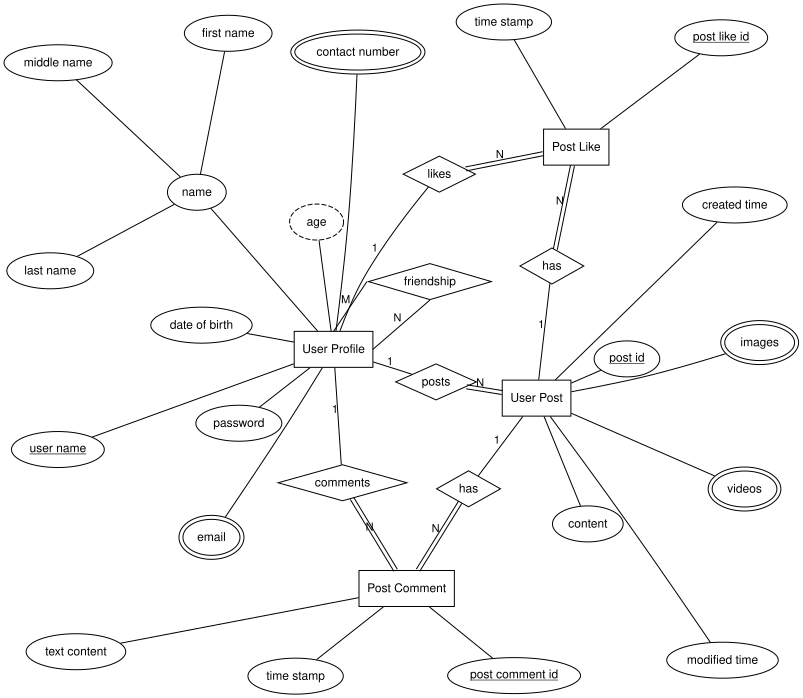

# Lecture 6: Designing ER Model of Facebook

Goal: design the Facebook database as an ER diagram (conceptual schema). The steps are: identify entity sets, identify relationships, identify constraints. Only basic functions are used (no pages, reels, ads).

## Features and use cases

1. **Profiles:** Anyone who signs up becomes a user.
2. **Friends:** A user has friends, and the friends are themselves users. This is a relationship between users and users.
3. **Posts:** A user can post. A post has text content, and also images, videos and so on.
4. **Likes and comments:** Users can like and comment on a post.
5. **Timeline:** Friends can visit your timeline and see all your posts.
   - Visiting a timeline extracts all posts of that profile from the database.

## Step 1: Identify entity sets

1. User Profile
2. User Post
3. Post Comment (comments on a post)
4. Post Like (likes on a post)

- **Separate entities:** A post can have many likes and many comments, so they are separate entities.
- **Why Likes is not an attribute of Post:** Many different users make the likes (same for comments), so a relationship would be hard to establish. A relationship exists between two entities, never between an attribute and an entity.
- **Refining:** You often find wrong assumptions later and refine the schema. This happens in the real world too.
- **Practice:** Practice with many ER diagrams makes this thinking clear.

## Attribute types

1. **User Profile:** Name, Email, Password, Contact Number, Date of Birth, Age.
   - **Name:** composite.
   - **User Name:** primary key.
   - **Email:** can be multi-valued (multiple emails stored). Whether it is multi-valued depends on the requirement.
   - **Contact Number:** multi-valued.
   - **Age:** derived (computed from Date of Birth).
2. **User Post:** Post ID, Content, Images, Videos, Created Time, Modified Time.
   - **Post ID:** unique identification, primary key.
   - **Content:** text.
   - **Images:** multi-valued (a post can have multiple images).
   - **Videos:** multi-valued.
   - **Created Time:** when the post was created.
   - **Modified Time:** Facebook later got a modification feature, so it is added.
3. **Post Comment:** Post Comment ID.
   - **Post Comment ID:** used for unique identification, primary key.

## Step 2: Identify relationships and constraints

1. **User Profile - Friendship - User Profile**
   - This is a relationship between one user profile and another user profile.
   - **Mapping cardinality:** M:N. One user profile can be a friend of many users, and one friend can be a friend of many user profiles.

2. **User Profile - Posts - User Post**
   - A user profile posts a post (not "shares").
   - **Participation:** total on the User Post side. Every post is posted by some user profile. There is no orphan post.
   - **Cardinality:** 1:N. One user can post N posts.

3. **User Profile - Likes - User Post**
   - A user profile can like a post.
   - **Mapping cardinality:** 1:N. One user profile can like N posts. A given Like is not made by N users.
   - **Participation:** total for Post Like. Any like on a post was made by some user profile.

4. **User Profile - Comments - Post Comment**
   - **Cardinality:** 1:N. One user profile can comment N times. One comment is made by exactly one user profile.
   - **Participation:** total for Post Comment. A comment is made by some user profile.

5. **User Post - Has - Post Comment**
   - **Cardinality:** 1:N. One user post can have N comments.
   - **Participation:** total for Post Comment. Any comment is on some user post.

6. **User Post - Has - Post Like**
   - **Cardinality:** 1:N. One user post can have N likes.
   - **Participation:** total for Post Like. Any like is associated with some user post.

There are 6 relationships in total.

## Final ER diagram (conceptual schema)

| Part | Details |
|------|---------|
| User Profile | Name (composite), User Name (primary key), Email (multi-valued), Password, Contact Number (multi-valued), Age (derived) |
| Friendship | User Profile to User Profile, M:N |
| User Profile - Posts - User Post | 1:N, total participation on User Post |
| User Profile - Comments - Post Comment | 1:N, total participation on Post Comment |
| User Post | Post ID (primary key), Content, Images (multi-valued), Videos (multi-valued), Created Time, Modified Time |
| User Post - Has - Post Comment | 1:N, total participation on Post Comment |
| User Post - Has - Post Like | 1:N, total participation on Post Like |
| User Profile - Likes - Post Like | 1:N, total participation on Post Like |

## Viewer question: Likes as an attribute of User Post

- **Problem:** If Likes were an attribute of User Post, the User Profile - Like relationship could not be established.
- **Practice:** This thinking comes only from practice.
- **Next lecture:** The relational model, and how to convert an ER diagram into a relational model.
