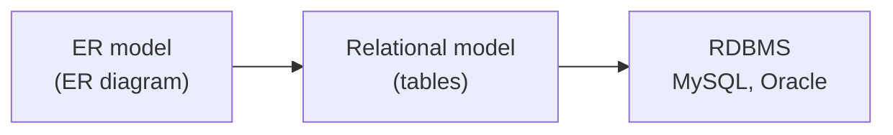
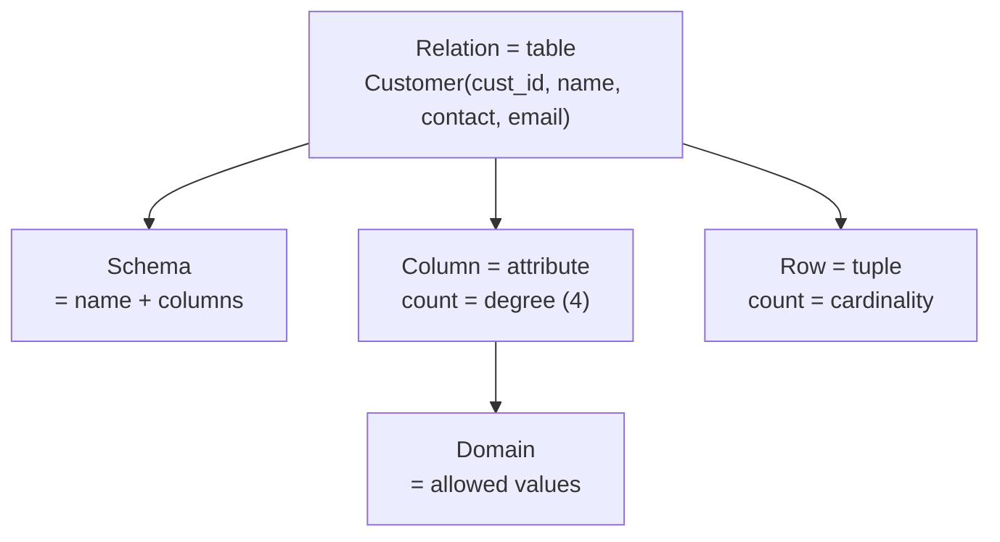
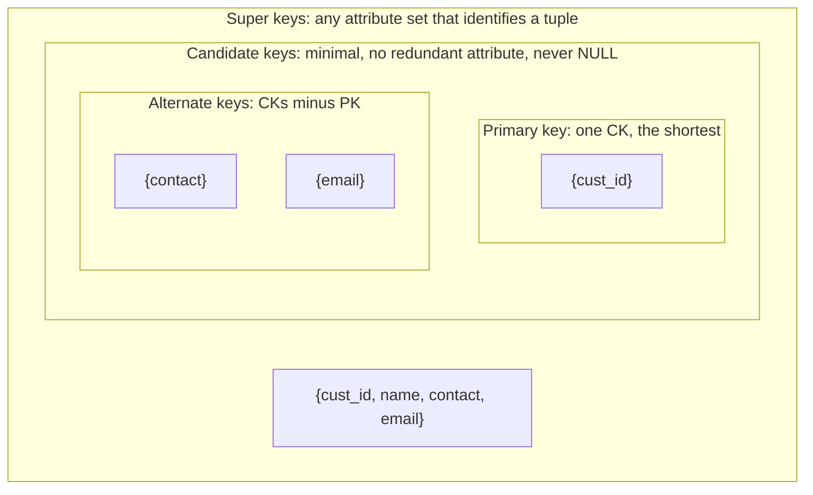
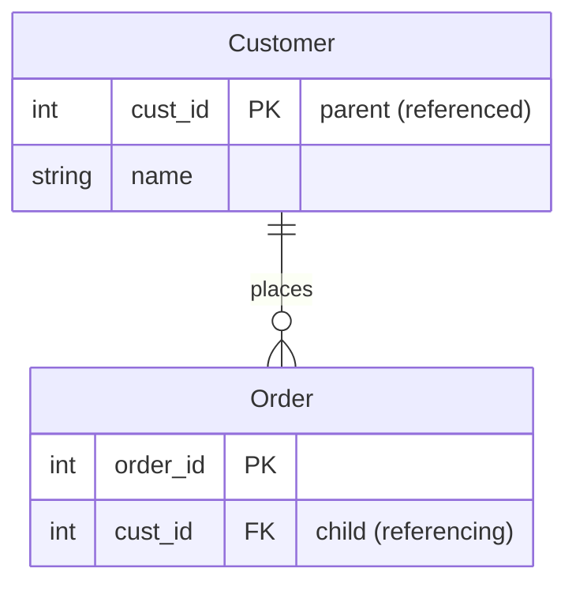
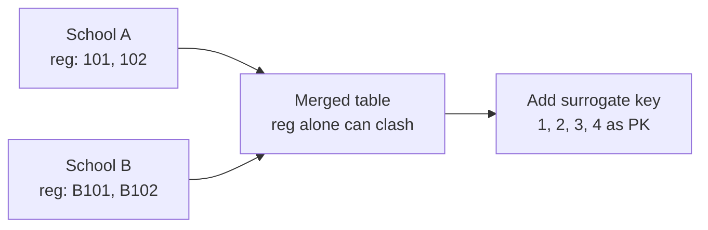
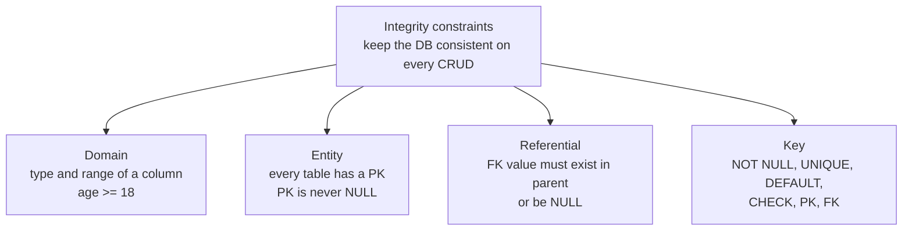
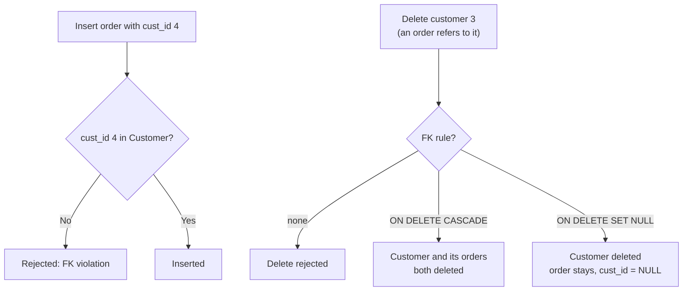
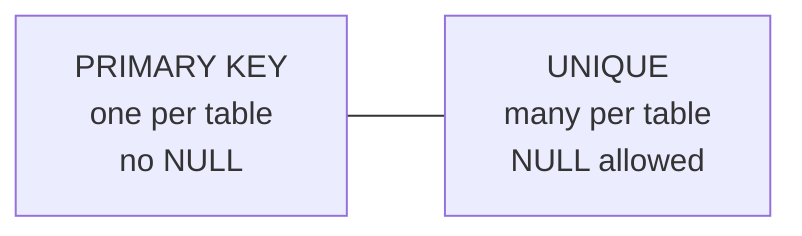

# Lecture 7: Relational Model

## 1. Where the relational model fits

## 2. Terms

| Term | Meaning |
|---|---|
| Relation | A relation is a table. |
| Tuple | A tuple is one row. |
| Attribute | An attribute is one column. |
| Domain | A domain is the set of allowed values of a column. |
| Schema | A schema is the relation name plus its columns. |
| Degree | Degree is the number of columns. |
| Cardinality | Cardinality is the number of rows. |

## 3. Properties of a table

| Property | Rule |
|---|---|
| Name | Each table name is unique. |
| Values | Each value is atomic. |
| Columns | Each column name is unique. |
| Rows | No two rows are the same. |
| Order | Row and column order does not matter. |

## 4. Keys

| Key | Definition |
|---|---|
| Super key | It is any set of columns that identifies each row. |
| Candidate key | It is a minimal super key. It is never NULL. |
| Primary key | It is the chosen candidate key. A table has only one. |
| Alternate key | It is every candidate key that is not the PK. |
| Foreign key | It is the PK of another table, stored here to link the two. |
| Composite key | It is a PK made of 2 or more columns. |
| Compound key | It is a PK made of 2 or more FKs. |
| Surrogate key | It is an auto-increment integer that the DB generates as the PK. |

## 5. Foreign key

## 6. Surrogate key example

## 7. Integrity constraints

## 8. Referential constraint in action

> **Interview:** An FK can be NULL. It becomes NULL when its parent row is deleted under SET NULL.

## 9. Key constraints

| Constraint | Rule |
|---|---|
| NOT NULL | The column cannot be empty. |
| UNIQUE | All values in the column differ. A table can have many. |
| DEFAULT | The column gets this value when none is given. |
| CHECK | The value must pass a condition, such as `age >= 18`. |
| PRIMARY KEY | The value is unique and not NULL. A table has only one. |
| FOREIGN KEY | The value must match a PK in the parent table. |

