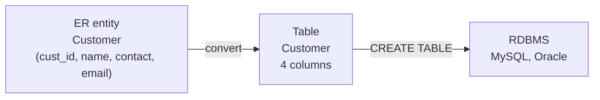
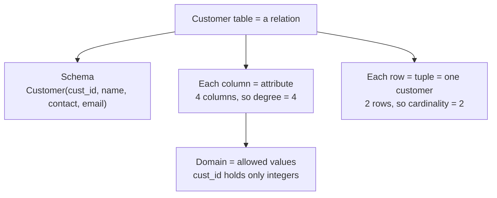
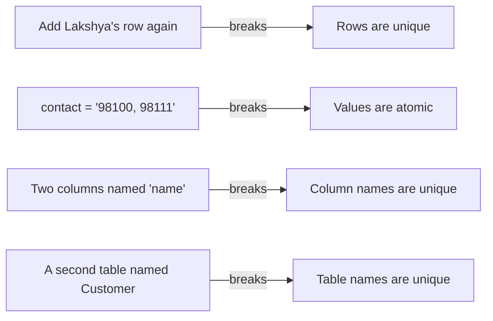
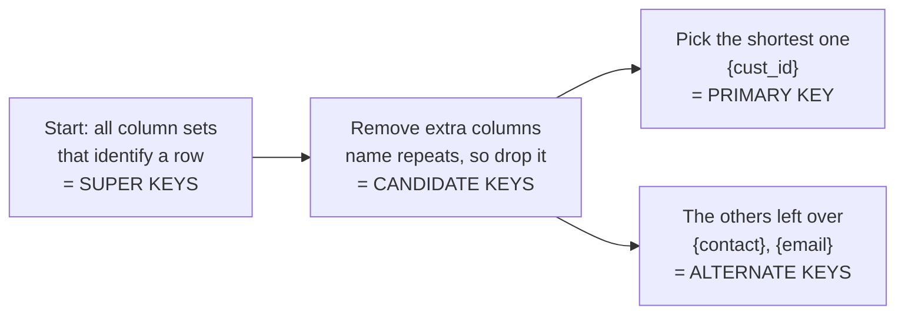
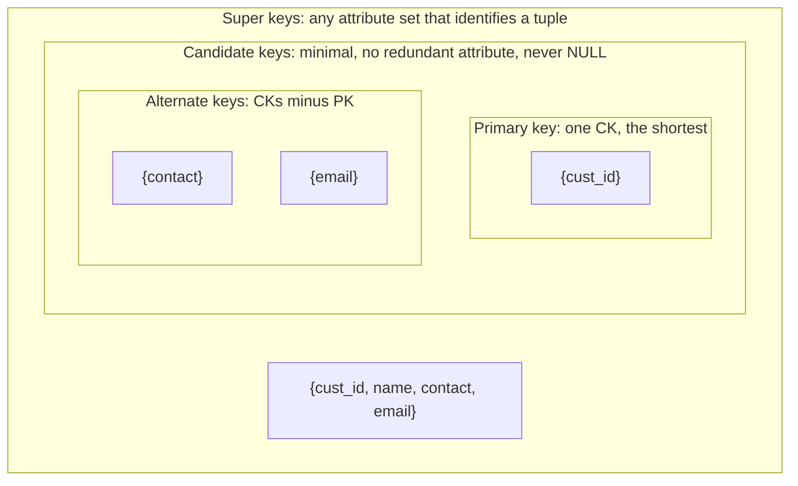
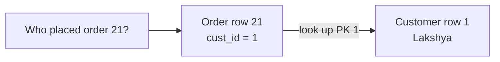
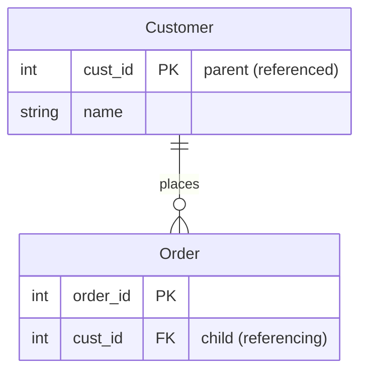
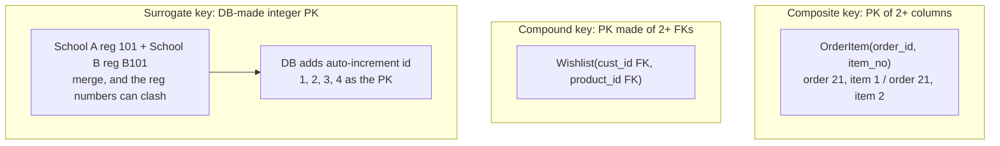
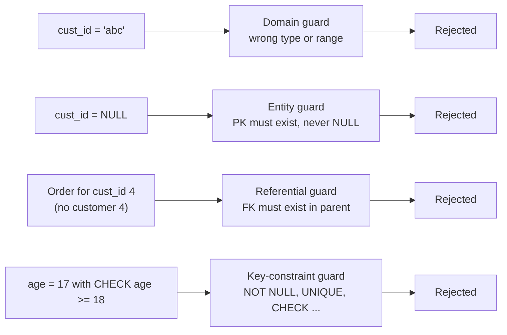
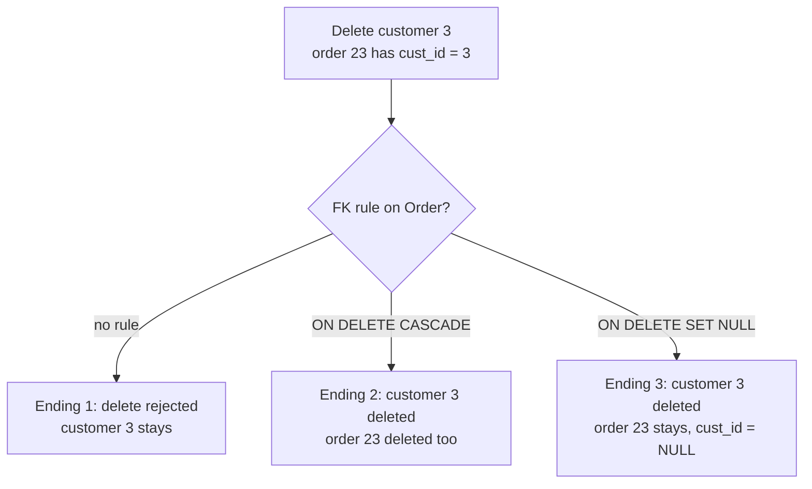

# Lecture 7: Relational Model

> **The story:** You run an online shop. Customers sign up and place orders. You must store them in tables safely.

## 1. The ER diagram becomes tables

You drew the ER diagram. Each entity becomes a table, and each attribute becomes a column.



## 2. Anatomy of a table

Two customers sign up. Here is the Customer table.

| cust_id | name | contact | email |
|---|---|---|---|
| 1 | Lakshya | 98100 | l@x.com |
| 2 | Raj | 98200 | r@x.com |



| Term | Meaning |
|---|---|
| Relation | A relation is a table. |
| Tuple | A tuple is one row. |
| Attribute | An attribute is one column. |
| Domain | A domain is the set of allowed values of a column. |
| Schema | A schema is the table name plus its columns. |
| Degree | Degree is the number of columns. |
| Cardinality | Cardinality is the number of rows. |

## 3. Rules every table follows

A careless clerk tries to break the table. Each attempt breaks a rule.



Row order and column order do not matter.

## 4. Which column identifies a customer?

Then a second Raj signs up. Name can no longer tell customers apart, so you hunt for a key.





Every candidate key is a super key, but not every super key is a candidate key.

## 5. Orders arrive, so link them with a foreign key

Lakshya places order 21. The Order table must say who placed it. It stores Lakshya's PK as a foreign key.

| order_id | cust_id (FK) |
|---|---|
| 21 | 1 |
| 22 | 2 |





The table holding the FK is the child. The table whose PK it copies is the parent.

## 6. More kinds of keys

The shop grows, and new tables need new kinds of keys.



| Key | Definition |
|---|---|
| Super key | It is any set of columns that identifies each row. |
| Candidate key | It is a minimal super key. It is never NULL. |
| Primary key | It is the chosen candidate key. A table has only one. |
| Alternate key | It is every candidate key that is not the PK. |
| Foreign key | It is the PK of another table, stored here to link the two. |
| Composite key | It is a PK made of 2 or more columns. |
| Compound key | It is a PK made of 2 or more FKs. |
| Surrogate key | It is an auto-increment integer that the DB generates as the PK. |

## 7. Guards at the door: integrity constraints

Every insert, update and delete passes four guards. Each guard stops one kind of bad data.



> **Interview:** The entity constraint is a favourite question. The PK is never NULL, otherwise rows cannot be told apart.

## 8. Customer 3 leaves: three endings

Customer 3 asks you to delete their account. Order 23 still points to them. The FK rule decides what happens.



> **Interview:** Can an FK be NULL? Yes. It becomes NULL when its parent row is deleted under SET NULL.

## 9. The six key constraints in one table

You write all six rules into the table when you create it.

```sql
CREATE TABLE Customer (
  cust_id INT PRIMARY KEY,           -- unique + not NULL, one per table
  name    VARCHAR(50) NOT NULL,      -- cannot be empty
  email   VARCHAR(50) UNIQUE,        -- no two customers share it
  age     INT CHECK (age >= 18),     -- must pass the condition
  prime   BOOLEAN DEFAULT FALSE      -- used when no value is given
);

CREATE TABLE Orders (
  order_id INT PRIMARY KEY,
  cust_id  INT,
  FOREIGN KEY (cust_id) REFERENCES Customer(cust_id)
    ON DELETE CASCADE                -- or ON DELETE SET NULL
);
```

| | PRIMARY KEY | UNIQUE |
|---|---|---|
| Count per table | A table has only one. | A table can have many. |
| NULL | It is never NULL. | It can be NULL. |
| Purpose | It identifies each row. | It stops duplicate values. |
