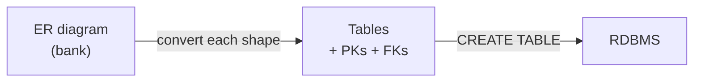
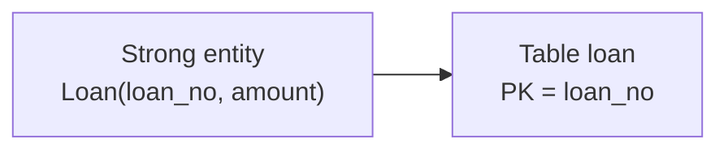
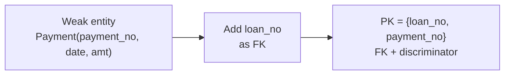
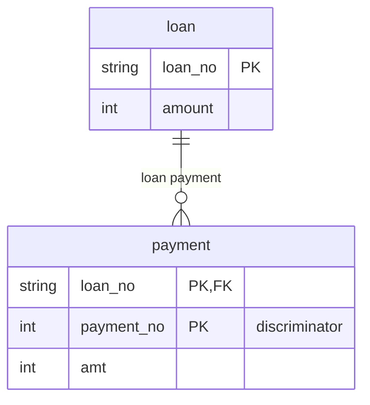
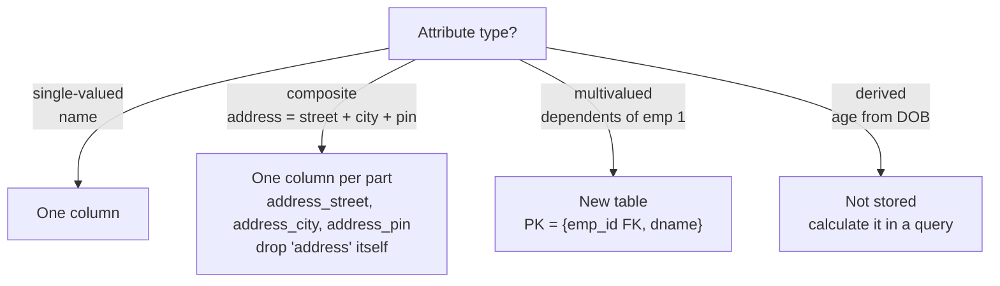
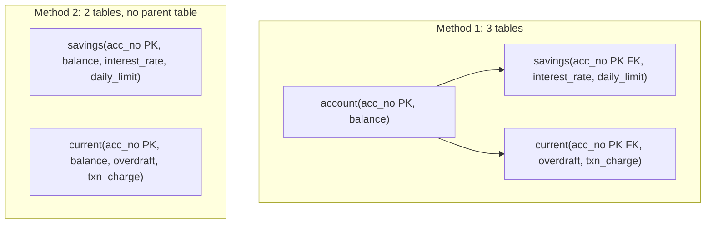
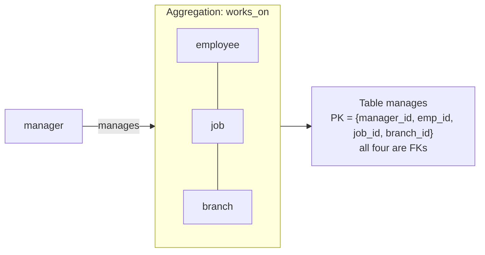
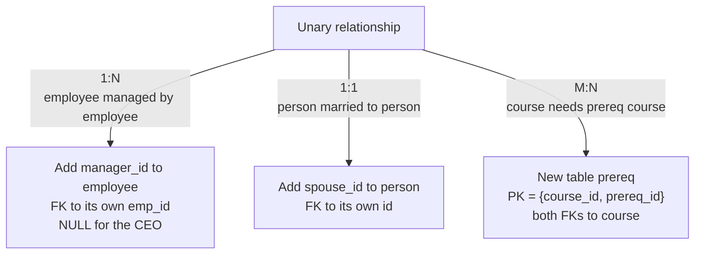
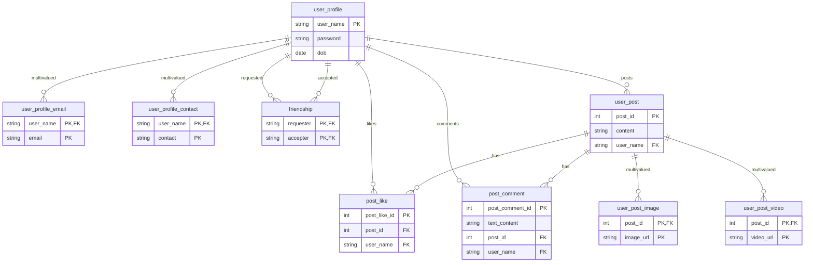

# Lecture 8: ER Model to Relational Model

> **The story:** You built the ER diagram for a bank. Now you must turn every shape in it into tables. Each panel converts one shape.

## 1. The big picture

The ER diagram says what exists. The tables say how to store it. Conversion decides the tables, the PKs and the FKs.

## 2. Strong entity: Loan gets its own table

Loan stands on its own. It becomes a table, and its key becomes the PK.

| loan_no (PK) | amount |
|---|---|
| L1 | 50000 |
| L2 | 20000 |

## 3. Weak entity: Payment cannot live without Loan

Payment 1 exists for loan L1 and for loan L2. So payment_no alone cannot be the PK. Borrow the loan's PK.

| loan_no (PK, FK) | payment_no (PK) | amt |
|---|---|---|
| L1 | 1 | 5000 |
| L1 | 2 | 5000 |
| L2 | 1 | 2000 |

## 4. Four kinds of attributes, four fates

A customer arrives with an address, many phone numbers and a birth date. Each attribute type is stored differently.

Employee 1 has three dependents. A new table stores one row per dependent.

| emp_id (PK, FK) | dname (PK) |
|---|---|
| 1 | Father |
| 1 | Mother |
| 1 | Wife |

> **Why a new table?** A dependents column in employee would repeat every other employee column for each dependent.

## 5. Generalisation: Account splits into Savings and Current

The bank has one Account type with two kinds. There are two ways to store it.

| | Method 1 | Method 2 |
|---|---|---|
| Tables | It has a parent table plus one per child. | It has one table per child only. |
| Parent attributes | They are stored once, in the parent. | They are copied into every child. |
| When it works | It always works. | It works only if the split is disjoint and complete. |
| Overlap problem | There is none. | An account that is both types stores balance twice. |
| Incomplete problem | There is none. | A third account type has no table. |

## 6. Aggregation: a manager manages a whole relationship

Employee works on a job at a branch. A manager manages that whole combination. Make one table for the outer relationship.

## 7. Unary relationship: a table points to itself

Some relationships connect an entity to itself. The cardinality decides the shape.

| emp_id (PK) | name | manager_id (FK) |
|---|---|---|
| 205 | Asha | NULL |
| 201 | Ravi | 205 |
| 202 | Meena | 205 |

## 8. Facebook: the whole ER diagram becomes 9 tables

Apply every rule above to the Facebook ER diagram. You get 9 tables.

| Table | Why it exists |
|---|---|
| user_profile | It is a strong entity. |
| user_profile_email, user_profile_contact | Email and contact are multivalued. |
| friendship | It is a unary M:N relationship. Its PK is a compound key of two FKs. |
| user_post | It is a strong entity with user_name as FK. |
| user_post_image, user_post_video | Image and video are multivalued. |
| post_like, post_comment | Each one links a user to a post through two FKs. |

## 9. Cheat sheet

| ER shape | Becomes |
|---|---|
| Strong entity | It becomes its own table with its own PK. |
| Weak entity | It becomes a table with PK = owner's PK (FK) + discriminator. |
| Single-valued attribute | It becomes one column. |
| Composite attribute | Each part becomes its own column. |
| Multivalued attribute | It becomes a new table with PK = entity PK (FK) + value. |
| Derived attribute | It is not stored. |
| Generalisation | It becomes Method 1 (parent + children) or Method 2 (children only). |
| Aggregation | It becomes a table holding the PKs of every participant. |
| Unary 1:N or 1:1 | It becomes a self-referencing FK column. |
| Unary M:N | It becomes a new table with two FKs to the same table. |
