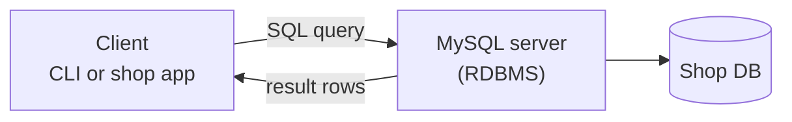
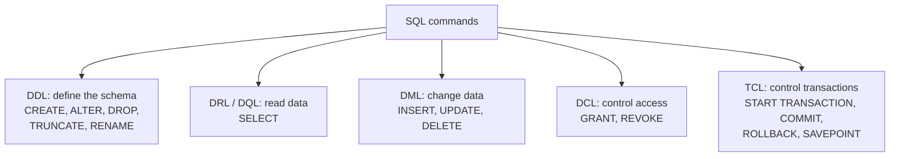
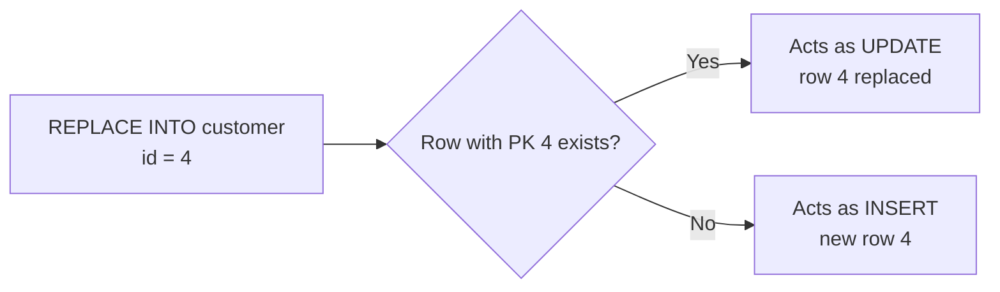
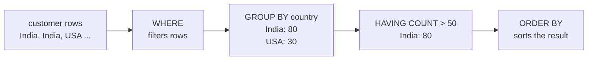
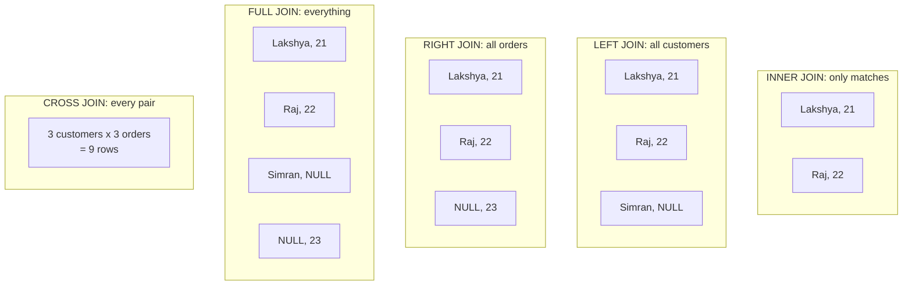
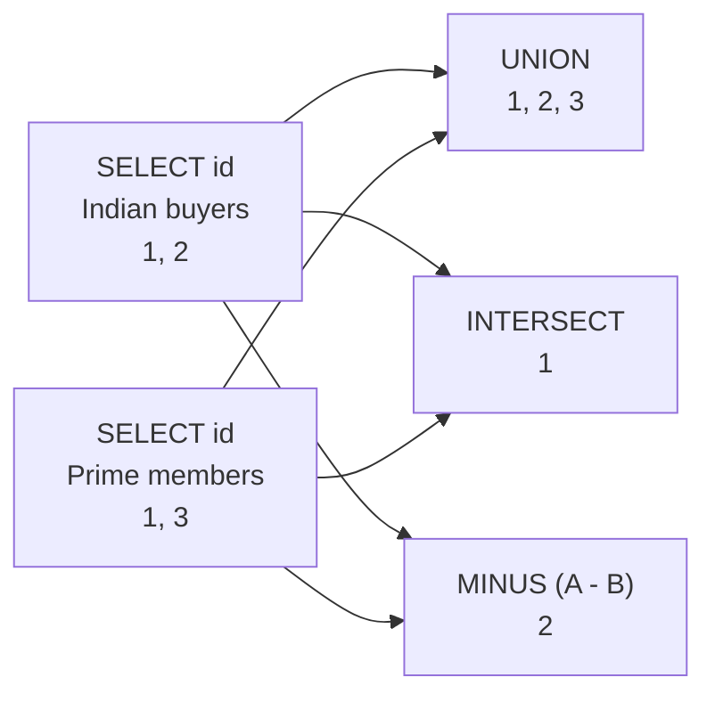
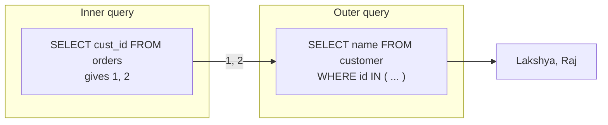
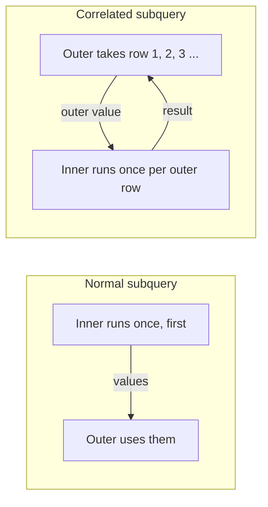
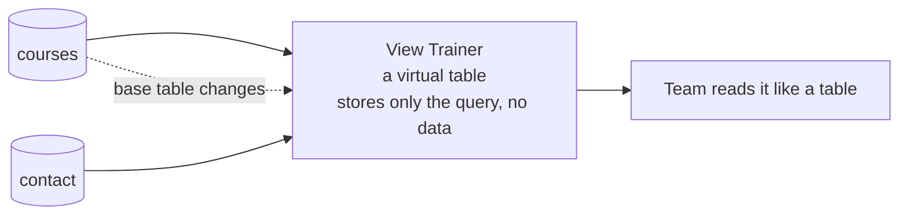

# Lecture 9: SQL

> **The story:** Your online shop now runs on MySQL. You build the tables, fill them, and ask them questions with SQL.

## 1. SQL talks, MySQL listens

Your app sends SQL to the MySQL server. The server runs it on the DB and sends back rows.



| | SQL | MySQL |
|---|---|---|
| What it is | It is a query language. | It is an RDBMS, a piece of software. |
| Job | It does CRUD on relational data. | It stores and manages the DB using SQL. |
| Is it a DB? | No, it is not a DB. | It manages DBs. |

CRUD means Create (INSERT), Read (SELECT), Update (UPDATE) and Delete (DELETE).

## 2. Pick a data type for each column

Each column of the shop needs a type. Pick the smallest type that fits.

| Type | Holds |
|---|---|
| CHAR(n) | It holds a fixed-length string of 0–255 characters. |
| VARCHAR(n) | It holds a variable-length string. It uses only the space it needs. |
| TEXT / BLOB | They hold long text or binary data, up to 65535 bytes. |
| TINYINT < SMALLINT < MEDIUMINT < INT < BIGINT | They hold integers, from 1 byte up to 8 bytes. |
| INT UNSIGNED | It holds only non-negative integers. |
| FLOAT / DOUBLE | They hold decimals with 23 and 53 digits of precision. |
| DECIMAL | It holds an exact decimal stored as a string. Use it for money. |
| DATE / TIME / DATETIME | They hold YYYY-MM-DD, HH:MM:SS, and both together. |
| TIMESTAMP | It holds YYYYMMDDHHMMSS. |
| ENUM / SET | ENUM holds one preset value. SET holds one or many. |
| BOOLEAN / BIT(n) | BOOLEAN holds 0 or 1. BIT holds up to 64 bits. |

> **Interview:** VARCHAR beats CHAR for names. CHAR always uses n bytes, but VARCHAR uses only the real length.

## 3. Five families of SQL commands

Every SQL command belongs to one family. Each family has one job.



| Family | Job | Commands |
|---|---|---|
| DDL | It defines the tables. | CREATE, ALTER, DROP, TRUNCATE, RENAME |
| DRL / DQL | It reads the data. | SELECT |
| DML | It changes the data. | INSERT, UPDATE, DELETE |
| DCL | It gives or takes back access. | GRANT, REVOKE |
| TCL | It manages transactions. | START TRANSACTION, COMMIT, ROLLBACK, SAVEPOINT |

## 4. Build the shop (DDL)

You create the database, the tables and their constraints. Later you reshape them with ALTER.

```sql
CREATE DATABASE IF NOT EXISTS shop;
USE shop;                                  -- pick the DB to work in
SHOW DATABASES;  SHOW TABLES;
DROP DATABASE IF EXISTS shop;

CREATE TABLE customer (
  id      INT PRIMARY KEY,                 -- or a separate line: PRIMARY KEY (id)
  name    VARCHAR(50) NOT NULL,
  email   VARCHAR(1024) UNIQUE,            -- unique, can be NULL, many per table
  age     INT,
  country VARCHAR(30),
  CONSTRAINT age_check CHECK (age > 12),   -- the name is optional
  rate    DOUBLE NOT NULL DEFAULT 4.25
);

CREATE TABLE orders (
  id      INT PRIMARY KEY,
  cust_id INT,                             -- a table can have many FKs
  FOREIGN KEY (cust_id) REFERENCES customer(id)
    ON DELETE CASCADE                      -- or ON DELETE SET NULL
    ON UPDATE CASCADE                      -- PK change flows to the FK
);

ALTER TABLE customer ADD phone INT NOT NULL;                 -- add a column
ALTER TABLE customer MODIFY name CHAR(1024);                 -- change its type
ALTER TABLE customer CHANGE COLUMN name full_name VARCHAR(1024); -- rename a column
ALTER TABLE customer DROP COLUMN phone;                      -- remove a column
ALTER TABLE customer RENAME TO customer_details;             -- rename the table
```

A column can be both a PK and an FK in the same table.

| Command | What it removes | Table survives? |
|---|---|---|
| DELETE FROM t | It removes the rows that match WHERE, or all rows. | Yes, the table stays. |
| TRUNCATE t | It removes all the rows at once. | Yes, the table stays. |
| DROP TABLE t | It removes the rows and the table itself. | No, the table is gone. |

## 5. Fill and fix the data (DML)

Customers sign up, change their details and leave. DML handles each event.

```sql
INSERT INTO customer (id, name, age) VALUES (1, 'Lakshya', 25), (2, 'Raj', 30);
UPDATE customer SET age = 26 WHERE id = 1;       -- one row
UPDATE student SET standard = standard + 1;      -- every row
DELETE FROM customer WHERE id = 1;               -- one row
DELETE FROM customer;                            -- every row
REPLACE INTO customer (id, age) VALUES (4, 3);   -- update if id 4 exists, else insert
```



## 6. Ask the shop questions (SELECT)

The manager asks questions about customers. Each WHERE clause trims the rows.

| id | name | age | country | prime |
|---|---|---|---|---|
| 1 | Lakshya | 25 | India | yes |
| 2 | Raj | 30 | India | NULL |
| 3 | Simran | 17 | USA | yes |

```sql
SELECT * FROM customer WHERE age > 18;                     -- Lakshya, Raj
SELECT * FROM customer WHERE age BETWEEN 0 AND 100;        -- both ends included
SELECT * FROM customer WHERE country IN ('India', 'UK');   -- short form of many ORs
SELECT * FROM customer WHERE age > 18 AND NOT country = 'USA';
SELECT * FROM customer WHERE prime IS NULL;                -- Raj (never use = NULL)
SELECT * FROM customer WHERE name LIKE 'R%';               -- Raj
SELECT * FROM customer ORDER BY name DESC;                 -- ASC is the default
SELECT DISTINCT country FROM customer;                     -- India, USA
SELECT 55 + 11;  SELECT now();                             -- no FROM: uses the DUAL table
```

| Wildcard | Matches | Example |
|---|---|---|
| `%` | It matches 0 or more characters. | `'R%'` matches Raj and Rohan. |
| `_` | It matches exactly 1 character. | `'R_j'` matches Raj. |

## 7. How many customers per country? (GROUP BY and HAVING)

The manager wants countries with more than 50 customers. GROUP BY makes buckets, and HAVING throws away small buckets.



```sql
SELECT country, COUNT(id) FROM customer
GROUP BY country
HAVING COUNT(id) > 50;
-- aggregates: COUNT(), SUM(), AVG(), MIN(), MAX()
-- GROUP BY with no aggregate works like DISTINCT
```

| WHERE | HAVING |
|---|---|
| It filters rows. | It filters groups. |
| It runs before GROUP BY. | It runs after GROUP BY. |
| It does not need GROUP BY. | It needs GROUP BY. |
| It works with SELECT, UPDATE and DELETE. | It works with SELECT only. |

> **Interview:** Every non-aggregate column in SELECT must also appear in GROUP BY.

## 8. Who ordered what? (Joins)

Orders hold only cust_id. To print names next to orders, you join the two tables on the FK.

| customer.id | name |
|---|---|
| 1 | Lakshya |
| 2 | Raj |
| 3 | Simran |

| orders.id | cust_id |
|---|---|
| 21 | 1 |
| 22 | 2 |
| 23 | NULL (guest) |



| Join | Returns |
|---|---|
| INNER | It returns only the rows that match in both tables. |
| LEFT | It returns all left rows, plus matches from the right or NULL. |
| RIGHT | It returns all right rows, plus matches from the left or NULL. |
| FULL | It returns all rows from both sides. MySQL builds it as LEFT UNION RIGHT. |
| CROSS | It returns every pair, so 10 rows x 5 rows gives 50 rows. It is rarely used. |
| SELF | It joins a table to itself, such as employee to manager. It uses INNER JOIN. |

```sql
SELECT c.name, o.id FROM customer AS c INNER JOIN orders AS o ON c.id = o.cust_id;  -- AS = alias
SELECT c.name, o.id FROM customer c LEFT  JOIN orders o ON c.id = o.cust_id;
SELECT c.name, o.id FROM customer c RIGHT JOIN orders o ON c.id = o.cust_id;

-- FULL JOIN in MySQL
SELECT c.name, o.id FROM customer c LEFT  JOIN orders o ON c.id = o.cust_id
UNION
SELECT c.name, o.id FROM customer c RIGHT JOIN orders o ON c.id = o.cust_id;

SELECT * FROM customer CROSS JOIN orders;
SELECT e.name, m.name FROM emp e INNER JOIN emp m ON e.manager_id = m.id;  -- SELF
SELECT c.name, o.id FROM customer c, orders o WHERE c.id = o.cust_id;    -- no JOIN keyword
```

## 9. Merge two lists (set operations)

You have the Indian buyer list and the Prime member list. Set operations stack them row by row.



```sql
SELECT id FROM t1 UNION SELECT id FROM t2;       -- unique rows
SELECT id FROM t1 UNION ALL SELECT id FROM t2;   -- keeps duplicates
SELECT DISTINCT id FROM t1 INNER JOIN t2 USING (id);                   -- INTERSECT
SELECT id FROM t1 LEFT JOIN t2 USING (id) WHERE t2.id IS NULL;         -- MINUS
```

| JOIN | SET operation |
|---|---|
| It combines columns, side by side. | It combines rows, one on top of the other. |
| It matches rows on a condition. | It stacks the results of SELECT statements. |
| Column types can differ. | Matching columns must have the same type. |
| Column counts can differ. | Column counts must be the same. |
| It can give duplicate rows. | It gives distinct rows (except UNION ALL). |

## 10. A question inside a question (subqueries)

"Show customers who placed an order." The inner query finds the buyers, and the outer query prints them.



```sql
SELECT name FROM customer WHERE id IN (SELECT cust_id FROM orders);            -- in WHERE
SELECT MAX(rating) FROM (SELECT * FROM movie WHERE country = 'India') AS temp; -- in FROM (derived table)
SELECT (SELECT COUNT(*) FROM orders) AS total, name FROM customer;             -- in SELECT
```



```sql
-- correlated: customers older than the average of their own country
SELECT name FROM customer AS outer_c
WHERE age > (SELECT AVG(age) FROM customer WHERE country = outer_c.country);
```

| JOIN | Subquery |
|---|---|
| It is faster. | It is slower. |
| The DBMS does the heavy work. | The user shapes the work. |
| It is harder to write and read. | It is easier to write and read. |
| Picking the right join is hard. | It is simple to pick. |

## 11. A saved window on the data (views)

The trainer team wants course names with trainer emails, without seeing other columns. You give them a view.



```sql
CREATE VIEW Trainer AS
  SELECT c.course_name, c.trainer, t.email
  FROM courses c, contact t WHERE c.id = t.id;
ALTER VIEW Trainer AS SELECT course_name FROM courses;
DROP VIEW IF EXISTS Trainer;
```

A view has no data of its own. A change in the base table shows up in the view at once.
