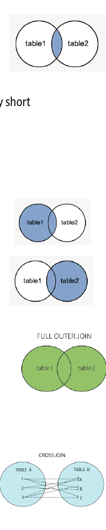
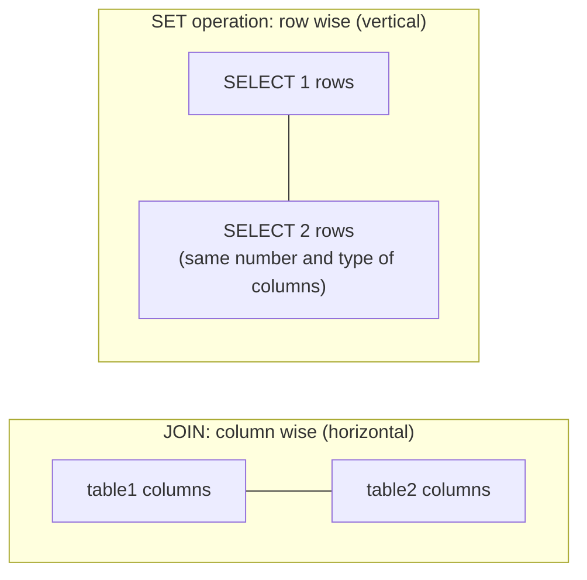
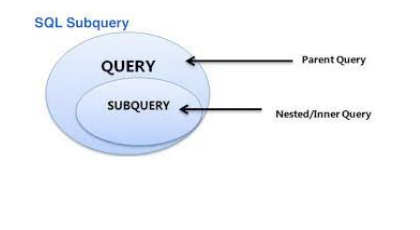

# Lecture 9: SQL in 1-Video

## LEC-9: SQL in 1-Video

1. **SQL:** Structured Query Language. It is used to access and manipulate data.
2. SQL uses **CRUD** operations to communicate with the DB.

   | Operation | Meaning |
   |-----------|---------|
   | **CREATE** | Execute INSERT statements to insert a new tuple into the relation. |
   | **READ** | Read data already in the relations. |
   | **UPDATE** | Modify data already inserted in the relation. |
   | **DELETE** | Delete a specific data point (tuple, row) or multiple rows. |

3. **SQL is not a DB.** It is a query language.
4. **RDBMS:** Relational Database Management System.
   1. It is software that implements a designed relational model.
   2. **Examples:** MySQL, MS SQL, Oracle, IBM.
   3. A table (relation) is the simplest data storage object in a relational DB.
   4. **MySQL** is an open-source RDBMS that uses SQL for all CRUD operations.
5. **MySQL client-server model:** The client is a CLI or frontend that uses services of the MySQL server.

   ```mermaid
   flowchart LR
     C["Client<br/>(CLI or frontend)"] -- "SQL" --> S["MySQL server<br/>(RDBMS)"] --> D[("DB")]
     S -- "result" --> C
   ```
6. **Difference between SQL and MySQL**
   1. SQL is the Structured Query Language used to perform CRUD operations in a relational DB.
   2. MySQL is an RDBMS. It stores, manages and administrates the DB (provided by itself) using SQL.

## SQL DATA TYPES (Ref: https://www.w3schools.com/sql/sql_datatypes.asp)

1. In an SQL DB, data is stored in tables.
2. Data can be of different types, like INT, CHAR etc.

| DATATYPE | Description |
|---|---|
| CHAR | string(0-255), string with size = [0, 255], e.g., CHAR(251) |
| VARCHAR | string(0-255) |
| TINYTEXT | String(0-255) |
| TEXT | string(0-65535) |
| BLOB | string(0-65535) |
| MEDIUMTEXT | string(0-16777215) |
| MEDIUMBLOB | string(0-16777215) |
| LONGTEXT | string(0-4294967295) |
| LONGBLOB | string(0-4294967295) |
| TINYINT | integer(-128 to 127) |
| SMALLINT | integer(-32768 to 32767) |
| MEDIUMINT | integer(-8388608 to 8388607) |
| INT | integer(-2147483648 to 2147483647) |
| BIGINT | integer (-9223372036854775808 to 9223372036854775807) |
| FLOAT | Decimal with precision to 23 digits |
| DOUBLE | Decimal with 24 to 53 digits |
| DECIMAL | Double stored as string |
| DATE | YYYY-MM-DD |
| DATETIME | YYYY-MM-DD HH:MM:SS |
| TIMESTAMP | YYYYMMDDHHMMSS |
| TIME | HH:MM:SS |
| ENUM | One of the preset values |
| SET | One or many of the preset values |
| BOOLEAN | 0/1 |
| BIT | e.g., BIT(n), n upto 64, store values in bits. |

3. **Size order:** TINY < SMALL < MEDIUM < INT < BIGINT.
4. **Variable length data types:** Types like VARCHAR are better to use, because they occupy space equal to the actual data size.
5. **Unsigned:** Values can also be unsigned, for example `INT UNSIGNED`.
6. **Types of SQL commands:**

   1. **DDL (Data Definition Language):** It defines the relation schema.
      1. **CREATE:** create table, DB, view.
      2. **ALTER TABLE:** modify the table structure. For example, change a column datatype or add or remove columns.
      3. **DROP:** delete table, DB, view.
      4. **TRUNCATE:** remove all the tuples from the table.
      5. **RENAME:** rename DB name, table name, column name etc.
   2. **DRL/DQL (Data Retrieval Language / Data Query Language):** It retrieves data from the tables.
      1. **SELECT**
   3. **DML (Data Modification Language):** It modifies data in the DB.
      1. **INSERT:** insert data into a relation.
      2. **UPDATE:** update relation data.
      3. **DELETE:** delete row(s) from the relation.
   4. **DCL (Data Control Language):** It grants or revokes authorities from users.
      1. **GRANT:** give access privileges to the DB.
      2. **REVOKE:** take back user access privileges.
   5. **TCL (Transaction Control Language):** It manages transactions done in the DB.
      1. **START TRANSACTION:** begin a transaction.
      2. **COMMIT:** apply all the changes and end the transaction.
      3. **ROLLBACK:** discard changes and end the transaction.
      4. **SAVEPOINT:** a checkpoint within the group of transactions to roll back to.

   ```mermaid
   flowchart TB
     SQL["SQL commands"] --> DDL["DDL<br/>CREATE, ALTER, DROP,<br/>TRUNCATE, RENAME"]
     SQL --> DRL["DRL / DQL<br/>SELECT"]
     SQL --> DML["DML<br/>INSERT, UPDATE, DELETE"]
     SQL --> DCL["DCL<br/>GRANT, REVOKE"]
     SQL --> TCL["TCL<br/>START TRANSACTION, COMMIT,<br/>ROLLBACK, SAVEPOINT"]
   ```

## MANAGING DB (DDL)

1. **Creation of DB**
   1. `CREATE DATABASE IF NOT EXISTS db-name;`
   2. `USE db-name;` You must run it to choose the DB on which CREATE TABLE etc. will run. It makes switching between DBs possible.
   3. `DROP DATABASE IF EXISTS db-name;` drops the database.
   4. `SHOW DATABASES;` lists all the DBs in the server.
   5. `SHOW TABLES;` lists tables in the selected DB.

## DATA RETRIEVAL LANGUAGE (DRL)

1. **Syntax:** `SELECT <set of column names> FROM <table_name>;`
2. Order of execution is from RIGHT to LEFT.
3. Q. Can we use SELECT without a FROM clause?
   1. Yes, using DUAL tables.
   2. DUAL tables are dummy tables created by MySQL. They let you do simple actions without user-defined tables.
   3. **Examples:**
      ```sql
      SELECT 55 + 11;
      SELECT now();
      SELECT ucase();
      ```
4. **WHERE**
   1. It reduces rows based on given conditions.
   2. **Example:** `SELECT * FROM customer WHERE age > 18;`
5. **BETWEEN**
   1. `SELECT * FROM customer WHERE age between 0 AND 100;`
   2. In this example, 0 and 100 are inclusive.
6. **IN**
   1. It reduces **OR** conditions.
   2. **Example:** `SELECT * FROM officers WHERE officer_name IN ('Lakshay', 'Maharana Pratap', 'Deepika');`
7. **AND/OR/NOT**
   1. **AND:** `WHERE cond1 AND cond2`
   2. **OR:** `WHERE cond1 OR cond2`
   3. **NOT:** `WHERE col_name NOT IN (1,2,3,4);`
8. **IS NULL**
   1. **Example:** `SELECT * FROM customer WHERE prime_status is NULL;`
9. **Pattern searching / wildcard ('%', '_')**
   1. `%` matches any number of characters, from 0 to n. It is similar to the `*` asterisk in regex.
   2. `_` matches only one character.
   3. **Example:** `SELECT * FROM customer WHERE name LIKE '%p_';`
10. **ORDER BY**
    1. It sorts the data retrieved using the **WHERE** clause.
    2. **Syntax:** `ORDER BY <column-name> DESC;`
    3. DESC means descending. ASC means ascending.
    4. **Example:** `SELECT * FROM customer ORDER BY name DESC;`
11. **GROUP BY**
    1. GROUP BY collects data from multiple records and groups the result by one or more columns, generally in a SELECT statement.
    3. **Syntax:** `SELECT c1, c2, c3 FROM sample_table WHERE cond GROUP BY c1, c2, c3.`
    4. All the column names after SELECT must be repeated in GROUP BY, for the query to execute successfully.
    5. It is used with aggregation functions to perform various actions:
       - COUNT()
       - SUM()
       - AVG()
       - MIN()
       - MAX()
12. **DISTINCT**
    1. It finds distinct values in the table.
    2. **Syntax:** `SELECT DISTINCT(col_name) FROM table_name;`
    3. GROUP BY can also do the same.
       1. `Select col_name from table GROUP BY col_name;` gives the same output as the DISTINCT query above.
       2. SQL is smart enough to realise that if you use GROUP BY without any aggregation function, you mean "DISTINCT".
13. **GROUP BY HAVING**
    1. Out of the categories made by GROUP BY, we want only a particular thing (a condition).
    2. It is similar to WHERE.
    3. **Example:** `Select COUNT(cust_id), country from customer GROUP BY country HAVING COUNT(cust_id) > 50;`
    4. **WHERE vs HAVING**

       | WHERE | HAVING |
       |-------|--------|
       | Filters rows from the table based on the specified condition. | Filters rows from the groups based on the specified condition. |
       | Used before GROUP BY. | Used after GROUP BY. |
       | GROUP BY is not needed. | GROUP BY is necessary. |
       | Can be used with SELECT, UPDATE and DELETE. | Used with SELECT. |

       - Both filter rows based on conditions.

       ```mermaid
       flowchart LR
         T["Table rows"] --> W["WHERE<br/>filters rows"] --> G["GROUP BY<br/>makes groups"] --> H["HAVING<br/>filters groups"] --> O["Result<br/>(ORDER BY sorts it)"]
       ```

## CONSTRAINTS (DDL)

1. **Primary Key**

    ```sql
    CREATE TABLE Customer
    (
        id INT PRIMARY KEY,
        branch_id INT,
        firstname CHAR(50),
        lastname CHAR(50),
        DOB DATE,
        Gender CHAR(8),
        PRIMARY KEY (id)
    );
    ```

    (Handwritten slide: the primary key can be declared inline on the column, `id INT PRIMARY KEY`, or as a separate line, `PRIMARY KEY (id)`; "choose one of the two ways".)

    1. A PK is not null, unique, and one per table.
2. **Foreign Key**
    1. An FK refers to the PK of another table.
    2. Each relation can have any number of FKs.
    3. ```sql
       CREATE TABLE ORDER (
       id INT PRIMARY KEY,
       delivery_date DATE,
       order_placed_date DATE,
       cust_id INT,
       FOREIGN KEY (cust_id) REFERENCES customer(id)
       );
       ```
3. **UNIQUE**
    1. It is unique, it can be null, and a table can have multiple unique attributes.
    2. ```sql
       CREATE TABLE customer (
       ...
       email VARCHAR(1024) UNIQUE,
       ...
       );
       ```
4. **CHECK**
    1. ```sql
       CREATE TABLE customer (
       ...
       CONSTRAINT age_check CHECK (age > 12),
       ...
       );
       ```
    2. The name "age_check" is optional. MySQL generates the constraint name automatically.
5. **DEFAULT**
    1. It sets the default value of the column.
    2. ```sql
       CREATE TABLE account (
       ...
       saving-rate DOUBLE NOT NULL DEFAULT 4.25,
       ...
       );
       ```
6. **PK and FK together:** An attribute can be both PK and FK in a table.
7. **ALTER OPERATIONS**
    1. They change the schema.
    2. **ADD:** add a new column.
        1. `ALTER TABLE table_name ADD new_col_name datatype ADD new_col_name_2 datatype;`
        2. **Example:** `ALTER TABLE customer ADD age INT NOT NULL;`
    3. **MODIFY:** change the datatype of an attribute.
        1. `ALTER TABLE table-name MODIFY col-name col-datatype;`
        2. **Example (VARCHAR to CHAR):** `ALTER TABLE customer MODIFY name CHAR(1024);`
    4. **CHANGE COLUMN:** rename a column.
        1. `ALTER TABLE table-name CHANGE COLUMN old-col-name new-col-name new-col-datatype;`
        2. **Example:** `ALTER TABLE customer CHANGE COLUMN name customer-name VARCHAR(1024);`
    5. **DROP COLUMN:** drop a column completely.
        1. `ALTER TABLE table-name DROP COLUMN col-name;`
        2. **Example:** `ALTER TABLE customer DROP COLUMN middle-name;`
    6. **RENAME:** rename the table itself.
        1. `ALTER TABLE table-name RENAME TO new-table-name;`
        2. **Example:** `ALTER TABLE customer RENAME TO customer-details;`

## DATA MANIPULATION LANGUAGE (DML)

1. **INSERT**
    1. `INSERT INTO table-name(col1, col2, col3) VALUES (v1, v2, v3), (val1, val2, val3);`
2. **UPDATE**
    1. `UPDATE table-name SET col1 = 1, col2 = 'abc' WHERE id = 1;`
    2. **Update multiple rows:** `UPDATE student SET standard = standard + 1;`
    3. **ON UPDATE CASCADE**
        1. You can add it to the table while creating constraints.
        2. Add it while creating constraints. If the PK of one table is the FK of another, updating that PK updates the FK automatically.
3. **DELETE**
    1. `DELETE FROM table-name WHERE id = 1;`
    2. `DELETE FROM table-name;` deletes all rows.
    3. **DELETE CASCADE:** It overcomes the DELETE constraint of the referential constraints.
        1. It answers: what happens to the child entry if the parent's entry is deleted?
        2. ```sql
           CREATE TABLE ORDER (
           order_id int PRIMARY KEY,
           delivery_date DATE,
           cust_id INT,
           FOREIGN KEY(cust_id) REFERENCES customer(id) ON DELETE CASCADE
           );
           ```
    4. **ON DELETE NULL:** It answers "can an FK have null values?"
        1. ```sql
           CREATE TABLE ORDER (
           order_id int PRIMARY KEY,
           delivery_date DATE,
           cust_id INT,
           FOREIGN KEY(cust_id) REFERENCES customer(id) ON DELETE SET NULL
           );
           ```
4. **REPLACE**
    1. It is primarily used for a tuple already present in a table.
    2. **As UPDATE:** If you use REPLACE with a WHERE clause on the PK, that row is replaced.
    3. **As INSERT:** If there is no duplicate data, a new tuple is inserted.
    4. `REPLACE INTO student (id, class) VALUES(4, 3);`
    5. `REPLACE INTO table SET col1 = val1, col2 = val2;`

## JOINING TABLES



1. All **RDBMS** are relational. We refer to other tables to get meaningful outcomes, using FKs.
3. **INNER JOIN**
    1. It returns a table with the matching values from both (or all) the tables.
    2. **Syntax:**
       ```sql
       SELECT column-list FROM table1 INNER JOIN table2 ON condition1
       INNER JOIN table3 ON condition2
       ...;
       ```
    3. **Alias in MySQL (AS)**
        1. An alias is a temporary nickname for a table or column in one query. It keeps the query short.
        2. `SELECT col_name AS alias_name FROM table_name;`
        3. `SELECT col_name1, col_name2,... FROM table_name AS alias_name;`
4. **OUTER JOIN**
    1. **LEFT JOIN**
        1. It returns all the data from the left table and the matched data from the right table.
        2. `SELECT columns FROM table LEFT JOIN table2 ON Join_Condition;`
    2. **RIGHT JOIN**
        1. It returns all the data from the right table and the matched data from the left table.
        2. `SELECT columns FROM table RIGHT JOIN table2 ON join_cond;`
    3. **FULL JOIN**
        1. It returns all data when there is a match in the left or right table data.
        2. It is **emulated** in MySQL using LEFT and RIGHT JOIN.
        3. LEFT JOIN UNION RIGHT JOIN.
        4. ```sql
           SELECT columns FROM table1 as t1 LEFT JOIN table2 as t2 ON t1.id = t2.id
           UNION
           SELECT columns FROM table1 as t1 RIGHT JOIN table2 as t2 ON t1.id = t2.id;
           ```
        5. You can also use UNION ALL. It keeps duplicate values, while UNION gives unique values.
5. **CROSS JOIN**
    1. It returns the cartesian product of both tables, so all possible variations appear.
    2. It is rarely used.
    3. **Example:** Table-1 has 10 rows and table-2 has 5, so the result has 50 rows.
    4. `SELECT column-lists FROM table1 CROSS JOIN table2;`
6. **SELF JOIN**
    1. The same table is joined to itself.
    2. It is used very little.
    3. It is emulated using INNER JOIN.
    4. `SELECT columns FROM table as t1 INNER JOIN table as t2 ON t1.id = t2.id;`
7. **Join without using join keywords**
    1. `SELECT * FROM table1, table2 WHERE condition;`
    2. **Example:** `SELECT artist_name, album_name, year_recorded FROM artist, album WHERE artist.id = album.artist_id;`

## SET OPERATIONS

1. They combine multiple SELECT statements.
2. They always give distinct rows.

| JOIN | SET Operations |
|---|---|
| Combines multiple tables based on matching condition. | Combination is resulting set from two or more SELECT statements. |
| Column wise combination. | Row wise combination. |
| Data types of two tables can be different. | Datatypes of corresponding columns from each table should be the same. |
| Can generate both distinct or duplicate rows. | Generate distinct rows. |
| The number of column(s) selected may or may not be the same from each table. | The number of column(s) selected must be the same from each table. |
| Combines results horizontally. | Combines results vertically. |



3. **UNION**
    1. It combines two or more SELECT statements.
    2. ```sql
       SELECT * FROM table1
       UNION
       SELECT * FROM table2;
       ```
    3. The number and order of columns must be the same for table1 and table2.
4. **INTERSECT**
    1. It returns common values of the tables.
    2. It is emulated.
    3. `SELECT DISTINCT column-list FROM table-1 INNER JOIN table-2 USING(join_cond);`
    4. `SELECT DISTINCT * FROM table1 INNER JOIN table2 ON USING(id);`
5. **MINUS**
    1. It returns the distinct rows from the first table that do not occur in the second table.
    2. It is emulated.
    3. `SELECT column_list FROM table1 LEFT JOIN table2 ON condition WHERE table2.column_name IS NULL;`
    4. **Example:** `SELECT id FROM table-1 LEFT JOIN table-2 USING(id) WHERE table-2.id IS NULL;`

## SUB QUERIES



1. The outer query depends on the inner query.
2. Subqueries are an alternative to joins.
3. They are nested queries.
4. **Syntax:**
   ```sql
   SELECT column_list (s) FROM table_name WHERE column_name OPERATOR
   (SELECT column_list (s) FROM table_name [WHERE]);
   ```
5. **Example:** `SELECT * FROM table1 WHERE col1 IN (SELECT col1 FROM table1);`
6. Subqueries exist mainly in 3 clauses:
    1. Inside a WHERE clause.
    2. Inside a FROM clause.
    3. Inside a SELECT clause.
7. **Subquery using FROM clause**
    1. `SELECT MAX(rating) FROM (SELECT * FROM movie WHERE country = 'India') as temp;`
8. **Subquery using SELECT**
    1. `SELECT (SELECT column_list(s) FROM T_name WHERE condition), columnList(s) FROM T2_name WHERE condition;`
9. **Derived subquery**
    1. `SELECT columnLists(s) FROM (SELECT columnLists(s) FROM table_name WHERE [condition]) as new_table_name;`
10. **Co-related sub-queries**
    1. **Normal nested subquery:** The inner SELECT runs once, first, and returns values to the main query.
    2. **Correlated subquery:** It executes once for each candidate row considered by the outer query. In other words, the outer query drives the inner query.

    ```mermaid
    flowchart LR
      subgraph N["Normal nested subquery"]
        direction LR
        I1["Inner SELECT<br/>runs once, first"] -- "values" --> O1["Outer query"]
      end
      subgraph C["Correlated subquery"]
        direction LR
        O2["Outer query<br/>each candidate row"] -- "outer.expr2" --> I2["Inner SELECT<br/>runs once per row"]
        I2 -- "result" --> O2
      end
    ```

    ```sql
    SELECT column1, column2, ....
    FROM table1 as outer
    WHERE column1 operator
                        (SELECT column1, column2
                         FROM table2
                         WHERE expr1 =
                                       outer.expr2);
    ```

## JOIN VS SUB-QUERIES

| JOINS | SUBQUERIES |
|---|---|
| Faster | Slower |
| Joins maximise calculation burden on DBMS | Keeps responsibility of calculation on user. |
| Complex, difficult to understand and implement | Comparatively easy to understand and implement. |
| Choosing optimal join for optimal use case is difficult | Easy. |

## MySQL VIEWS

1. A view is a database object with no values of its own. Its contents come from the base table. It has rows and columns like a real table.
2. In MySQL, a view is a **virtual table** created by a query over one or more tables. It works like the base table but holds no data.
3. **View vs table:** Views are definitions built on top of other tables (or views). If the underlying table changes, the same changes show in the view too.

   ```mermaid
   flowchart LR
     T1[("courses")] --> V["View Trainer<br/>(virtual table, no data of its own,<br/>defined by a query)"]
     T2[("contact")] --> V
     V --> U["User reads it<br/>like a table"]
   ```
4. `CREATE VIEW view_name AS SELECT columns FROM tables [WHERE conditions];`
5. `ALTER VIEW view_name AS SELECT columns FROM table WHERE conditions;`
6. `DROP VIEW IF EXISTS view_name;`
7. **View using a join clause:** `CREATE VIEW Trainer AS SELECT c.course_name, c.trainer, t.email FROM courses c, contact t WHERE c.id = t.id;`

NOTE: We can also import/export table schema from files (.csv or json).
