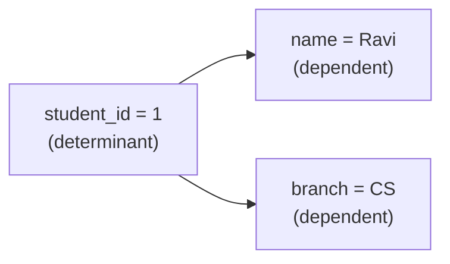
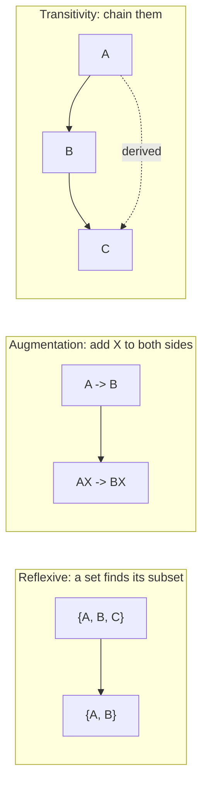
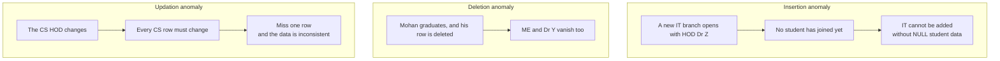
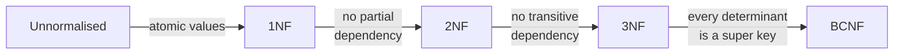
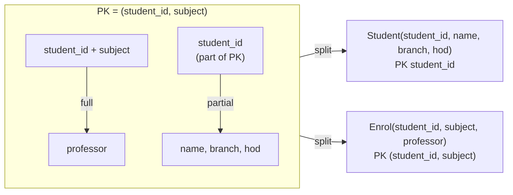
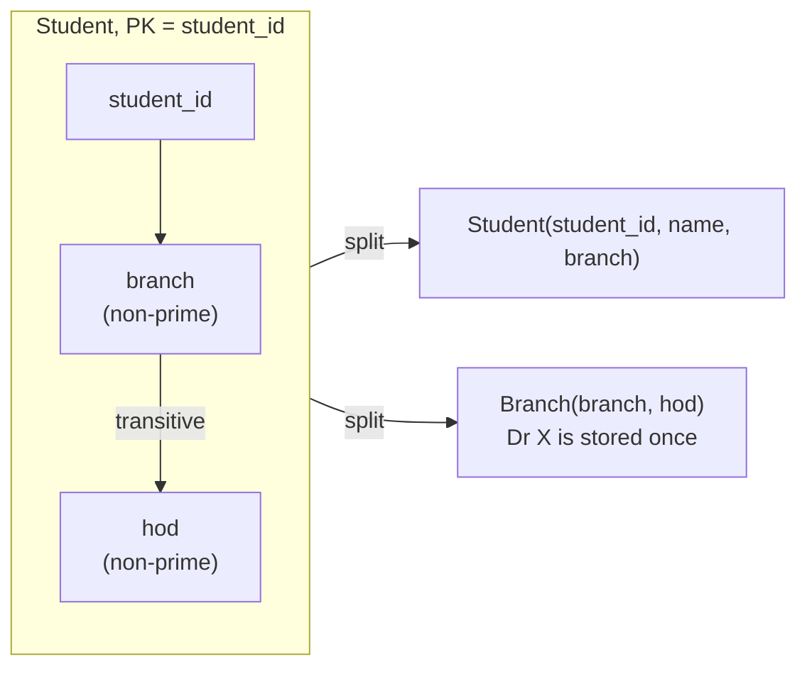
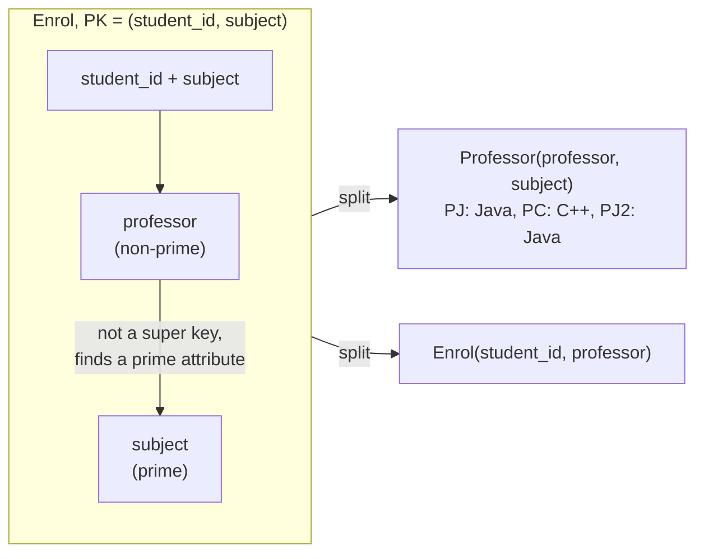
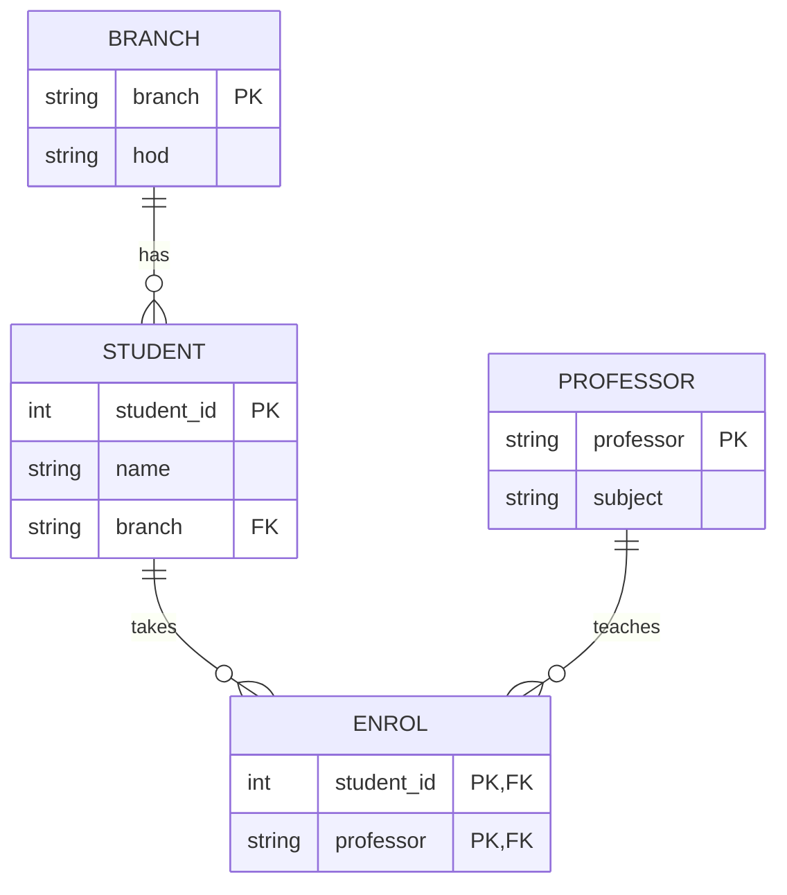

# Lecture 11: Normalisation

> **The story:** A college office keeps everything in one big table. It breaks again and again. You split it, step by step, until every table has one job.

## 1. Functional dependency: who finds whom

If you know A, you can find B. We write it `A -> B`. A is the **determinant**, and B is the **dependent**.

| FD type | Rule | Example |
|---|---|---|
| Trivial | B is a subset of A. | `(id, name) -> id` |
| Non-trivial | B is not a subset of A. | `id -> branch` |

## 2. Armstrong's axioms: rules to derive new FDs

Three rules let you derive new FDs from given ones.

A worked check uses R(A, B, C, D, E) with `A -> B`, `A -> C`, `CD -> E`, `B -> D`, `E -> A`.

| Claim | Proof | Result |
|---|---|---|
| `BC -> CD` | Augment `B -> D` with C. | It is valid. |
| `EC -> AC` | Augment `E -> A` with C. | It is valid. |
| `B -> C` | No rule derives it. | It is illegal. |
| `CD -> AC` | `CD -> E -> A` by transitivity, and `CD -> C` by reflexive. | It is valid. |

## 3. The messy table

The office stores students, branches, HODs and subjects together. One cell holds two subjects.

| student_id | name | branch | hod | subject | professor |
|---|---|---|---|---|---|
| 1 | Ravi | CS | Dr X | Java, C++ | PJ, PC |
| 2 | Asha | CS | Dr X | Java | PJ2 |
| 3 | Mohan | ME | Dr Y | Java | PJ |

## 4. Three anomalies strike

Redundant data causes three anomalies. The DB also grows larger and gets slower.

| Anomaly | What goes wrong |
|---|---|
| Insertion | You cannot insert data without some other, unrelated data. |
| Deletion | Deleting one fact loses another fact. |
| Updation | One change needs many rows to be updated. |

**Normalisation** fixes this. It splits a big table into smaller linked tables until each table has a single job (the Single Responsibility Principle).

## 5. The ladder of normal forms

Each form needs the one before it.

| Term | Meaning |
|---|---|
| Prime attribute | It is part of some candidate key. |
| Non-prime attribute | It is not part of any candidate key. |

## 6. 1NF: one value per cell

Ravi's cell holds "Java, C++". Give each subject its own row.

| student_id | name | branch | hod | subject | professor |
|---|---|---|---|---|---|
| 1 | Ravi | CS | Dr X | Java | PJ |
| 1 | Ravi | CS | Dr X | C++ | PC |
| 2 | Asha | CS | Dr X | Java | PJ2 |
| 3 | Mohan | ME | Dr Y | Java | PJ |

The PK is now (student_id, subject). Ravi's data repeats, so redundancy remains. 1NF only demands atomic values.

## 7. 2NF: no partial dependency

The name depends on student_id alone, which is only part of the PK. That is a partial dependency.

A non-prime attribute must depend on the **whole** PK, never on a part of it.

## 8. 3NF: no transitive dependency

In Student, student_id finds branch, and branch finds hod. A non-prime column finds another non-prime column.

All three anomalies are gone. IT can open without a student. Mohan can leave without deleting ME. The HOD changes in one row.

## 9. BCNF: every determinant is a super key

In Enrol, each professor teaches one subject, so `professor -> subject`. The professor is not a super key, yet it finds the prime attribute subject.

BCNF is a stronger 3NF. For every `A -> B`, A must be a super key.

## 10. The final tables

The one messy table became four clean tables. Each has one job.

## 11. Normal forms at a glance

For an FD `X -> Y`, each form forbids one pattern.

| Form | It forbids | Fix in the story |
|---|---|---|
| 1NF | It forbids a multi-valued cell. | We gave each subject its own row. |
| 2NF | It forbids Y depending on part of the PK. | We split name out of Enrol. |
| 3NF | It forbids a non-prime X finding a non-prime Y. | We split hod into Branch. |
| BCNF | It forbids an X that is not a super key. | We split subject into Professor. |

| Advantage | Why |
|---|---|
| Less redundancy | Each fact is stored once. |
| Consistency | Each fact changes in one place only. |
| No anomalies | Insert, delete and update behave safely. |
| Space and speed | The DB is smaller and queries run faster. |
