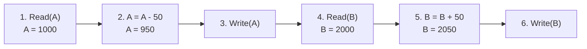
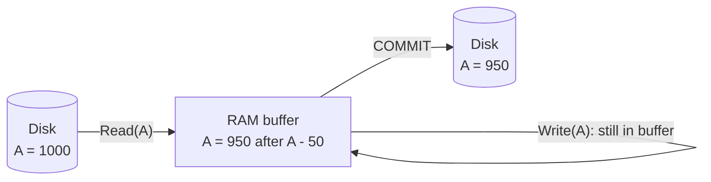
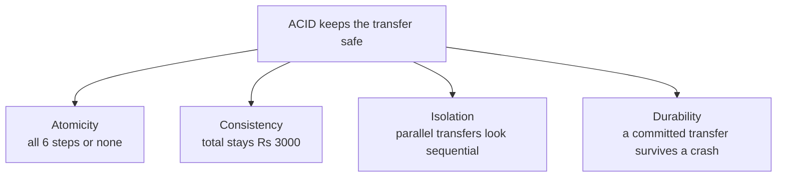
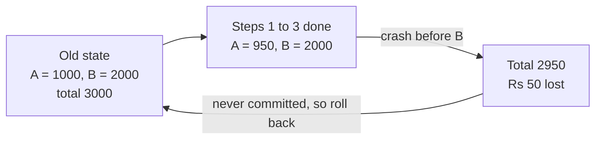
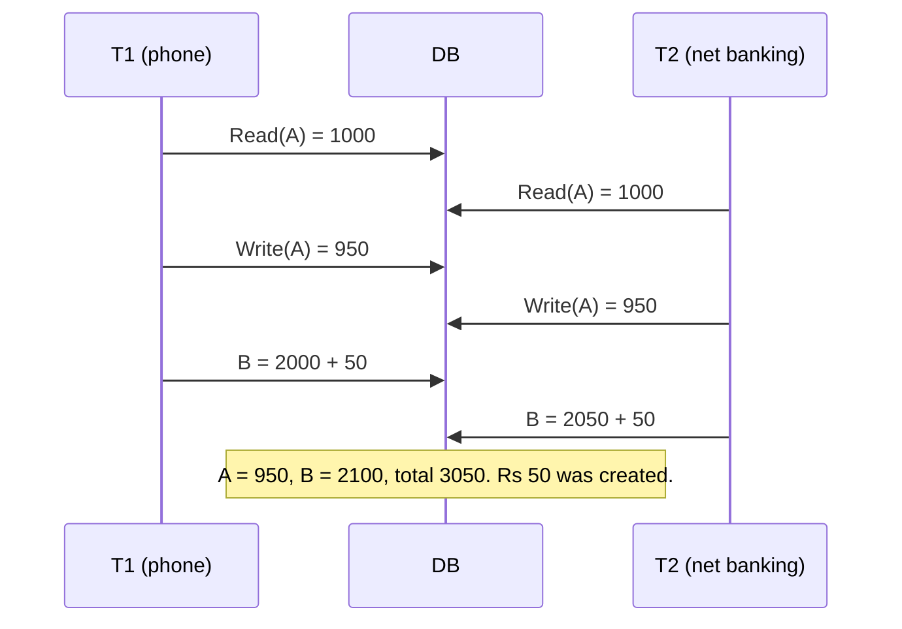
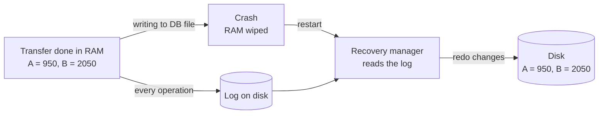
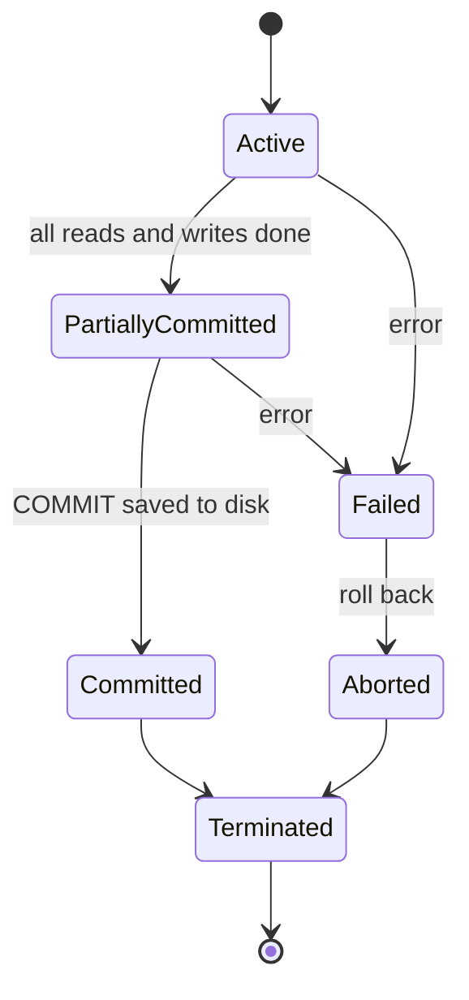

# Lecture 12: Transaction

> **The story:** Bank ABC has two accounts. A has Rs 1000 and B has Rs 2000. You send Rs 50 from A to B. The bank must never lose or create money.

## 1. One click, six steps

You press "Send Rs 50" once. The DB runs it as six steps in a fixed order. Together they form one transaction.

| Term | Meaning |
|---|---|
| Transaction | It is one logical unit of work made of one or more SQL statements. |
| Commit | All changes become permanent together. |
| Rollback | A failure undoes every change of the transaction. |
| SQL | The commands are `BEGIN TRANSACTION`, `COMMIT` and `END TRANSACTION`. |

> **Interview:** A transaction is complete only when all of its steps complete.

## 2. Where the work happens

The DB lives on disk. Read copies A into a RAM buffer. Write also changes only the buffer. Only COMMIT puts the change on disk.

## 3. ACID: four things that can go wrong

Each ACID property stops one disaster in the transfer.

| Property | Rule | Who ensures it |
|---|---|---|
| Atomicity | All steps happen, or none happen. | The recovery system rolls back. |
| Consistency | Integrity constraints hold before and after. | Correct atomicity gives consistency. |
| Isolation | Concurrent transactions behave as if run one by one. | The DB uses locks. |
| Durability | Committed changes survive any failure. | The recovery manager uses logs. |

> **Interview:** "What are the ACID properties?" is a very famous question. Explain each one with the A to B transfer.

## 4. Atomicity: the crash in the middle

A is debited. Then the server crashes before B is credited. Rs 50 vanishes, so the DB rolls back to the old state.

The DB keeps the old state apart from the half-done state. That is how it can roll back.

## 5. Consistency: count the money

The total money in the bank must be the same before and after.

| Moment | A | B | Total | Consistent? |
|---|---|---|---|---|
| Before | 1000 | 2000 | 3000 | Yes. |
| After success | 950 | 2050 | 3000 | Yes. |
| After crash, no rollback | 950 | 2000 | 2950 | No. |

## 6. Isolation: two phones, one account

You send Rs 50 from your phone (T1). At the same moment, net banking (T2) also sends Rs 50. Both read the old value of A.

The fix is to make T2 wait until T1 ends. In reality both run together, but locks make the result look sequential.

## 7. Durability: the crash after "Success"

The app shows "Success". Then the server crashes before RAM reaches disk. The log on disk lets the DB redo the transfer.

Checkpoints also help recovery. They are covered in the next lecture.

## 8. The life of a transaction

Every transfer moves through these states. It ends either committed or aborted.

| State | What happens | Transfer example |
|---|---|---|
| Active | All reads and writes run here. | Steps 1 to 6 run. |
| Partially committed | The last step is done, but changes sit in the RAM buffer. | A = 950 and B = 2050 exist only in RAM. |
| Committed | Changes are permanent. Rollback is no longer possible. | The disk shows A = 950 and B = 2050. |
| Failed | A hardware, software, network or user error stops the transaction. | The server crashes at Write(A). |
| Aborted | Every buffered change is undone. The old state returns. | The disk still shows A = 1000 and B = 2000. |
| Terminated | The transaction has either committed or aborted. | The transfer is over. |

> **Interview:** A committed transaction can never be rolled back. A failed one always ends as aborted.
