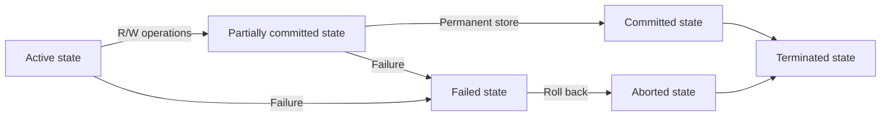

# Lecture 12: Transaction

## 1. Transaction

A **transaction** is a unit of work done against the DB in a logical sequence. The sequence is very important.

- **Definition:** It is a logical unit of work with one or more SQL statements.
- **Outcome:** Either all changes become permanent, or any failure rolls back and every change is undone.

**Example:** Bank ABC has two accounts, A (Rs 1000) and B (Rs 2000). Transfer Rs 50 from A to B. The user sees one operation (debit A, credit B). The DB sees several steps.

Transaction T1 has 6 logical steps, in this sequence:

1. Read(A): read A's balance and check constraints (the balance must not go negative).
2. A = A - 50: a temporary change, so A becomes 950.
3. Write(A).
4. Read(B).
5. B = B + 50: B becomes 2050.
6. Write(B).

- **Atomic:** The 6 steps are treated as a single task. Either the whole transaction completes, or none of it happens.
- **Failure causes:** An unreadable B, a server error, a hardware failure or a logical error.
- **Rollback:** If failure comes after A was debited, the debited money is credited back. Real banks sometimes take hours or days, but the money still returns.
- **Consistency:** Money can neither be created nor destroyed. The total is Rs 3000. If Rs 50 is deducted from A and the transaction neither completes nor rolls back, the system has Rs 2950.

> **Interview:** A transaction is a unit of work made of many steps. It is complete only when all steps complete.

**Read and Write inside a transaction:**

1. **Read(A):** The DB is on disk and still has 1000. Read brings the value into a local buffer in main memory (RAM).
2. **Write(A):** Conceptually, it writes the buffer value (950) into the DB on disk. This is a simplification.
3. **In real DB systems:** Write also goes only to a buffer in RAM. The change reaches the physical DB only when COMMIT is called at the end.
4. **SQL commands:** `BEGIN TRANSACTION`, `COMMIT`, `END TRANSACTION`.

## 2. ACID Properties

The DB system must maintain these properties of a transaction to keep the data's integrity. A transaction that does not follow these 4 properties brings inconsistency into the DB. Integrity constraints (domain constraints, consistency constraints) were covered earlier.

> **Interview:** "What are the ACID properties?" is a very famous interview question.

### a. Atomicity

Either all operations of the transaction are reflected properly in the DB, or none are.

- **Binary:** All 6 steps reflect in the DB, or none do. It is 0 or 1, never fuzzy.
- **Example:** A = 1000, B = 2000. Read(A), A - 50 = 950, Write(A) are done. Before B is updated, the system crashes. Now A = 950 and B = 2000, so the total is 2950. Rs 50 is lost. This is an inconsistent state.
- **Recovery:** On failure, the transaction recovers to the old state (A = 1000, B = 2000), because it never reached the committed state.
- **Old state kept:** The DB maintains the old state separately from the intermediate state.

### b. Consistency

Integrity constraints must be maintained before and after the transaction. The DB must be consistent after the transaction.

- **Example:** Total money in the banking system is 3000 before and after. One account is debited and another is credited, so nothing is lost.
- **Link to atomicity:** If atomicity is implemented properly, consistency is maintained.

### c. Isolation

Even when transactions run concurrently, for every pair Ti and Tj it appears to Ti that either Tj finished before Ti started, or Tj started after Ti finished. Each transaction is unaware of the others.

- **Example problem:** T1 (you, from your phone) and T2 (net banking) both transfer Rs 50 from A to B at the same time.
  - Both read A = 1000.
  - T1 writes A = 950. T2 also computes 1000 - 50 = 950 and writes A = 950.
  - Both credit B, so B = 2000 + 50 + 50 = 2100.
  - **Result:** A = 950, B = 2100, total 3050. Rs 50 was created, which is impossible.
- **Solution:** Make transactions look sequential. T2 does not start until T1 terminates (succeeds or fails).
- **In reality:** Both execute concurrently. The DB uses locks so the result is logically sequential.
- **Importance:** Without isolation, consistency breaks for the whole DB.
- **Link to OS:** A decrement must be an atomic operation, so that another thread or transaction does not read the old value.

### d. Durability

After a transaction completes successfully, its changes persist, even through system failures.

- **Problem case:** The user is told the transaction completed, but a system failure at the end means the change never reached the DB. The user's Rs 50 never arrived. This must never happen.
- **Real DBs:** The work happens on a copy in main memory (A = 950, B = 2050). Writing it to the DB file on disk must succeed. If the system crashes during that write, the DB must recover and re-execute it.
- **Mechanism:** A crash wipes main memory. So the DB either generates logs of every operation (such as 50 subtracted, write to A, read B) and keeps them on disk, or writes to disk at intermediate points.
- **Restart:** The system reads the logs, finds what happened and redoes the changes in the actual DB. Checkpoints can also be used (covered later).
- **Owner:** The recovery management component of the DB ensures durability.

## 3. Transaction states

This is the life cycle of a transaction.

### a. Active state

This is the very first state. All read and write operations happen here.

- **No error:** T moves to partially committed.
- **Any error:** T moves to failed.
- **Example:** Read(A) and Read(B) succeed, so T goes to partially committed. A problem even while reading from the DB sends T straight to failed.

### b. Partially committed state

After the transaction executes, the changes are saved in a buffer in main memory.

- **Next state:** If the changes become permanent on the DB, T moves to committed. On any failure, T goes to failed.
- **Main memory:** All the work happens there, because the CPU does the plus and minus work there. Data is brought from the storage device (hard disk, SSD, a server or S3).
- **Commit:** When all 6 steps are done, COMMIT makes the changes permanent in the DB, and T moves to committed.
- **Error:** An error at any step (for example during Write(A)) sends T straight to failed.
- **Every state checks completion:** This keeps atomicity and avoids inconsistency.

### c. Committed state

The updates are permanent on the DB.

- **No rollback:** Rollback cannot be done from the committed state.
- **New state:** A new consistent state is achieved.
- **Example:** The DB before Active is State 1 (A = 1000, B = 2000). After commit, it is State 2 (A = 950, B = 2050). The changes are permanent. The transaction was successful.

### d. Failed state

A failure happens while T executes, so it cannot continue.

- **Failure types:** Hardware, software, a communication issue, or an interrupt by the user. Any kind counts.

### e. Aborted state

When T reaches the failed state, all changes made in the buffer are reversed. T rolls back completely and reaches the aborted state.

- **Result:** The DB's state before T is restored.
- **Example:** After rollback, the DB returns to State 1. It never reached State 2.

### f. Terminated state

A transaction has terminated if it has either committed or aborted.

- **In SQL:** `BEGIN TRANSACTION` and `END TRANSACTION` are the two operators. The work in between is the partially committed work.
- **On a problem:** T goes to failed and rolls back to a checkpoint or an earlier state.
- **On leaving the block:** T is terminated, through either abort or commit.

## 4. Implementing atomicity

How to implement atomicity is covered in the next lecture (Lecture 13).
