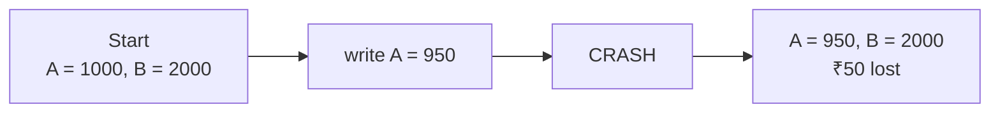
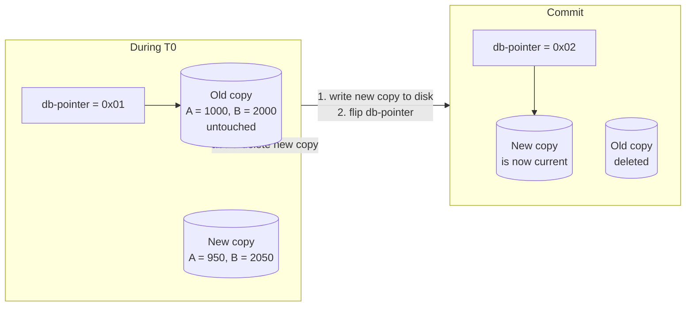
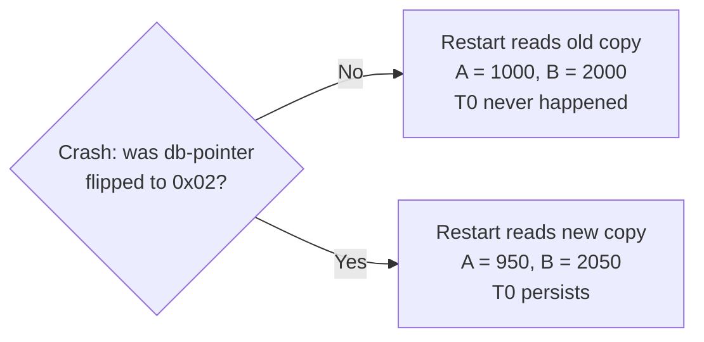
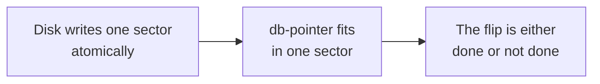
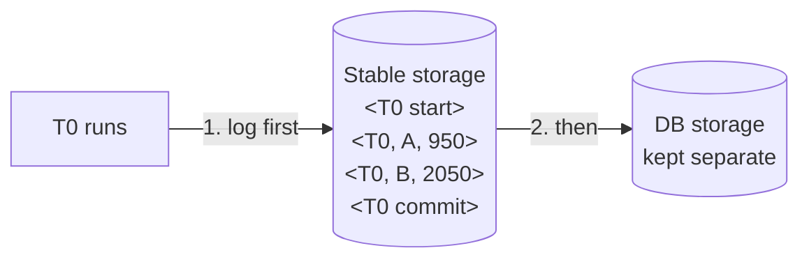
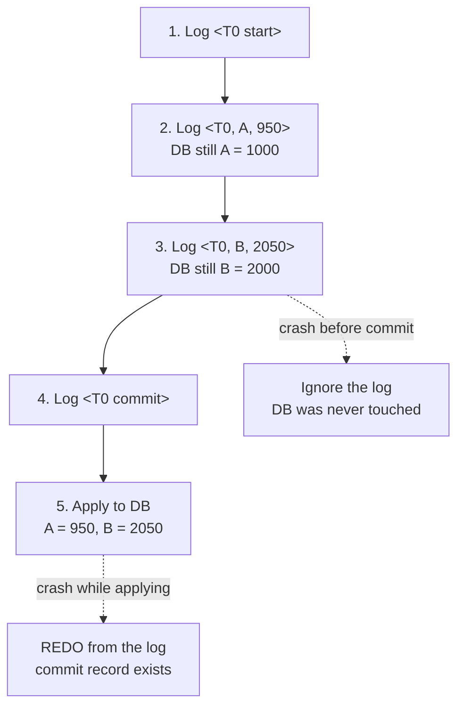
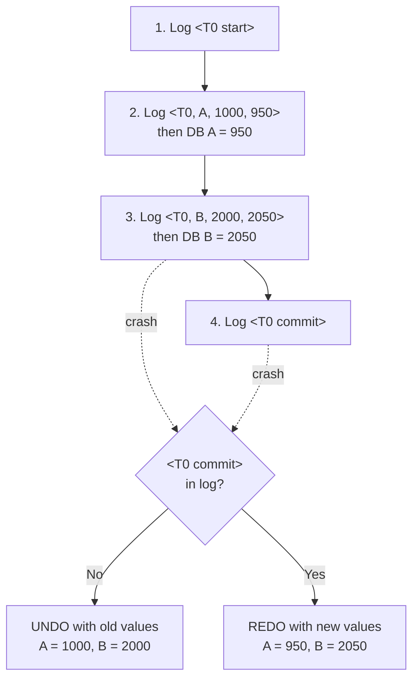
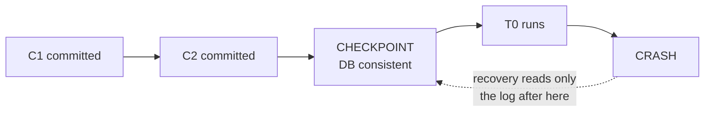
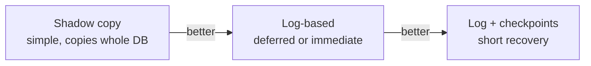

# Lecture 13: How to implement Atomicity and Durability

> **The story:** Raj sends ₹50 from account A (₹1000) to account B (₹2000). The power can fail at any moment. The bank must never lose or invent money.

## 1. The crash that must never hurt

T0 debits A, and then the power fails before B is credited. Without protection, ₹50 vanishes.

The **recovery mechanism component** of the DBMS stops this. It gives two guarantees.

| Property | Guarantee |
|---|---|
| Atomicity | T0 happens fully or not at all. A failed T0 rolls back. |
| Durability | Once the user is told "committed", the change survives any crash. |

## 2. Method 1: shadow copy

The bank copies the whole DB, works on the copy, and then flips one pointer. The `db-pointer` lives on disk and always points to the current copy.

T0 counts as **committed** only when the new `db-pointer` is written to disk. It assumes only one transaction runs at a time.

## 3. Shadow copy: what a crash does

The power fails. On restart, the DB simply follows `db-pointer`.

| Guarantee | How shadow copy gives it |
|---|---|
| Atomicity | The old copy is never touched, so a failure leaves all or nothing. |
| Durability | The new copy is on disk before the pointer flips, so a committed T0 survives. |

## 4. Can the pointer flip tear halfway?

An interviewer asks: what if the crash hits while 0x01 becomes 0x02? It cannot tear.

| Shadow copy | Verdict |
|---|---|
| Strength | It is the simplest method. |
| Drawback | It copies the whole DB for every T, and a DB can be terabytes. |
| Limit | It cannot run concurrent transactions. |

## 5. Method 2: keep a diary first (log-based recovery)

Copying terabytes is too slow. So the bank writes a diary (log) of every change before touching the DB.

| Rule | Reason |
|---|---|
| Log before the DB write | A log written after the write cannot explain a crash in between. |
| Log in stable storage | Stable storage makes each write atomic and survives power failures. |
| Log apart from the DB | A DB disk failure must not destroy the log too. |
| No DB copy | The log replaces the costly shadow copy. |

## 6. Deferred modification: write the DB only after commit

T0 writes only to the log. The DB stays untouched until `<T0 commit>` is logged.

It needs only **redo**, never undo, because the DB is never touched before commit.

## 7. Immediate modification: write the DB while T0 runs

Each write is logged with its **old and new value**, and then the DB is updated at once.

The log keeps the old value because the DB already holds 950. Undo needs to know it was 1000.

## 8. Deferred vs immediate

| | Deferred | Immediate |
|---|---|---|
| DB updated | The DB is updated only after commit. | The DB is updated during T. |
| Log record | It holds the new value. | It holds the old and new values. |
| Crash before commit | The log is ignored. | Undo restores the old values. |
| Crash after commit | Redo applies the new values. | Redo applies the new values. |

Redo happens only when `<T commit>` is in the log. Without it, T is treated as failed.

## 9. The diary grows too big: checkpoints

Lakhs of transactions fill the log. A checkpoint marks a point where the DB is consistent and all earlier transactions are committed.

## 10. The full answer

> **Interview:** Explain shadow copy first. Then explain log-based recovery, deferred and immediate. End with checkpoints.
