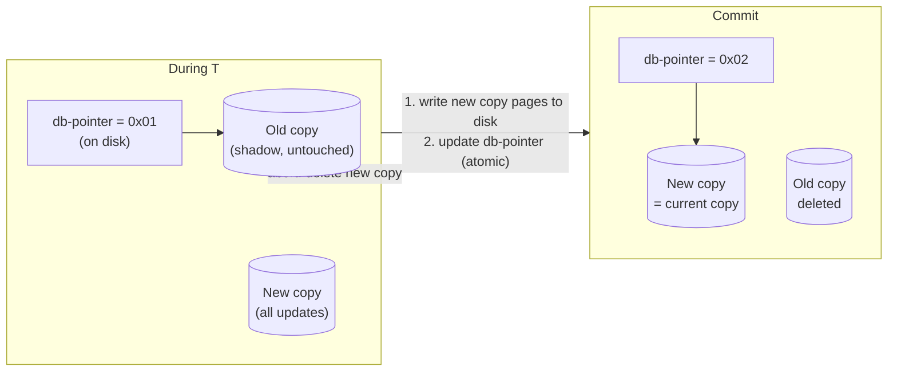
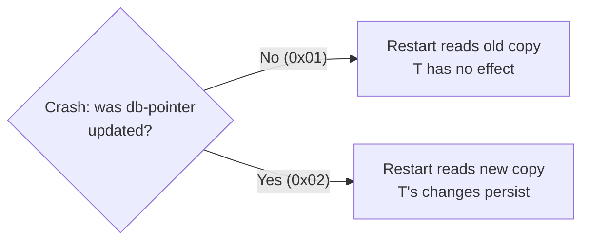
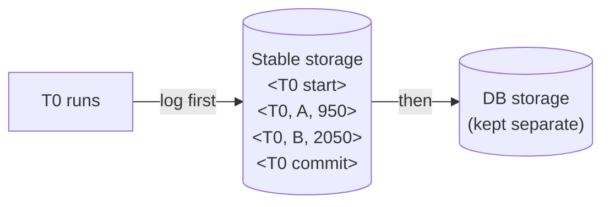
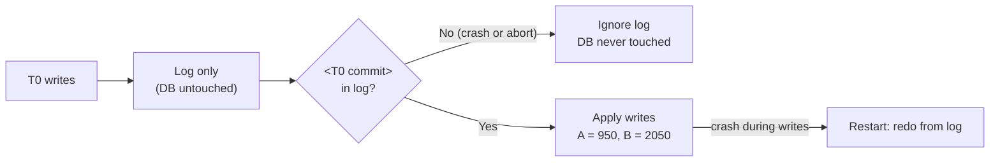
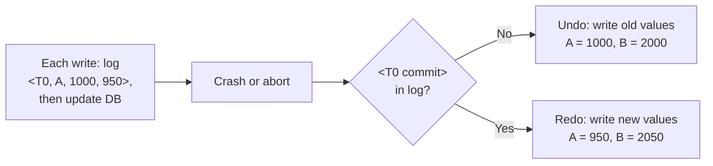
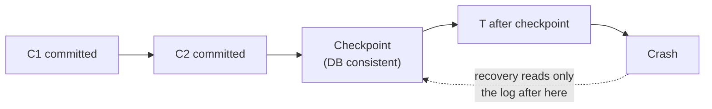

# Lecture 13: How to implement Atomicity and Durability in Transactions

## 1. Recovery mechanism component

The **recovery mechanism component** of the DBMS supports **atomicity and durability**. The shadow-copy scheme and the other schemes below are implemented inside it.

- **Atomicity (recap):** T is all-or-nothing. Money deducted but not credited is not allowed. On failure, T rolls back.
- **Durability (recap):** Once T is committed and the user is notified, the updates in the DB must persist.

## 2. Shadow-copy scheme

This scheme is based on making copies of the DB, called **shadow copies**. It is the simplest and most naive method.

- **Assumption:** Only one transaction (T) is active at a time. Transactions run serially. Concurrent transactions do not work with this scheme.
- **db-pointer:** A pointer kept on the **disk**. At any instant it points to the current copy of the DB. For example, it holds address 0x01, which points to the old copy.

**How T runs:**

1. T creates a complete copy of the DB. The copy is made in RAM and written to disk later.
2. All updates go to the new copy. The original (shadow) copy stays untouched.
3. If T **has to be aborted**, the system deletes the new copy. The old copy is not affected, since db-pointer pointed to it all along.
4. If T succeeds, it commits in these steps:
   1. The OS writes all pages of the new copy from RAM to disk.
   2. The DB system updates db-pointer to point to the new copy (for example 0x01 to 0x02).
   3. The new copy is now the current copy.
   4. The old copy is deleted.
5. T is **COMMITTED** at the point where the updated db-pointer is written to disk. Writing the new copy to disk alone is not enough. The user is told "committed" only after db-pointer shows the new location.

### a. Atomicity

- **Failure before the pointer update:** The old content of the DB is not affected.
- **Abort:** Delete the new copy of the DB from RAM.
- **Result:** Either all updates are reflected or none.

### b. Durability

- **Failure before the pointer update:** The new copy may already be on disk, but db-pointer still says 0x01. On restart, the system reads db-pointer and sees the original DB. None of T's effects are visible. T counts as successful only when db-pointer is updated.
- **Failure after the pointer update:** All pages of the new copy were written to disk before that. On restart, the system reads the new copy. db-pointer already says 0x02, so the changes persist. The old copy is already deleted.

### c. Atomic pointer write

The scheme depends on the write to db-pointer being atomic.

- **Disk guarantee:** Disks provide atomic updates to an entire block, or at least a disk sector.
- **Placement:** db-pointer lies entirely in a single sector, by storing it at the beginning of a block.
- **Question:** What if the system fails in the middle of changing 0x01 to 0x02? It cannot. A single-sector write is either done or not done.

### d. Drawback

The scheme is **inefficient**. The entire DB is copied for every transaction, and a DB can be terabytes in size.

## 3. Log-based recovery methods

The log is a sequence of records. The log of each transaction is kept in **stable storage**, so the DB can recover from it after any failure.

- **No DB copy:** This method needs no copy of the DB.
- **When written:** Log records are written as T executes: T started, each value changed, T committed.
- **Every operation logged:** Any operation performed on the DB is recorded in the log.
- **Log first:** The logs must be stored **before** the transaction is applied in the DB. A log written after the operation would not tell what was happening if the system failed in between.

**Stable storage** is a classification of computer data storage technology. It guarantees atomicity for any given write operation. It lets software be robust against some hardware and power failures.

- **Kept separate:** Logs live apart from the DB storage. Otherwise, if the DB storage fails, the logs are lost too.
- **Cost:** Stable storage is expensive and robust.

**Example for log records:** A = 1000 and B = 2000 initially. T0 sends 50 from A to B: read(A), A = A - 50, write(A), read(B), B = B + 50, write(B).

- **Log records:** `<T0 start>`, `<T0, A, 950>`, `<T0, B, 2050>`, `<T0 commit>`.
- **Update record:** It holds the transaction id, the variable and its new value.

### a. Deferred DB modifications

This method ensures **atomicity**. It records all DB modifications in the log. It defers all write operations until the final action of T has executed.

- **Before commit:** Only log records are written. The actual DB is not modified.
- **At completion:** The log is used to execute the deferred writes. After `<T0 commit>` is written, A = 950 and B = 2050 are written to the DB using the log.
- **Crash or abort:** If the system crashes before T completes, or T is aborted, the log information is ignored. No commit record means T never committed, and the DB was never touched.
- **Failure during the writes:** The system performs **redo**.
  - **Example:** T0 is committed and the user is told. A = 950 is written, and the system crashes before B = 2050 is written.
  - **On restart:** The system reads the log from stable storage. `<T0 commit>` is there, so T0 did commit.
  - **Redo:** It re-executes the writes from the log and finishes T0.
  - **Same for commit time:** Failure during commit or deferred writes is handled the same way. The commit record proves T0 completed.

### b. Immediate DB modifications

DB modifications are output to the DB while T is still active.

- **Versus deferred:** Deferred mode logs a write and applies it after commit. Here each write is logged first and written to the DB right after. So the DB is updated again and again while T runs.
- **Uncommitted modifications:** These are modifications written by an active T. T may fail midway, and then the changes must be rolled back using the log.
- **Restore:** After a crash or T failure, the system uses the old value field of the log records to restore modified values.
  - **Log format:** `<T0, A, 1000, 950>` means transaction id, item, old value, new value. The full log is `<T0 start>`, `<T0, A, 1000, 950>`, `<T0, B, 2000, 2050>`, `<T0 commit>`.
  - **Why old value:** The DB already holds 950. To roll back, the old value 1000 must be known.
  - **Example:** T0 wrote A = 950, then fails or the user aborts. Read the log, find A's old value 1000 and write it back.
- **Log first:** The update takes place only after the log records are in stable storage. If the DB were updated first and the system failed before the log was written, recovery would be impossible.

| Case | Action | Example |
|------|--------|---------|
| Failure before T completes, or T aborted | Undo using the old value field. | Crash before commit. Write 1000 back to A and 2000 back to B. |
| T completes, then the system crashes | Redo using the new value field, because the commit log exists. | T0 completed and the user was told, but the DB crashed while applying the commit. The log shows T0 committed, so write 950 and 2050 again. |

- **Redo rule:** Redo only if `<T0 commit>` is in the log. If that line is absent, assume T0 failed and undo it.

### c. Checkpoints (improved log-based method)

- **Problem:** Logs keep growing with thousands or lakhs of transactions. Stable storage fills up, and keeping all old information is costly.
- **Checkpoint:** It is made at a point where the DB is consistent. All transactions before it (C1, C2, ...) are in the committed state.
- **Recovery:** If a transaction fails after a checkpoint, recovery needs only the log after the last checkpoint.

## 4. Interview

> **Interview:** Answer with the shadow-copy method first. Then explain log-based recovery (deferred and immediate), which is better than shadow copy. Checkpoints improve it further.

> **Interview:** Cross-question: what if the system fails while changing db-pointer from 0x01 to 0x02? It cannot. The disk writes a block or sector atomically, and db-pointer sits in a single sector.
