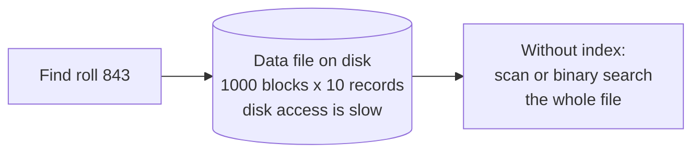
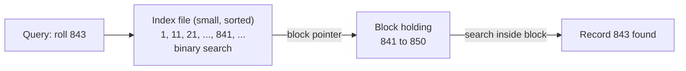
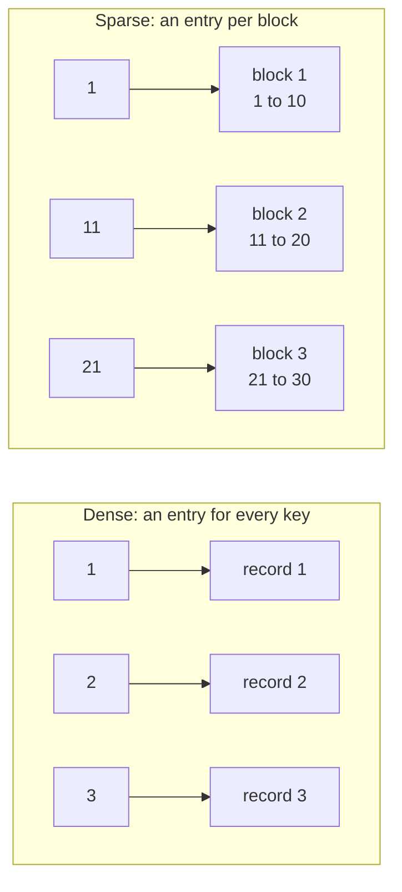
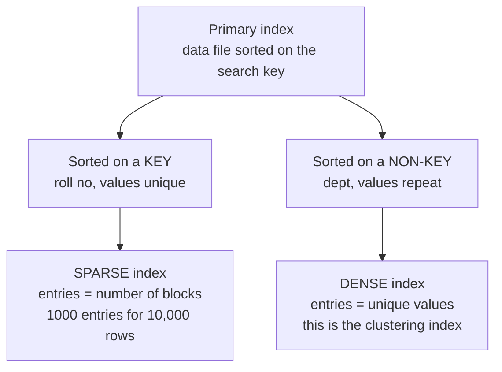
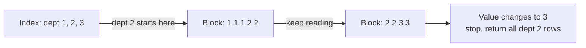
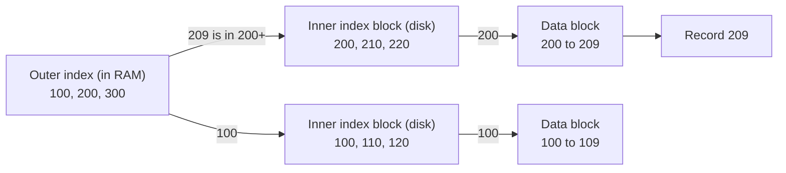
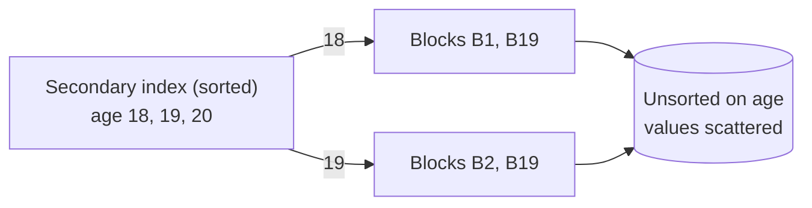

# Lecture 14: Indexing in DBMS

> **The story:** Your college stores 10,000 students on disk. The principal shouts, "Get me roll no. 843, now!" Disk is slow, so you build an index, like the index at the back of a book.

## 1. The problem: a huge file on a slow disk

The data file sits on disk in blocks. Each block holds 10 records, so 10,000 students fill 1000 blocks.

## 2. The fix: a small sorted index

You keep a small, sorted index file. It says which block holds which key. Binary search the index, then jump straight to one block.

Each index entry has two parts.

| Search key | Data reference |
|---|---|
| 841 | Address of the block holding 841 to 850 |

| Term | Meaning |
|---|---|
| Index | An index is a data structure that finds rows with fewer disk accesses. |
| Search key | The search key is the column you index. It can be the PK, a CK or any column. |
| Data reference | The data reference is a pointer to the disk block holding that key. |
| Rule | The index file is always sorted, so binary search works on it. |
| Rule | The index must be small. Otherwise searching it costs as much as the file. |
| Rule | Indexing is optional. Small tables do not need it. |

## 3. Dense vs sparse: how many entries?

Your index can hold an entry for every key, or only one per block.

| | Dense index | Sparse index |
|---|---|---|
| Entries | It has one entry per search key value. | It has one entry per block. |
| Space | It uses more space. | It uses less space. |
| Lookup | It points straight to the record. | It points to the block, then you search inside it. |

## 4. Primary index: the file is sorted on the search key

The student file is sorted on roll number. An index on that same sorting column is a primary (clustering) index. A file can be sorted on only one column, so it has only one primary index.

> **Note:** A primary index does not have to be on the primary key. It only needs the file to be sorted on its search key.

## 5. Clustering index: all students of one department

The file is now sorted on dept, and dept values repeat. Each unique dept gets one entry pointing to its first block. You read forward until the value changes.

Rows with the same value form a cluster. This makes `GROUP BY dept` fast.

## 6. Multi-level index: the index itself gets too big

Now index all of India's population. The index is too big for RAM, so you index the index. A small outer index stays in RAM. The big inner index stays on disk.

## 7. Secondary index: search by a column the file is not sorted on

The principal now asks for students by age. The file is sorted on roll no, so ages lie scattered across blocks. You build a secondary (non-clustering) index.

| | Primary index | Secondary index |
|---|---|---|
| Data file | The file is sorted on the search key. | The file is not sorted on the search key. |
| Count per table | A table has only one. | A table can have many. |
| Type | It is sparse on a key and dense on a non-key. | It is always dense. |
| Repeated values | One entry points to the first block. | One entry holds a list of all blocks. |

> **Interview:** Why index an unsorted file? The index itself is sorted, so you binary search it instead of scanning every record.

## 8. The trade-off

| | Effect |
|---|---|
| Advantage | Reads (`SELECT`, `WHERE`) are faster and need less IO. |
| Disadvantage | The index needs extra space. |
| Disadvantage | `INSERT`, `UPDATE` and `DELETE` get slower, because the index must change too. |

MySQL indexes the primary key by default.
