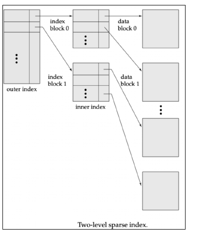

# Lecture 14: Indexing in DBMS

## 1. What indexing is

**Indexing** **optimises the performance** of a database. It minimises the number of disk accesses needed to process a query.

- **Why:** The data file sits on disk. Disk access is slow, so fetching tuples straight from it is slow.
- **Index:** It is an extra layer on top of the data file. It is like caching, but it is not caching.
- **Data file:** Also called the main file or database file. The disk stores it in blocks (block 1, block 2, ... block n).

**Example:** A student table has 10,000 records, with 10 records per block. That gives 1000 blocks. Roll number is the primary key, so the file is sorted on it. Query: get student no. 843.

| Approach | Steps |
|----------|-------|
| Without index | Linear search, or binary search on the whole file (log2 n steps), over all 10,000 records. |
| With index | Binary search the small index file (1000 entries). Get the block pointer (block 841). Go to that block and search inside it (linear or binary). |

- **Less disk access:** You search the index file instead of the disk. A block is small, so once it is known, searching inside it is cheap.
- **Index must be small:** If every record were indexed, there would be no gain. The index search and the data file search would cost the same.

## 2. Index as a data structure

The index is a **data structure**. It locates and accesses data in a table quickly.

## 3. What it speeds up

Indexing speeds up read operations such as **SELECT** queries and the **WHERE** clause. Implementations such as MySQL index the primary key by default.

## 4. Search key

The **search key** contains a copy of the primary key or candidate key of the table, or something else.

| Search Key | Data Reference |
|------------|----------------|

The key points to the value (data reference).

- **Any attribute:** It can be a primary key, a candidate key, or another attribute. In the example, it is roll number.

## 5. Data reference

The **data reference** is a pointer holding the address of the disk block where the value of the corresponding key is stored. It is the base pointer of a block, so the block can be accessed directly.

## 6. Indexing is optional

Indexing is **optional**, but it increases access speed. It is the secondary means to access the tuple, not the primary one.

- **When needed:** A very small database does not need it. It helps when the database is big.
- **Primary route:** Search the data file directly (linear or binary).
- **Index route:** Search the index, take the block pointer, and retrieve the tuples from that block.

## 7. The index file is always sorted

- **Binary search:** It works on the index, and it is always better than linear search.
- **Unsorted data file:** The index file is still kept sorted. An unsorted index gives no benefit.

## 8. Indexing methods

### a. Primary index (clustering index)

A file may have several indices, on different search keys. Suppose the data file is sequentially ordered. A primary index is an index whose search key also defines the sequential order of the file.

- **When it applies:** The data file is sorted on some one attribute. A file can be sorted on only one attribute at a time. Sorted on roll number means unsorted on age or name.
- **All files:** All files are ordered on some search key, primary or non-primary.

> **NOTE:** The term primary index is sometimes used to mean an index on a primary key. This usage is **nonstandard** and **should be avoided**. Primary index does not mean the search key must be the primary key. It can be a non-primary key too.

#### Dense and sparse indices

| | Dense index | Sparse index |
|---|-------------|--------------|
| Entries | One index record for every search key value in the data file. | An index record for only some of the search-key values. |
| Example | Roll numbers 1 to 10,000: entries for 1, 2, 3, ... 10,000 are all in the index. | One entry per block: the first search key of each block (1, 11, 21, ...), a gap of 10. |
| Index record | The search-key value and a pointer to the first data record with that value. The rest of the records with the same value are stored sequentially after the first. | A range of index columns stores the same data block address. When data is needed, the block address is fetched. |
| Cost | It needs more space, since each record holds the search key and a pointer to the record on disk. | It resolves the issues of dense indexing. |

Which one is better depends on the case. Primary indexing applies to a data file sorted on a primary key attribute or on a non-key attribute.

#### Based on key attribute

- **Sorting:** The data file is sorted on the primary key attribute. The PK is the search key in the index.
- **Index type:** A sparse index is formed. The number of entries in the index file equals the number of blocks in the data file.
  - **Why sparse:** The file is sorted and keys are unique. Only the first key of each block (the block base pointer) is stored. The rest (such as 12, 13, ... 20) are found by searching inside the block.
  - **Example:** 1000 blocks give 1000 index entries for 10,000 records.

#### Based on non-key attribute

- **Sorting:** The data file is sorted on a non-key attribute.
- **Entries:** The number of entries equals the number of unique non-key attribute values in the data file.
- **Index type:** It is a dense index, because all the unique values have an entry in the index file. Values can repeat (such as 1 1 1 2 3 3 3 4 4 4 5), and it is not known how many times, so every unique value gets an entry.
- **Example:** A company recruited many employees in various departments. A clustering index should be created for all employees of the same department.
  - **Entry:** Each unique value is indexed once, with the base pointer of the block where it first occurs.
  - **Search:** Go to the block of its first occurrence. Binary search inside that block for the first occurrence. Then keep moving to the next records (next blocks if needed) until the value ends. Return all of them.
  - **Use:** Grouping, such as GROUP BY department (average salary per department, who works in a department), or course-wise enrolled students.
  - **Clustering:** Records with the same value form a cluster.
- **Naming:** Some writers call this non-key case "clustering indexing" and say it is not primary indexing. Here it is still primary indexing. Its one criterion is that the data file is sorted on some one search key.
- **Dense and sparse are schemes:** Both are used inside primary indexing. A key attribute gives sparse. A non-key attribute gives dense.

#### Multi-level index

A multi-level index has two or more levels.

- **Why:** A single-level index may grow so large that binary search on it takes much time.
- **Index the index:** An outer index is built on top of the first-level (inner) index.
- **Example:** The data file has roll numbers 100, 101, 102, ... The first-level index has one entry per block (100, 110, 120, ...), pointing to data blocks. The outer index groups them (100, 200, 300, ...), each pointing to an index block of the inner index.
- **Search 109:** The outer index finds the 100 entry, which gives the inner index block. The inner index gives the data block of 100. Binary search inside the data block finds 109.
- **Search 209:** The outer index finds the 200 entry (it covers 200 up to before 300). Then the inner index block, then the data block, then the record.
- **When needed:** The first-level index table becomes very big (such as the population of India). The big first-level index is stored on the hard disk. The small outer index table is kept in RAM.

### b. Secondary index (non-clustering index)

The data file is unsorted, so primary indexing is not possible.

- **Why:** The file is sorted on one attribute only (say roll number). It is unsorted on all others (age, name, address). Indexing on those needs a secondary index.
- **No binary search on data:** The next value after 1 may not be 2 or 3, so values lie scattered across blocks.
- **Key or non-key:** The search key can be a key or non-key (a candidate key too). It makes no difference.
- **Name:** Usually a primary index already exists on the sorting key, and a search on another key is needed.
- **Entries:** The number of entries in the index file equals the number of records in the data file.
  - **Every key:** Every search key needs an entry with its block pointer. Sparse is not possible, as the order is unknown.
  - **Repeating values:** If search key values repeat, entries equal the unique values. Each entry holds a list (a linked list, or an extra index level) of all blocks where that value lies. For example, 1 is in B1 and B19, and 2 is in B2 and B19.
- **Dense:** It is an example of a dense index.
- **Benefit:** Without the index, you do a linear search over all records (such as 1 lakh). With it, you binary search the sorted index and get the block pointer or pointers.

> **Interview:** What is the benefit of indexing when the data file is unsorted? The index file is sorted, so binary search works on it.

## 9. Advantages of indexing

- **Speed:** Faster access and retrieval of data.
- **IO:** Less IO.

## 10. Limitations of indexing

- **Space:** It needs additional space to store the index table.
- **Writes:** It decreases performance in INSERT, DELETE and UPDATE queries.
