# Lecture 15: NoSQL

> **The story:** Your shop app goes viral. Millions of users arrive, and the data gets messy. Your SQL database starts to struggle, so you meet NoSQL.

## 1. One user, two ways to store the data

Matt signs up. He lives in Delhi and his hobbies are cricket and guitar. SQL splits him across tables, but NoSQL keeps him in one document.

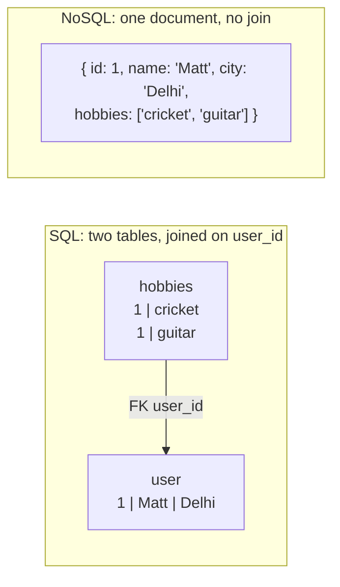

NoSQL means "not only SQL". It is non-tabular, has a flexible schema and scales out easily. It still supports queries.

| Data type | Example | Can SQL store it as-is? |
|---|---|---|
| Structured | A student table has a fixed schema. | Yes, it can. |
| Semi-structured | An email has a fixed header and a free body. | No, it must be processed first. |
| Unstructured | Chats, CCTV footage and survey dumps have no structure. | No, it must be processed first. |

NoSQL stores all three types as they are.

## 2. Why NoSQL was born

Storage became cheap, but developers became expensive. Speed began to matter more than saving space.

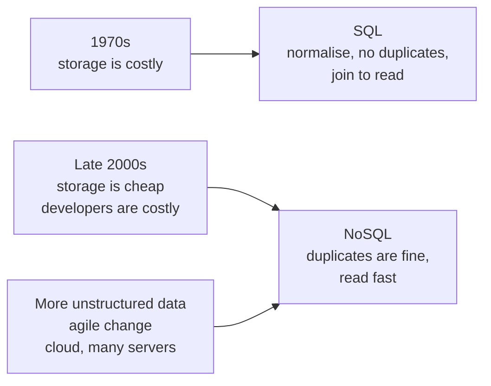

## 3. Raj has no city: flexible schema

Raj signs up without a city or hobbies. SQL wastes space on NULLs. NoSQL simply leaves those fields out.

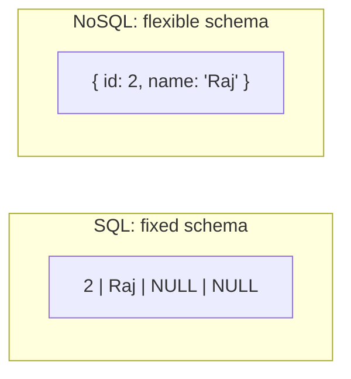

Changing a SQL schema on the go is a huge task. In NoSQL, each document can have its own fields.

## 4. The disk fills up: scale up or scale out

Your single server runs out of space. You can make it bigger or add more servers.

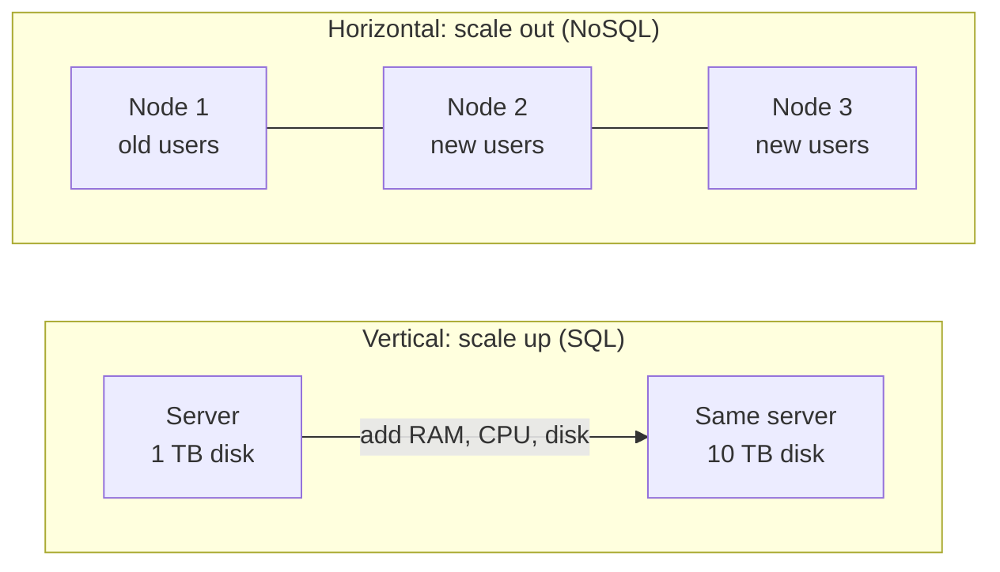

| | Vertical scaling | Horizontal scaling |
|---|---|---|
| What changes | The one server gets bigger hardware. | More servers are added. |
| Where data lives | All data stays on one node. | Data spreads across nodes. |
| Used by | SQL generally scales this way. | NoSQL scales this way. |
| Cost | It is always costly. | Many cheap machines are cost efficient. |

## 5. Why SQL cannot scale out well

You spread the SQL tables over three servers. A join now needs all of them on one machine.

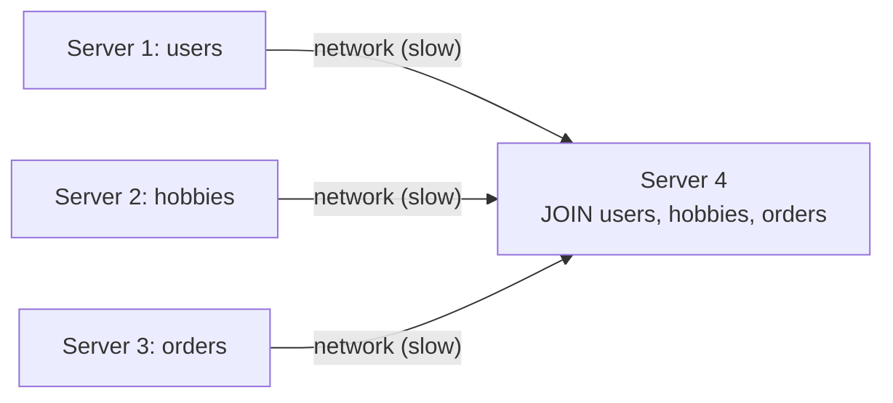

> **Interview:** Can SQL scale horizontally? It is possible but not practical. Joins must pull tables across the network first. A NoSQL document is self-contained, so it needs no join and spreads easily.

Scaling out is done with **sharding** or **replica sets**.

## 6. A server dies: replica sets give high availability

Matt's document is copied on server 1 and server 3. Server 1 crashes, and server 3 answers instead.

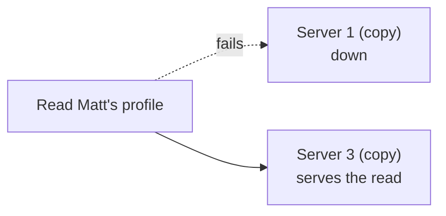

NoSQL replicates data automatically, so it stays available when a server fails.

## 7. Fast reads, slow writes

Matt opens his profile, and it loads in one go. Then Matt drops guitar, and the whole document must be loaded to edit it.

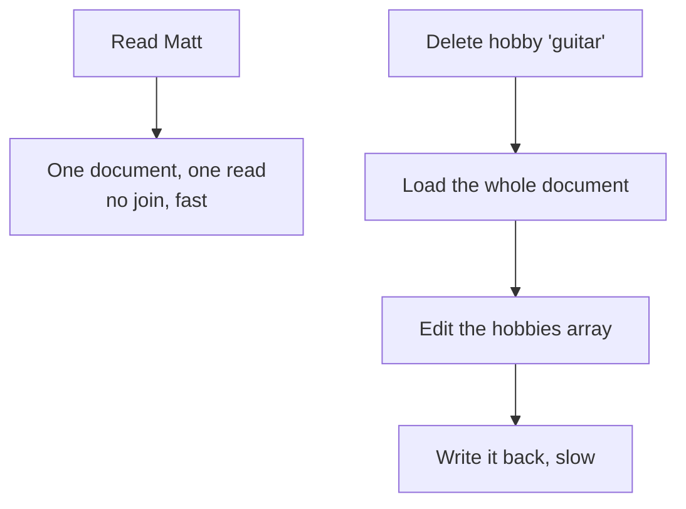

> **MongoDB rule:** Data that is accessed together should be stored together.

Frequently opened data, such as recent chats, is cached for instant reads. That is why NoSQL suits cloud apps.

## 8. Four ways to store Matt: the NoSQL types

The same user can be stored in four NoSQL models.

### 8a. Key-value: one key, one value

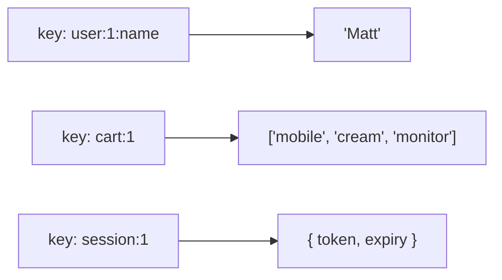

It works like a persistent hash map. Lookup by key takes constant time.

### 8b. Document: many fields in one JSON object

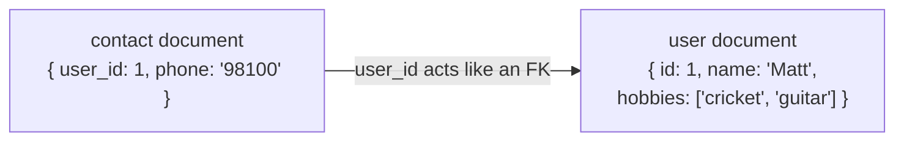

### 8c. Column store: each column sits together

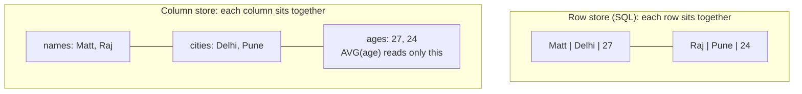

Same-type columns compress well, so aggregates like AVG and SUM are fast.

### 8d. Graph: nodes and edges

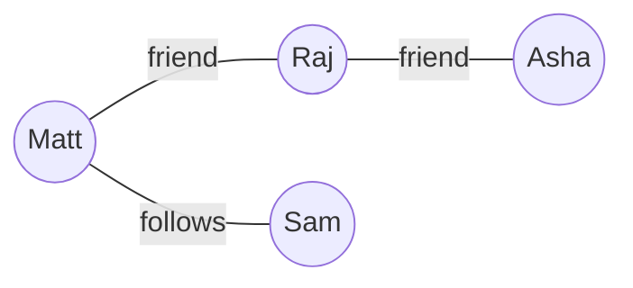

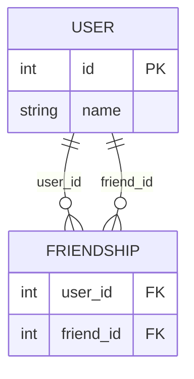

SQL needs this extra table and a join to find friends. A graph DB stores the edges directly, so it needs no join.

| Type | Stores data as | Best for | Examples |
|---|---|---|---|
| Key-value | It stores key and value pairs. | It suits carts, sessions and caching. | Redis, DynamoDB |
| Document | It stores JSON-like documents. | It suits e-commerce and general apps. | MongoDB, CouchDB |
| Column store | It stores each column together. | It suits analytics and aggregation. | Cassandra, HBase, Redshift |
| Graph | It stores nodes and edges. | It suits social networks and fraud detection. | Neo4j, Amazon Neptune |

## 9. When to choose NoSQL

| Situation | Why NoSQL fits |
|---|---|
| Fast agile development | There is no schema design, so you ship fast. Reels was built quickly this way. |
| Structured, semi-structured or unstructured data | It stores every kind of data as it is. |
| Huge volumes of data | It reads and writes large data quickly. |
| Scale-out architecture | Self-contained documents spread across servers. |
| Microservices and real-time streaming | These need fast access. |
| Cloud applications | Data spreads across many servers without joins. |

> **Interview:** For a cloud application, choose NoSQL. For banking, choose SQL, because the data is structured and needs ACID.

## 10. Two myths

| Myth | Truth |
|---|---|
| "NoSQL cannot store relationships." | It can. Related data is nested in one document, or linked by an id field. |
| "NoSQL never supports ACID." | Some do. MongoDB supports ACID transactions. |

## 11. The price you pay: disadvantages

| Disadvantage | Reason |
|---|---|
| Data redundancy | Data is copied for fast reads, so it takes more storage. Storage is cheap, so this is minor. |
| Costly update and delete | The whole document must be loaded to change one field. |
| No single model fits all | A graph DB is bad at range queries. MongoDB is the safest general choice. |
| No ACID in general | Most NoSQL DBs skip ACID, except MongoDB and a few others. |
| No consistency constraints | The DB enforces no rules like CHECK. The app must validate data. |

## 12. SQL vs NoSQL

| | SQL | NoSQL |
|---|---|---|
| Storage model | It uses tables with fixed rows and columns. | It uses documents, key-value pairs, wide columns or graphs. |
| Born | It was built in the 1970s to cut duplication. | It was built in the late 2000s for scale and fast change. |
| Examples | Oracle, MySQL, PostgreSQL, SQL Server | MongoDB, Redis, Cassandra, Neo4j |
| Schema | The schema is fixed. | The schema is flexible. |
| Scaling | It scales vertically. | It scales horizontally. |
| ACID | It supports ACID. | Most do not, except MongoDB. |
| Joins | It needs joins. | It usually needs no joins. |
| Object mapping | It needs ORM mapping, done in Java with the DAO pattern. | A document maps directly to an object. |

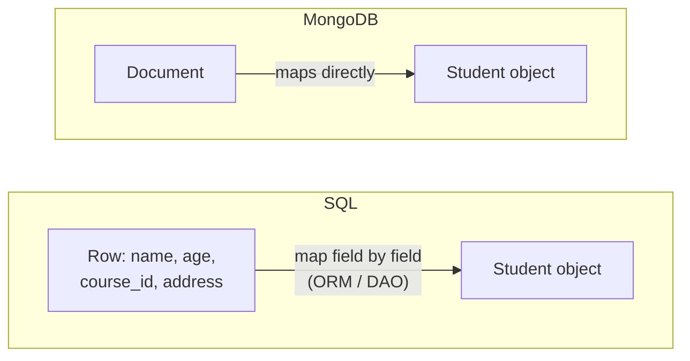
