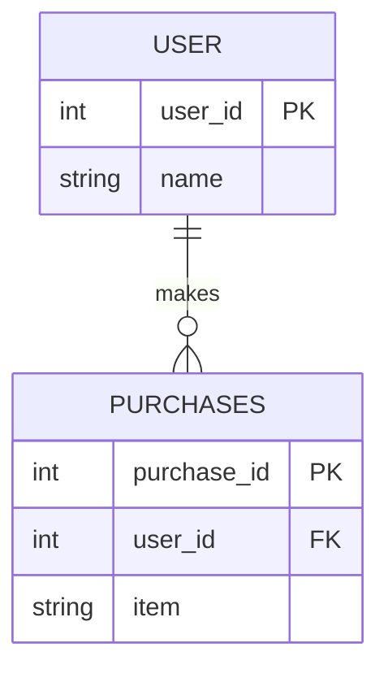
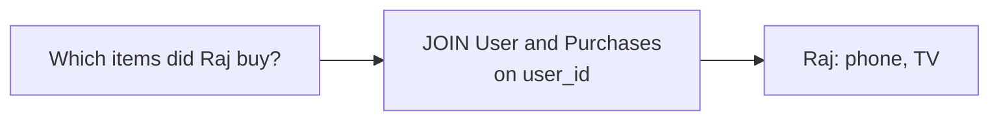
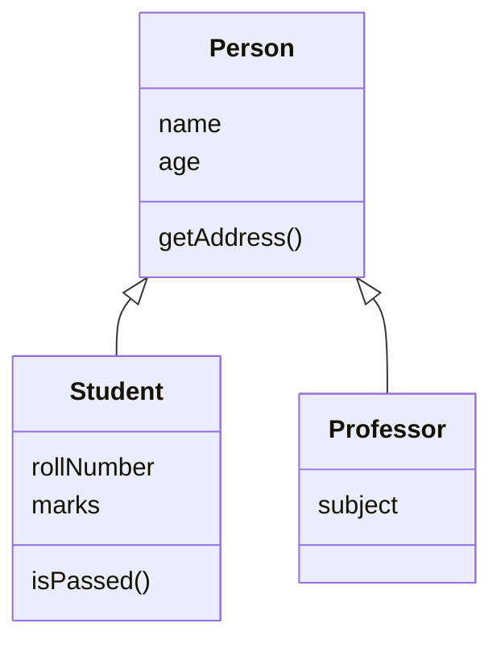
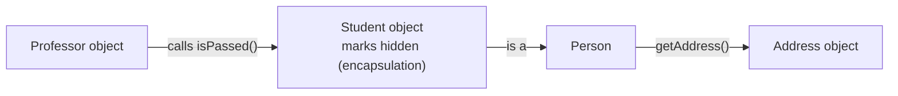
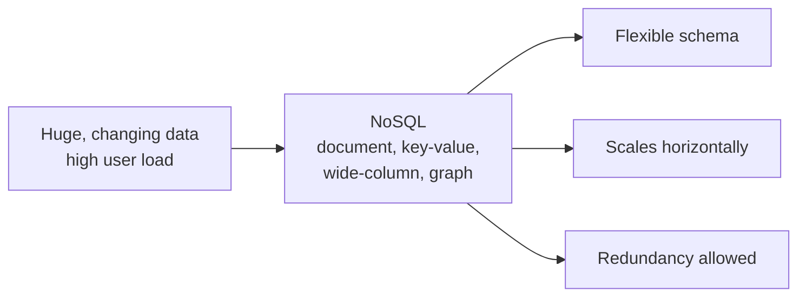
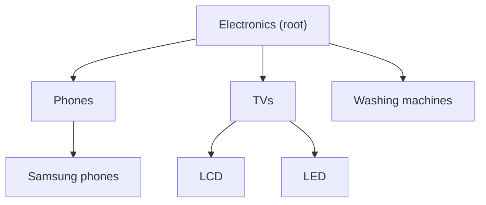
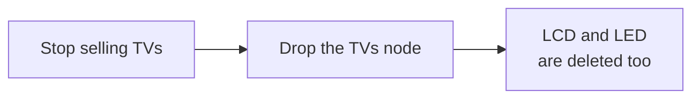
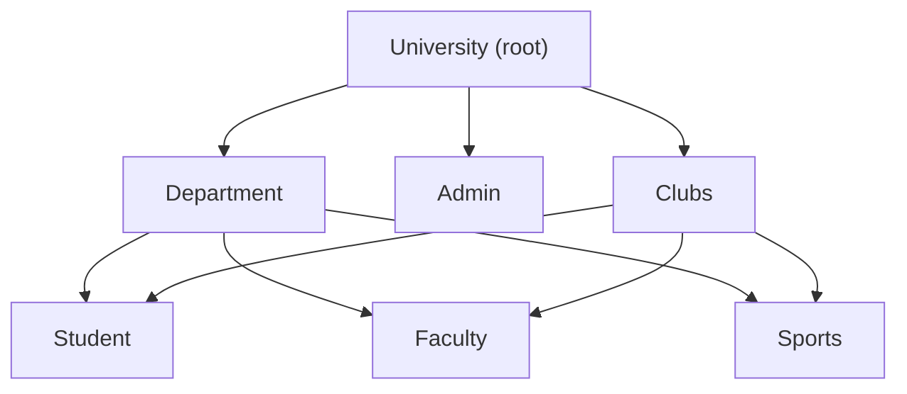
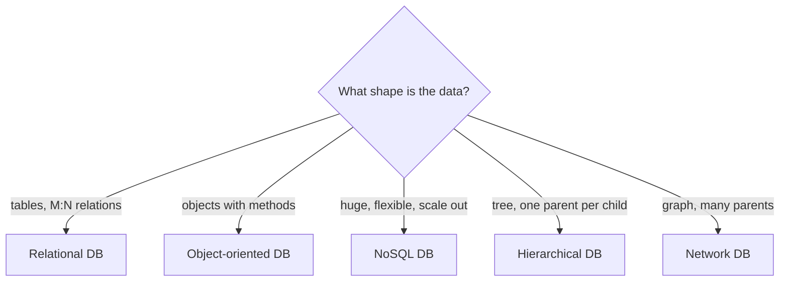

# Lecture 16: Types of Databases

> **The story:** You start a company. It grows, and each new part of it has data of a different shape. You must pick the right database for each part.

## 1. The shop needs orders: relational DB

Users buy items. The data is structured, and users link to purchases. Tables joined by foreign keys fit this.

| Relational DB | Detail |
|---|---|
| Model | Data lives in tables linked by foreign keys. |
| Language | It uses SQL for CRUD. |
| Examples | MySQL, Oracle and MS SQL Server are relational. |
| Pro: mature | It has been used since the 1970s and has huge community support. |
| Pro: structured | It is highly optimised for structured data. |
| Pro: normalised | It strongly guarantees normalisation, so there is little redundancy. |
| Con: scaling | It scales poorly horizontally. This is its biggest weakness. |
| Con: complexity | A very large schema becomes messy to manage. |

> **Interview:** Why is the relational DB a poor fit for the cloud? It does not scale horizontally well.

## 2. The university app thinks in objects: object-oriented DB

Your university app is written in Java. A student is an object with data and methods. You store the whole object, not rows.

| Object-oriented DB | Detail |
|---|---|
| Model | Each record is an object. It holds data and methods. |
| Handle | The object ID plays the role of the primary key. |
| OOP ideas | It uses inheritance, object identity and encapsulation. |
| When to move | Move here when relational tables and joins become too tangled. |
| Examples | ObjectDB and GemStone are object-oriented. |
| Pro: one package | One fetch returns the whole object, so no joins are needed. |
| Pro: complex data | It handles complex relations and many data types. |
| Pro: OOP fit | It fits Java and C++ code directly. |
| Con: performance | Its complexity slows down CRUD. |
| Con: community | It has little community support. |
| Con: no views | It has no views. Encapsulation hides data instead. |

## 3. The social feed explodes: NoSQL DB

Millions of users post every second. The data shape keeps changing, so you scale out with NoSQL. See lecture 15 for detail.

MongoDB is the most famous NoSQL DB.

## 4. The catalog is a tree: hierarchical DB

Your electronics catalog is a strict tree. Every child has exactly one parent, and you read it top-down from the root.

| Hierarchical DB | Detail |
|---|---|
| Model | Records form a tree. A parent has many children, and a child has one parent. |
| Fits | It fits org charts, file systems, family trees and drop-down menus. |
| Disk fit | Disk storage is also a tree, so it works as a physical model too. |
| Example | IBM IMS is hierarchical. |
| Pro: simple | One-to-many traversal is simple and fast. |
| Pro: easy changes | You can add or drop a branch without touching the rest. |
| Con: one parent | A child cannot have two parents. Siblings cannot relate. |
| Con: slow search | Every search starts at the root and goes down. |
| Con: redundancy | The same data is often stored in many places. |

## 5. Students join clubs: network DB

A student belongs to a department and also to a club. Now a child has two parents, so the tree becomes a graph.

| Network DB | Detail |
|---|---|
| Model | It extends the hierarchical DB. A child can have many parents. |
| Shape | Many parents turn the tree into a graph. |
| Examples | IDS, IDMS, Raima and TurboIMAGE are network DBs. Only legacy systems use them. |
| Pro | It handles complex many-to-many relations. |
| Con: slow | Traversing a big graph with M:N links is slow. |
| Con: upkeep | It is tedious to maintain and has little community support. |

## 6. Which DB for which shape?

| DB | Structure | Main weakness | Used today |
|---|---|---|---|
| Relational | It uses tables. | It scales poorly horizontally. | It is used everywhere. |
| Object-oriented | It uses objects. | It is slow and complex. | It is rarely used. |
| NoSQL | It uses flexible formats. | It allows redundancy. | It is used heavily in the cloud. |
| Hierarchical | It uses a tree. | A child has only one parent. | It is rarely used. |
| Network | It uses a graph. | Graph traversal is slow. | Only legacy systems use it. |

> **Interview:** Know relational and NoSQL in depth. They are what the market uses. Have a rough idea of the other three.
