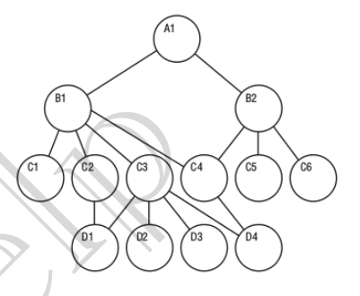

# Lecture 16: Types of Databases

## LEC-16: Types of Databases

1. **Relational Databases**
   1. Based on Relational Model.
      1. Data is defined in the form of tables; tables are related to each other (tables are also called relations).
      2. Relations are established through foreign keys; referential integrity and many constraints apply.
   2. Relational databases are quite **popular**, even though it was a system designed in the 1970s. Also known as relational database management systems (RDBMS), relational databases commonly use **Structured Query Language (SQL)** for operations such as **creating**, **reading**, **updating**, and **deleting** data. Relational databases store information in **discrete tables**, which can be **JOIN**ed together by fields known as **foreign** keys. For example, you might have a User table which contains information about all your users, and **join** it to a Purchases table, which contains information about all the purchases they've made. MySQL, Microsoft SQL Server, and Oracle are types of relational databases.
      1. Meaningful data is pulled out of the DBMS by establishing relations with joins.
   3. they are ubiquitous, having acquired a steady user base since the 1970s
      1. Most mature database; can be used for almost all types of use cases, except where horizontal scalability is needed (discussed in the last lecture).
      2. Very old, so community support is very good: courses, Stack Overflow and internet support are easy to find when stuck.
   4. they are highly optimised for working with structured data.
      1. Data fed in must be structured (structured vs unstructured data was discussed in the last lecture).
   5. they provide a stronger guarantee of data normalisation
      1. Normalisation and redundancy removal are a requirement before inserting data.
      2. Design flow: visualise data, draw ER diagram, convert ER diagram to tables, apply normalisation step by step; so data is almost normalised and there is no data redundancy.
   6. they use a well-known querying language through SQL
      1. Data is retrieved with SQL.
   7. **Scalability issues** (Horizontal Scaling).
      1. The biggest disadvantage of relational databases; it is the one problem of an otherwise most mature DB.
      2. Interview question: which problem of the relational model makes it a poor fit for cloud systems, and why is it not called the best DBMS? Answer: it cannot fulfil today's cloud requirements well because of the horizontal scalability issue.
   8. Data become huge, system become more complex.
      1. Hard to keep track of which data is related to which, so it gets messy.
      2. Problematic for the DBA: a very large relational model for one application is difficult to manage.
2. **Object Oriented Databases**
   1. The object-oriented data model, is based on the **object-oriented-programming paradigm,** which is now in wide use. **Inheritance**, **object-identity**, and **encapsulation** (information hiding), with methods to provide an interface to objects, are among the key concepts of object-oriented programming that have found applications in data modelling. The object-oriented data model also supports a rich type system, including structured and collection types. While inheritance and, to some extent, complex types are also present in the E-R model, encapsulation and object-identity distinguish the object-oriented data model from the E-R model.
      1. Needs prior OOPs knowledge (classes, objects, encapsulation, inheritance, polymorphism); this is why it is typical to understand and not very popular. You must think about and design the whole system in an object-oriented way.
      2. A class is a blueprint; an object is an instance of a class.
      3. Class attributes: characteristics, i.e. the data types that together define the class.
      4. Class methods: define the behaviour of the object, i.e. what the object is capable of doing.
      5. Everything is defined as objects and stored as objects. Data is not stored directly as, e.g., strings: data is encapsulated in a class, bundled into an object, and the object is stored directly on disk or in the database.
      6. Objects can hold tables and executable code; the executable code lives in the methods.
      7. Objects communicate with each other via methods.
      8. Handles: the object ID (like the primary key in relational terms).
      9. All information stored in the DB is capable of being represented as an object; whatever is retrieved comes back as an object.
      10. Example: a Student class with name, roll number, etc. as attributes and methods like "can study" or "is passed" (e.g. passed the 2021 exam). Create an instance (object) per student, set name, roll number, address, and store it in the DB as an object; retrieve it as an object and call methods, e.g. `student.isPassed()`. Methods hold executable code.
      11. No tables here: not a table blueprint with data stored row by row. A class instance (object) is created and stored as a whole bunch.
      12. All OOPs concepts apply:
          1. Inheritance: e.g. a Person class (name, gender, age); Student and Professor inherit from Person, each with its own extra attributes.
          2. Object identity: each object represents itself, e.g. a Student object represents that it is a student.
          3. Encapsulation: hide which information/attributes of an object are visible, and expose others.
          4. Methods provide the interface to the object.
      13. The object model is structured and stores a collection of data, i.e. it also stores structured data: a structure is needed (student must have a name etc.) before the data is stored.
   2. Sometimes the database can be very complex, having multiple relations. So, maintaining a relationship between them can be tedious at times.
      * The relational model's problem arises exactly when establishing and maintaining relations becomes hard (its basis is relations between tables); then one can shift to an object-oriented database.
      1. In Object-oriented databases data is treated as an object.
      2. All bits of information come in one instantly available object package instead of multiple tables.
         1. No need to join many tables to get information; all needed information is stored inside the object.
      * Example:
         1. A Person class (name, phone number, email, address) is the blueprint; Person objects are stored.
         2. Student (roll number, marks, relevant information) is a Person, and Professor is also a Person: inheritance applies, and the Person attributes apply to both.
         3. Suppose the `isPassed` method is exposed to the Professor but average marks is not. The professor calls `isPassed` on a particular Student object to find out whether the student passed.
         4. `isPassed` may contain an algorithm that goes into the student's past records in the DB and checks whether the student passed in 2021 or 2010, or how many subjects the student failed; it can also give the dates a student took leave.
         5. Personal information of the student that the university knows but the professor should not see can be hidden.
         6. A Person lives somewhere: the address is stored separately as another object, and the Person calls a method such as `getAddress` to get it. Objects interact with other objects through methods.
   3. **Advantages**
      1. Data storage and retrieval is easy and quick.
         1. Data arrives in object form, so all bits of information come instantly in that package; no joins are needed. Somewhat like NoSQL, but not completely.
      2. Can handle complex data relations and more variety of data types that standard relational databases.
         1. It handles complex relations because relations are not written in the relational way: no rule that everything must be an individual table, no redundancy rule, no strict normalisation; there is no particular method or norm here.
      3. Relatively friendly to model the advance real world problems
         1. OOP came because real-world problems are easier to model that way.
      4. Works with functionality of OOPs and Object Oriented languages.
         1. If the software is written object-oriented and the DB is also object-oriented, they interact easily because both use the same paradigm. Same for software in C++ or Java.
   4. **Disadvantages**
      1. High complexity causes performance issues like read, write, update and delete operations are slowed down.
         1. Sometimes too much complexity is put into method calls.
      2. Not much of a community support as isn't widely adopted as relational databases.
      3. Does not support views like relational databases.
         1. In relational DBs a view can be declared so that a professor sees only a trimmed-down version of Student; this is not supported here, but views can be implemented using encapsulation.
   5. e.g., ObjectDB, GemStone etc.
3. **NoSQL Databases**
   1. NoSQL databases (aka "not only SQL") are non-tabular databases and store data differently than relational tables. NoSQL databases come in a variety of types based on their data model. The main types are document, key-value, wide-column, and graph. They provide flexible schemas and scale easily with large amounts of data and high user loads.
   2. They are schema free.
      1. No tables at all.
   3. Data structures used are not tabular, they are more flexible, has the ability to adjust dynamically.
   4. Can handle huge amount of data (big data).
   5. Most of the NoSQL are open sources and has the capability of horizontal scaling.
   6. It just stores data in some format other than relational.
      1. Redundancy can exist here: repeated data.
   7. Refer **LEC-15** notes...
      1. NoSQL is a modern database, relational databases are old and very mature. In cloud systems NoSQL is almost mature now; MongoDB is the prime, very famous example.
4. **Hierarchical Databases**
   1. As the name suggests, the hierarchical database model is most appropriate for use cases in which the main focus of information gathering is based on a **concrete hierarchy**, such as several individual employees reporting to a single department at a company.
      1. Real-world examples: a family tree (grandparents, parents, their children, and so on, starting from a root); a file system (directories such as Movies, Music with children inside).
      2. Biggest use case: information is needed from top to bottom, traversing down the tree.
      3. Organisation management example: CEO, then VPs, presidents, CTO, then senior directors, directors, managers; or company, then Marketing, HR and other departments, divided further. Store who reports to whom and which department comes under which department.
      4. Software engineering department example: many employees work under it, under an employee more employees, under a lead more leads, and so on.
      5. When you know the data is of this kind, do not use NoSQL or the relational model for it: the relational model is built for M:N relations, a different use case, and using it only adds complexity. Use a hierarchical DB directly because it is simple and fits the use case.
   2. The schema for hierarchical databases is defined by its **tree-like** organisation, in which there is typically a **root** "parent" directory of data stored as records that links to various other subdirectory branches, and each subdirectory branch, or child record, may link to various other subdirectory branches.
   3. The hierarchical database structure dictates that, while a parent record can have several child records, each child record can only have **one parent** record. Data within records is stored in the form of fields, and each field can only contain one value. Retrieving hierarchical data from a hierarchical database architecture requires traversing the entire tree, starting at the root node.
      1. Electronics shop example: table Electronics, inside it Phones, TVs, Washing Machines; inside Phones, e.g. Samsung phones. To list all types of TV, traverse from the root down to TVs, then to LCD and LED and print their records. Retrieving top-down like this is the use case.
   4. Since the **disk storage system** is also inherently a hierarchical structure, these models can also be used as physical models.
      1. Recall the schemas: conceptual (logical) schema says how data is related and what the data is; physical schema says how it is stored on disk; view schema.
      2. The logical schema is tree-like and the file system is tree-like, so the logical schema can be copied as is to disk and stored the same way.
   5. The key **advantage** of a hierarchical database is its ease of use. The one-to-many organisation of data makes traversing the database simple and fast, which is ideal for use cases such as website drop-down menus or computer folders in systems like Microsoft Windows OS. Due to the separation of the tables from physical storage structures, information can easily be added or deleted without affecting the entirety of the database. And most major programming languages offer functionality for reading tree structure databases.
      1. Example: stop selling TVs; drop the TV node, and all its children are deleted automatically, so the database is freed easily and is easy to manage.
      2. Trees are important in DSA; most programming languages support them.
   6. The major **disadvantage** of hierarchical databases is their inflexible nature. The one-to-many structure is not ideal for complex structures as it cannot describe relationships in which each child node has multiple parents nodes. Also the tree-like organisation of data requires top-to-bottom sequential searching, which is time consuming, and requires repetitive storage of data in multiple different entities, which can be redundant.
      1. If siblings (same level) have a relation among themselves, it cannot be established; only one-to-many is allowed.
      2. Searching always starts from the root and goes down; with a very big tree, maintenance and traversal become very costly in time complexity, so it is useless for such cases.
   7. e.g., IBM IMS.
      1. IMS stands for Information Management System.
      2. A node cannot have multiple parents; where a node must have multiple parents, use a network database.
5. **Network Databases**
   1. **Extension** of Hierarchical databases
      1. Related to the hierarchical database: still built like a hierarchy, tree-like in structure, but multiple parents are allowed.
   2. The child records are given the freedom to associate with multiple parent records.
      1. A child node has the freedom to link with multiple parent records, so complex relations can be handled, unlike in the hierarchical DB, which insists on one parent per child and cannot store multiple parents.
   3. Organised in a **Graph** structure.
      1. Since multiple parents are possible, it is a graph-like structure.
   4. Can handle complex relations.
   5. Maintenance is tedious.
   6. **M:N links** may cause slow retrieval.
      1. The tree-like hierarchical DB was already slow with a lot of data; here there is also a lot of data plus M:N links, so traversal becomes very costly. Graph traversal is costly.
   7. Not much web community support.
      1. Not famous; hierarchical, network and object-oriented databases all have very specific use cases and little community support, so they are not used much and will not be in future. The most famous are relational and NoSQL databases (NoSQL is modern, relational is old and mature).
   8. e.g., Integrated Data Store (IDS), IDMS (Integrated Database Management System), Raima Database Manager, TurboIMAGE etc.
      1. These are old examples, rarely used today; only some legacy systems use them.
      2. Example: University as the root, with Department and Admin under it; Department has Student, Faculty and Sports; there are also Clubs. Students and Faculty can be in clubs, Sports are also in clubs. So a Student's parents are both Department and Club, and a Faculty's parents are both Department and Club. This needs multiple parents, so use a network DB.

6. Which databases to focus on
   1. Relational and NoSQL databases are the ones used in the market; in cloud-heavy companies NoSQL (e.g. MongoDB) is used a lot.
   2. Know every type: when the use case comes, advantages and disadvantages, which has better market support, and what you would pick for your own software.
   3. If the structure is only tree-like and siblings have no relation, use a hierarchical DB; if there are multiple parents (graph-like structure), use a network DB.
   4. Interview: you may be asked what relational and NoSQL databases are, and what other databases exist; have at least a rough idea of the rest.
