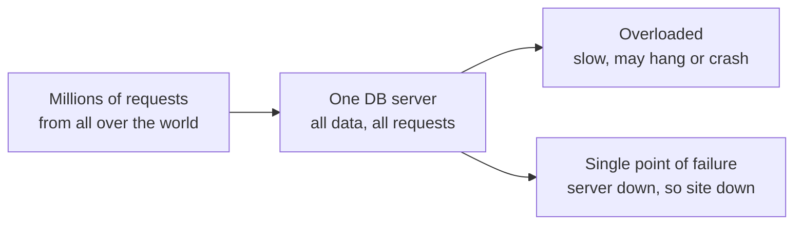
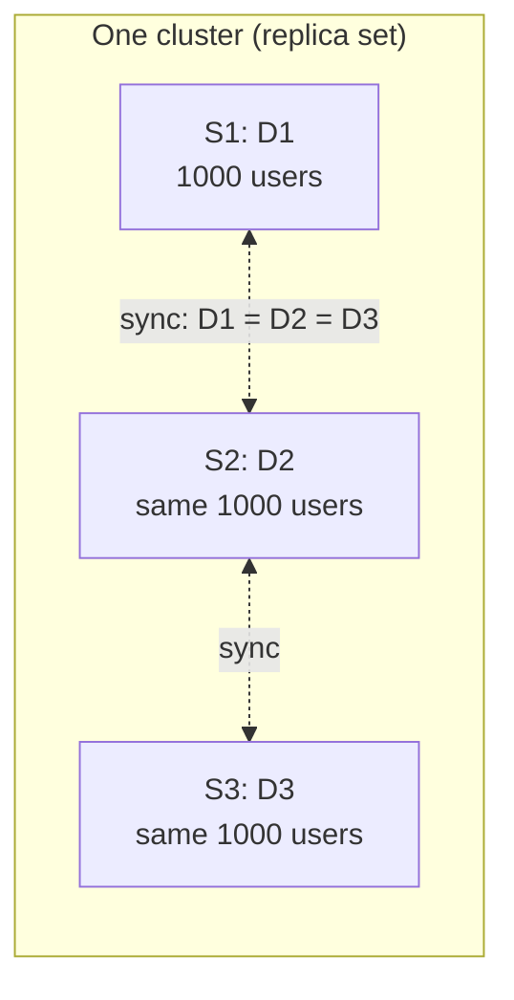
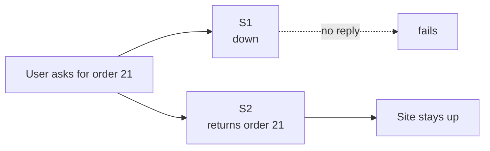
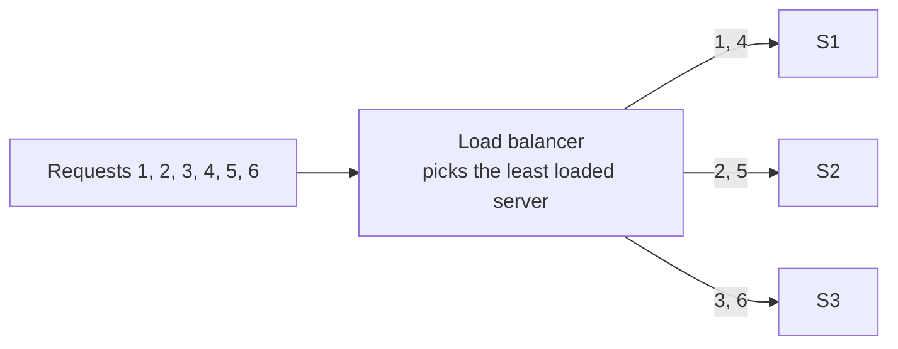
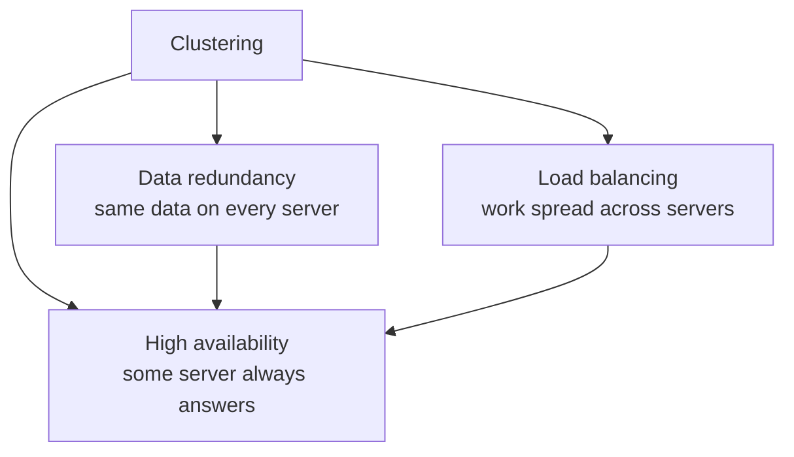
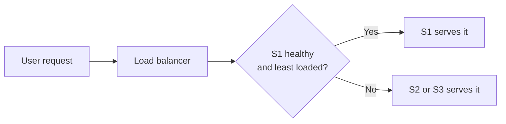

# Lecture 17: Clustering in DBMS

> **The story:** Your shop goes global. Millions of users hit one DB server every day. The server cannot keep up, so you copy it.

## 1. One server is not enough

One DB on one machine serves the whole world. A bigger machine (vertical scaling) still hits a limit. If that machine dies, the website dies.

## 2. Make replicas: the cluster

You put the same data on three servers. This group of identical servers is one cluster, also called a replica set.

| Term | Meaning |
|---|---|
| Database clustering | It is running more than one server that holds the same database. |
| Cluster | It is the group of servers (nodes) that hold the same data. |
| Replica | It is one copy of the full database on one server. |
| Node / server / host | It is a machine that stores data, takes requests and sends replies. |
| Used with | It is common in NoSQL (MongoDB replica sets) but works with SQL too. |

## 3. S1 crashes, the site stays up

A hacker attack takes S1 down. S2 still holds the same data, so it answers. The user never knows which server replied.

> **Interview:** Is this redundancy bad? No. Bad redundancy repeats data inside one DB and causes anomalies. Clustering copies the whole DB across servers on purpose, which makes the system robust.

## 4. Traffic spikes: the load balancer

A sale starts and traffic triples. A load balancer sits in front. It sends each request to the least loaded server.

Without it, one server takes every request in sequence and may crash.

## 5. The three wins

| Advantage | What it gives |
|---|---|
| Data redundancy | If one server fails, the others still have the data. |
| Load balancing | No single server is overloaded, so requests run fast. |
| High availability | The database stays reachable even when a node dies. |
| Abstraction | The user does not know which server served the request. |

## 6. How it works, end to end

Each request goes to the load balancer, then to a healthy, lightly loaded node. If a node collapses, another node takes the request. Total failure is very unlikely.

