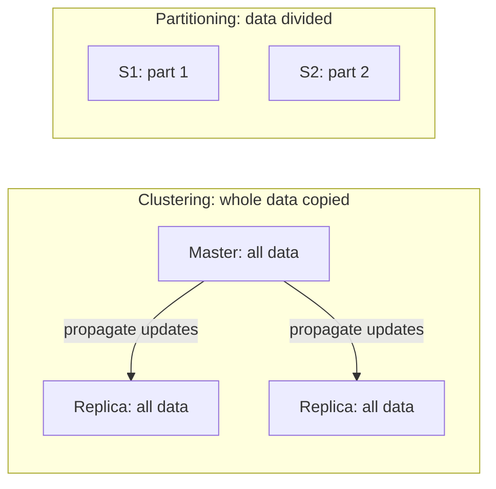

# Lecture 18: Partitioning & Sharding in DBMS (DB Optimisation)

## LEC-18: Partitioning & Sharding in DBMS (DB Optimisation)

### Context: why DB optimisation techniques are needed

- **Two problems:** A DBMS makes storing data easy. A very large system has two problems: huge data and a huge number of requests.
- **Huge data:** An application serving masses (for example a website hosted on the cloud with a live event) has data that is hard to manage on a single node. Manageability suffers.
- **Huge requests:** A single node cannot serve millions of requests properly. At some point the system may crash, or its response time becomes very high.
- **Fix:** Distribute the data. The result is a distributed database.
- **Goal:** DB optimisation techniques make data easily manageable and reduce response time.

**Option 1: Scale up (vertical scaling, increase hardware).**

1. Example: a 1 TB disk becomes 2 TB. CPU and RAM are doubled.
2. In practice, response time does not become half when everything is doubled.
3. Cost increases a lot (disk, CPU, RAM). It is an expensive bet and not logical in terms of money.

**Option 2: Clustering (replica set).**

1. Copies of the same DB instance are made, so all data is replicated (redundancy).
2. There is a master node and replicas. Updates always come to the master. The master propagates them to the replicas.
3. Propagation causes delay, and it has to be managed.
4. **Problem:** One replica may be updated while another is not yet updated.

**A better way: partitioning.** It is a level above clustering.

- **Scale out:** Partitioning is a scale-out (horizontal scaling) technique. The capacity of a single node is not increased. Data is split and new nodes are added.
- **Versus clustering:** Clustering is also horizontal scaling, because new nodes are added. But there the whole data is copied. In partitioning, the data is divided between servers.



---

1. **Idea of partitioning:** A big problem is solved easily when it is chopped into smaller sub-problems.
   - Partitioning divides a big database (data, metrics and indexes) into smaller, handy slices called **partitions**.
   - SQL queries use partitioned tables directly, without any alteration.
   - Once the database is partitioned, the data definition language works on the smaller slices instead of the giant database. This cuts down the problems in managing large tables.

2. **Partitioning across servers:** Partitioning divides stored database objects across separate servers. This increases performance and controllability of the data. We can manage huge chunks of data optimally.
   - **Problem with scale out:** When we scale out machines, relational databases give a hard time, because it is tough to maintain the relations.
   - **Solution:** Apply partitioning to a database that is already scaled out (equipped with multiple servers). Partition the database among those servers and handle the big data easily.
   - **When applied:** When response time has increased because the data is huge and traversing it takes a lot of time.
   - **Example:** A Student table (name, id, class, address, phone number) with a huge number of students.

3. **Vertical partitioning**
   1. Slice the relation vertically (column-wise).
      - Example: the first two columns go to server S1. The other two columns go to server S2.
   2. Different servers must be accessed to get complete tuples.
      - To get the complete information of one tuple, both servers must be accessed.

4. **Horizontal partitioning**
   1. Slice the relation horizontally (row-wise).
      - Example: roll no 1 to 25K on S1 and roll no 25K to 100K on S2.
   2. Independent chunks of data tuples are stored on different servers.
      - Students 1 to 10000 are fetched from S1 only, so S1 is independent of S2.

   | Type | Slice | Example | Complete tuple |
   |------|-------|---------|----------------|
   | Vertical | Columns | Two columns on S1, two on S2 | Needs both servers |
   | Horizontal | Rows | Roll no 1 to 25K on S1, rest on S2 | One server |

   ```mermaid
   flowchart LR
     T["Student<br/>name | id | class | address | phone"]
     T -- "vertical: by columns" --> V1["S1: name, id"]
     T -- "vertical" --> V2["S2: class, address, phone"]
     T -- "horizontal: by rows" --> H1["S1: roll no 1 to 25K<br/>(full tuples)"]
     T -- "horizontal" --> H2["S2: roll no 25K to 100K<br/>(full tuples)"]
   ```

5. **When is partitioning applied?**
   1. The dataset becomes so huge that managing it is a tedious task.
   2. The number of requests is so large that access to a single DB server takes huge time. So the response time of the system becomes high.
      - **Main reason:** This is the more important and better reason to apply partitioning. Tables are then divided horizontally or vertically.

6. **Advantages of partitioning**
   1. **Parallelism**
      - Chunk 1 is on S1 and chunk 2 is on S2.
      - Incoming requests are filtered by the key (for example id 1 to 10000 on S1, the rest on S2). Each request goes to the server holding its data. So requests are served in parallel.

      ```mermaid
      flowchart LR
        Q1["Request id 42"] --> S1["S1: id 1 to 10000"]
        Q2["Request id 50000"] --> S2["S2: rest"]
      ```
   2. **Availability**
      - All DB optimisation techniques increase availability (as in clustering).
      - If node S1 crashes, only the requests for S1's data are affected, not all of them.
   3. **Performance**
      - Each server is less loaded. If all the data were on one system, it would be more loaded and processing would take more time.
      - Requests are also divided between servers, so response time decreases.
   4. **Manageability**
      - A DBA who has to change something for students 1 to 10000 goes to S1 only, and it is quicker. Likewise for S2.
      - It gives a bird's-eye view: this half of the data is here, so work on it here.
   5. **Reduced cost:** Scaling up (vertical scaling) might be costly.
      - Instead of one big costly machine, use more machines of smaller capacity.
      - Each machine gets only part of the requests.

7. **Distributed database**
   1. A single logical database that is spread across multiple locations (servers) and logically interconnected by a network.
      - After partitioning, data sits on different servers. Logically it is still the same database (for example the Student table, or a university database).
   2. It is the product of applying DB optimisation techniques like **clustering, partitioning and sharding.**
   3. **Why it is needed:** Read point 5.
      - Requests have increased and data has become huge, so DB optimisation techniques are applied.

8. **Sharding**
   1. Sharding is a technique to implement horizontal partitioning.
      - It is an extension of partitioning.
   2. **Fundamental idea:** Instead of having all the data sit on one DB instance, we split it up. We introduce a **routing layer** to forward each request to the instance that holds the data.
      - **Example:** Student data. Roll no 1 to 10K is stored on S1. The rest, up to 100K, is stored on S2. This is a horizontal partition (tuple-wise: the full tuple goes to one node).
      - **Shard:** Each part is called a shard. Shard 1 holds roll no 1 to 10K. Shard 2 holds roll no above 10K to 100K. Each shard is stored on its own server. "Shard" is just a name.
      - **Independence:** Shards are independent. A request for roll no 1 to 10K goes to S1. Other requests go to S2.
      - **Routing layer:** It is a layer written in the application layer (software). It decides which shard a request goes to (S1 or S2). It is additional logic, a lookup (an intermediate layer). It is needed whenever sharding is applied.

      ```mermaid
      flowchart LR
        App["Request (roll no)"] --> RL{"Routing layer<br/>look up shard key"}
        RL -- "roll no 1 to 10K" --> SH1["Shard 1 on S1"]
        RL -- "roll no above 10K" --> SH2["Shard 2 on S2"]
      ```
      - **Invoice example:** An Invoice table has its data split between Database Shard 1 and Database Shard 2 (one colour of rows on each). The split is made on a custom id (customer id), not on the primary key (invoice id).
      - **Shard key (partition key):** The column on which the split is made. In the Student table it was student (roll no). In the Invoice table the primary key is invoice id, but the shard key can be something else (customer id).
      - **Interviews and industry:** Partitioning and sharding are used as the same thing (vertical sharding, horizontal sharding). They are not exactly synonyms. By theory, sharding is a way of horizontal partitioning.
   3. **Pros**
      1. **Scalability**
         - It is a technique to increase scalability (scale out).
         - Parallelism, availability, manageability and lower cost also follow, as listed above.
      2. **Availability**
   4. **Cons**
      1. **Complexity:** You must make the partition mapping, implement a routing layer in the system, and handle non-uniformity, which creates the need for re-sharding.
         - **Mapping:** You must identify which shard a request belongs to, based on the partition key. This needs an additional routing layer which you write yourself.
         - **Non-uniformity:** The shard key should divide the data uniformly (for example 3 rows to each node out of 6). If the shard key is not the primary key, one key value can have far more rows (for example customer id 2 has placed 10,000 orders). Then that shard gets much more data than the other. The division becomes non-uniform and the original problem comes back.

         ```mermaid
         flowchart LR
           K["Shard key: customer id"] --> A["Shard 1<br/>customer 2: 10,000 orders"]
           K --> B["Shard 2<br/>other customers: few orders"]
           A -. "overloaded, so re-shard" .-> K
         ```
         - **Re-sharding:** Handling this is your responsibility. Re-shard from time to time. That means you change the partition key and shard again.
      2. **Not well suited for analytical queries,** because the data is spread across different DB instances. This is the **scatter-gather problem.**
         - **Example:** An Invoice table has an amount column. The query is the total amount ordered by each customer. On a single node, one aggregation function (SUM) in SQL would answer it.
         - **With sharding:** The data is on multiple nodes. The query goes to the first node and finds its sum. It goes to the second node and finds its sum. Then both sums are combined.

         ```mermaid
         flowchart LR
           Q["SUM(amount) per customer"] -- "scatter" --> N1["Node 1: partial sum"]
           Q -- "scatter" --> N2["Node 2: partial sum"]
           N1 -- "gather" --> G["Combine the sums"]
           N2 -- "gather" --> G
         ```
         - **Cost:** Another layer (or the DBMS) has to handle this. This adds complexity.

- **Trade-off:** You have to give up something to gain something. Pros come with cons. Sharding and partitioning are still used a lot.
- **Clustering, partitioning and sharding:** All three are very important. Know the core idea of each for system design interview questions on how to optimise a system.

> **Interview:** You have a large number of requests on one system and must reduce response time. Shard the data across different nodes. Write a routing layer that sends each request to its particular shard. This gives manageability, scale out, scalability, availability, parallelism and performance. It avoids scaling up (vertical scaling is costly).
