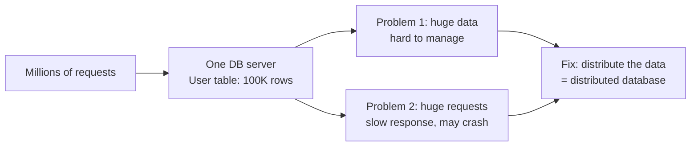
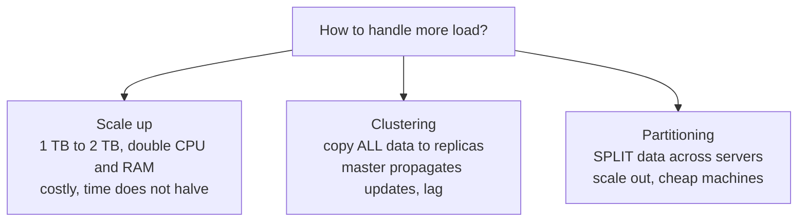
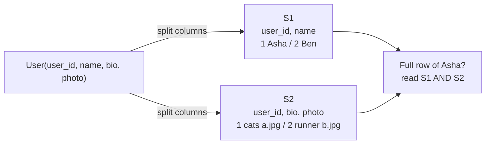
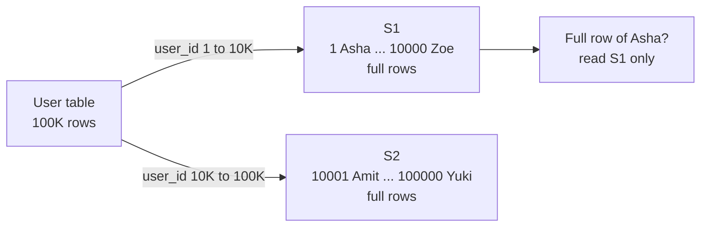
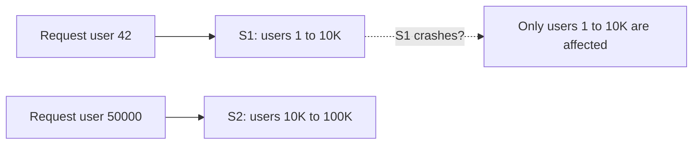
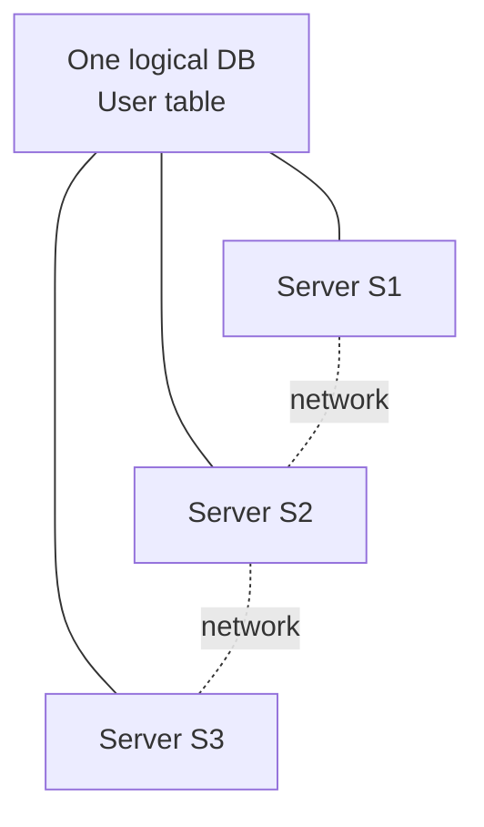
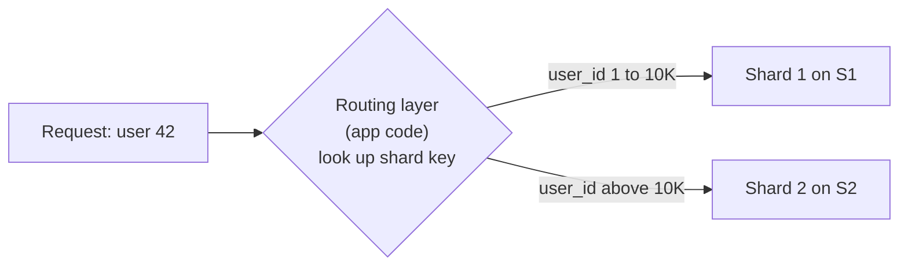
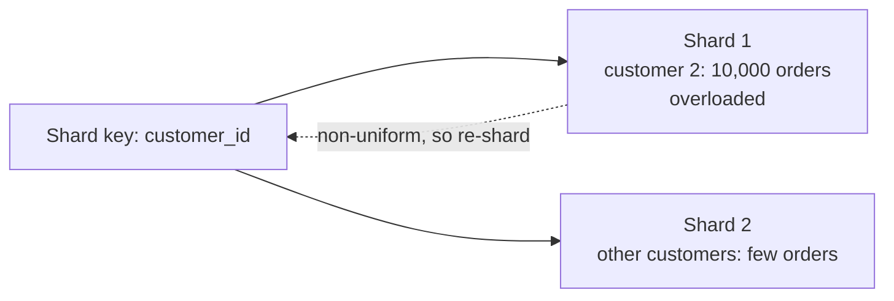
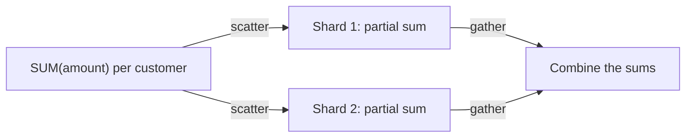
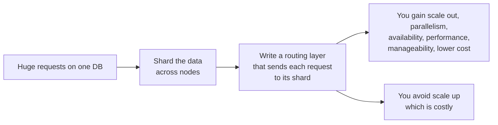

# Lecture 18: Partitioning and Sharding

> **The story:** You built a photo app. It went viral. Its User table now has 100K users and millions of requests. One DB server can no longer cope.

## 1. One server is drowning

The single server faces two problems at once. Huge data makes it hard to manage. Huge request volume makes it slow or makes it crash.

## 2. Three ways out

You weigh three options. Partitioning wins because it splits the data instead of copying it.

| Option | Scaling type | What happens to data | Catch |
|---|---|---|---|
| Scale up | Vertical | One bigger machine holds it all. | It is costly, and time does not halve. |
| Clustering | Horizontal | Every node holds a full copy. | Replicas lag behind the master. |
| Partitioning | Horizontal | Each node holds only a part. | Relations across servers are harder. |

## 3. Cut by columns: vertical partitioning

You first slice the table by columns. Small, hot columns go to S1, and heavy columns go to S2.

| user_id | name | bio | photo |
|---|---|---|---|
| 1 | Asha | loves cats | a.jpg |
| 2 | Ben | runner | b.jpg |

## 4. Cut by rows: horizontal partitioning

You then slice the table by rows instead. Each server holds full rows for one range of user_id.

| Type | Slices by | Example | Full row needs |
|---|---|---|---|
| Vertical | Columns | Name on S1, photo on S2 | It needs both servers. |
| Horizontal | Rows | Users 1–10K on S1, the rest on S2 | It needs one server. |

## 5. Why partitioning pays off

Requests now spread across servers. Each server holds less and serves less.

| Advantage | What it means |
|---|---|
| Parallelism | Different servers answer different requests at the same time. |
| Availability | A crash on one server affects only its part of the data. |
| Performance | Each server is less loaded, so response time drops. |
| Manageability | A DBA fixes users 1–10K on S1 only. |
| Reduced cost | Many small machines are cheaper than one huge one. |

Apply partitioning when the data is too big to manage or when requests make a single server slow. Heavy request load is the stronger reason.

## 6. Still one database: distributed database

The data now lives on many servers. To the app, it is still one logical database.

A distributed database is the result of clustering, partitioning and sharding.

## 7. Sharding: add a routing layer

Sharding is how you implement horizontal partitioning. Each part is a shard, and a routing layer in your app sends each request to the right shard.

The shard key need not be the PK. An Invoice table has PK invoice_id, but you can shard it by customer_id.

| Term | Meaning |
|---|---|
| Shard | A shard is one horizontal part of the table, on its own server. |
| Shard key | The shard key is the column used to split rows. It is also called the partition key. |
| Routing layer | The routing layer is app code that maps each request to its shard. |
| Re-sharding | Re-sharding means choosing a new shard key and splitting the data again. |

> **Interview:** People use "partitioning" and "sharding" as the same word. Strictly, sharding is a way to do horizontal partitioning.

## 8. Trouble 1: one shard gets too hot

You shard invoices by customer_id. Then customer 2 places 10,000 orders, and shard 1 overloads.

A good shard key spreads rows evenly. A bad one recreates the original problem, so you must re-shard from time to time.

## 9. Trouble 2: analytics need scatter-gather

The finance team asks for the total amount per customer. On one server, a single `SUM` would do. With shards, the query must visit every shard and combine the parts.

| Pros of sharding | Cons of sharding |
|---|---|
| It scales out to more servers. | You must build the mapping and the routing layer. |
| It keeps the other shards available when one fails. | A skewed shard key forces re-sharding. |
| It serves requests in parallel. | Analytical queries need scatter-gather. |

## 10. The interview answer

The interviewer says: "One system gets a huge number of requests. Reduce the response time."

