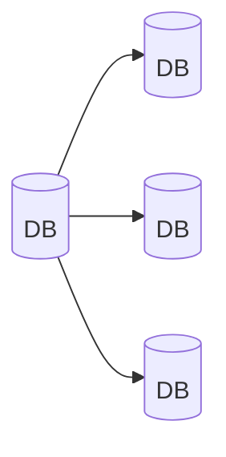
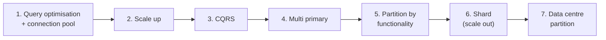
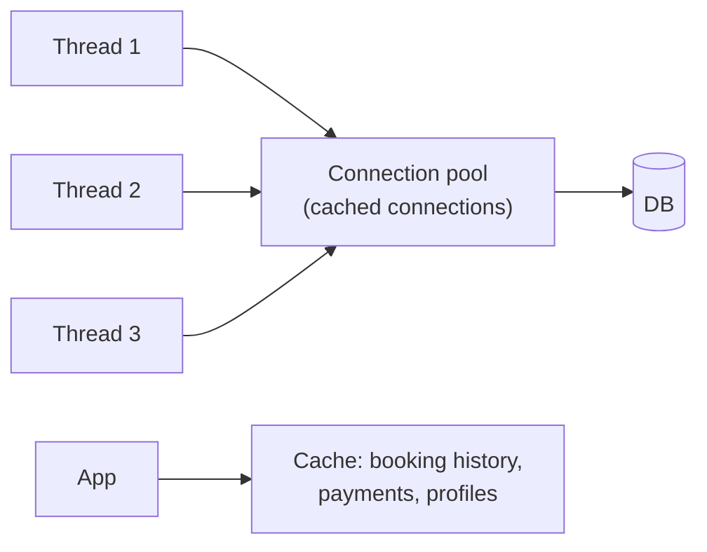
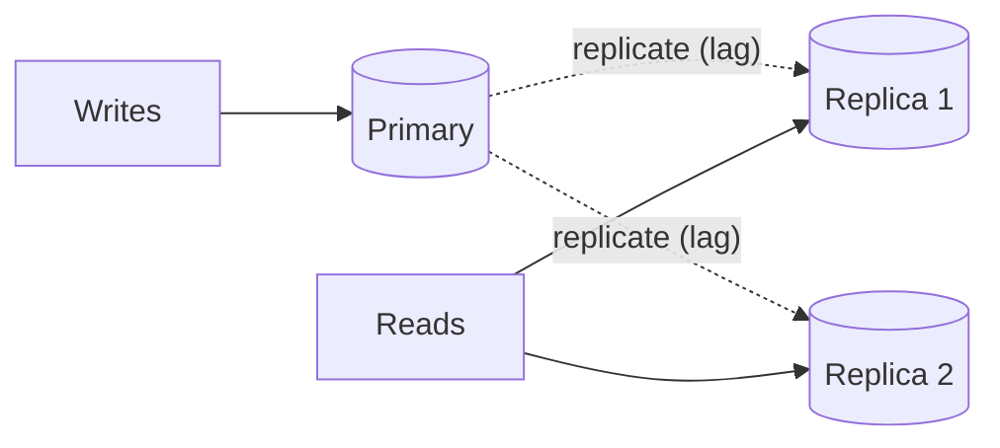
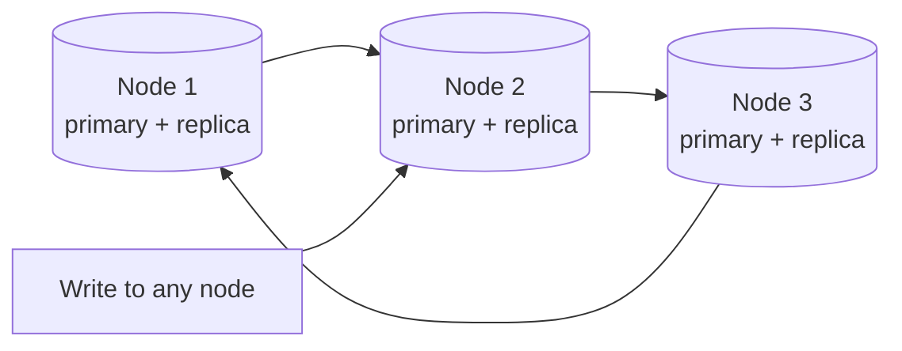
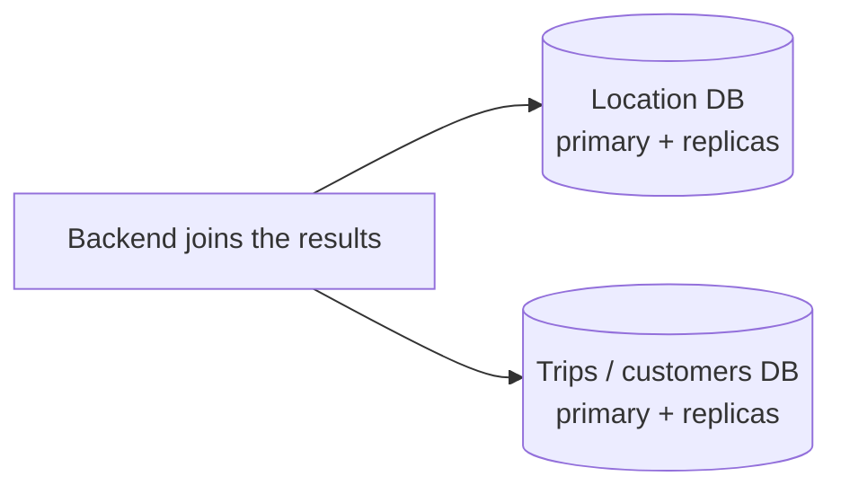
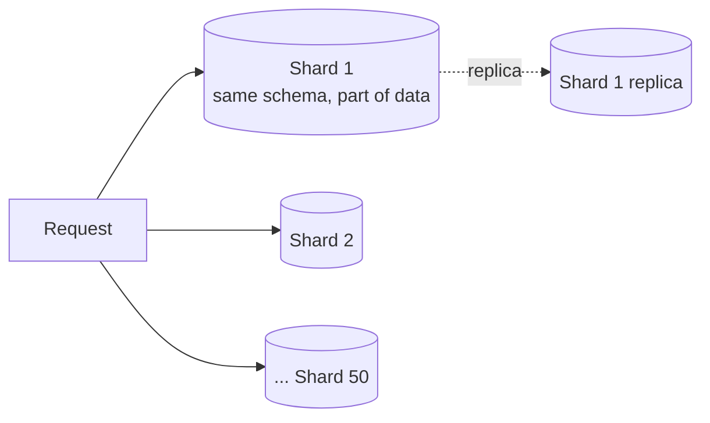
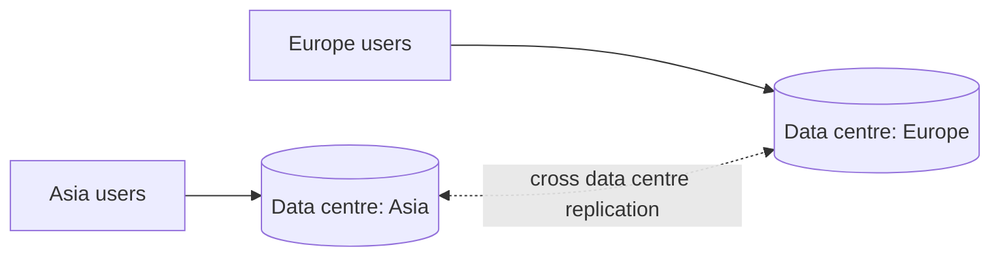

# Lecture 19: Database Scaling Patterns

Step by step scaling (Lakshay).

## What will you learn?

- **Choice:** In a step by step manner, when to choose which scaling option.
- **Feasibility:** Which scaling option is practically feasible at the moment.

## A case study

**Cab booking app.**

- **Start:** A tiny startup with about 10 customers onboard.
- **Setup:** A single small machine DB stores all customers, trips, locations, booking data and customer trip history.
- **Load:** About 1 trip booking in 5 minutes.

## Your app becomes famous, but...

The problem begins.

- **Load:** Requests scale up to 30 bookings per minute.
- **Performance:** Your tiny DB system starts performing poorly. API latency has increased a lot.
- **Failures:** Transactions face deadlock, starvation and frequent failure.
- **Experience:** The app feels sluggish. Customers are dissatisfied.

## Is there any solution?

- We have to apply some kind of performance optimisation measures.
- We might have to scale our system going forward.

## Pattern 1: Query optimisation and connection pool implementation

- **Cache data:** Cache frequently used, non-dynamic data like booking history, payment history and user profiles.
- **Redundancy:** Introduce database redundancy (or maybe use NoSQL).
- **Connection pool:** Use connection pool libraries to **cache DB connections**. Multiple application threads can use the same DB connection.

- **Result:** These are good optimisations as of now.
- **Growth:** The business scales to one more city. It now gets about 100 bookings per minute.

## Pattern 2: Vertical scaling (scale up)

- **What:** Upgrade the initial tiny machine, for example RAM by 2x and SSD by 3x.
- **Limit:** Scale up is pocket friendly only up to a point. The more you scale up, the more the cost increases exponentially.
- **Result:** This is a good optimisation as of now.
- **Growth:** The business grows. You decide to scale to 3 more cities. It now gets 300 bookings per minute.

## Pattern 3: Command Query Responsibility Segregation (CQRS)

- **Problem:** The scaled-up big machine cannot handle all read and write requests.
- **Idea:** Separate read and write operations, machine-wise (physical machines).
- **Setup:** Add 2 more machines as replicas of the primary machine.
  - All read queries go to the replicas.
  - All write queries go to the primary.

- **Growth:** The business grows. You decide to scale to 2 more cities.
- **New problems:**
  - The primary cannot handle all write requests.
  - Lag between primary and replica hurts the user experience.

## Pattern 4: Multi primary replication

- **Idea:** Why not distribute write requests to replicas also?
- **Setup:** All machines can work as primary and replica. A multi primary configuration is a logical circular ring.
  - Write data to any node.
  - Read data from any node that replies to the broadcast first.

- **Growth:** You scale to 5 more cities and your system is in pain again (about 50 requests per second).

## Pattern 5: Partitioning of data by functionality

- **Idea:** What about separating the location tables into a separate DB schema?
- **Setup:** Put that DB on separate machines, with a primary-replica or multi-primary configuration. Different DBs host data categorised by different functionality.
- **Join:** The backend (application layer) has to take responsibility for joining the results.

- **Growth:** You plan to expand your business to another country.

## Pattern 6: Horizontal scaling (scale out)

- **Sharding:** Use multiple shards. Allocate 50 machines, all with the same DB schema. Each machine holds just a part of the data.
- **Locality:** Locality of data should be there.
- **Replicas:** Each machine can have its own replicas. They may be used in failure recovery.

- **Difficulty:** Sharding is generally hard to apply. But "No Pain, No Gain".
- **Growth:** You scale the business across continents.

## Pattern 7: Data centre wise partition

- **Problem:** Requests travelling across continents have high latency.
- **Idea:** Distribute traffic across data centres. Place data centres across continents.
- **Replication:** Enable cross data centre replication. It helps disaster recovery.

- **Availability:** This always maintains the availability of your system.
- **Next:** Now, plan for an IPO. :p
