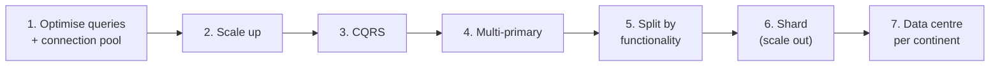
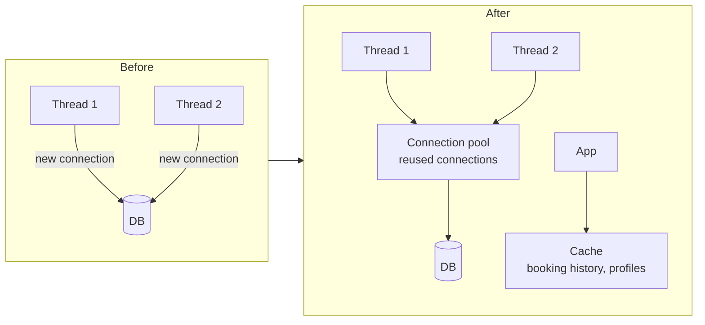
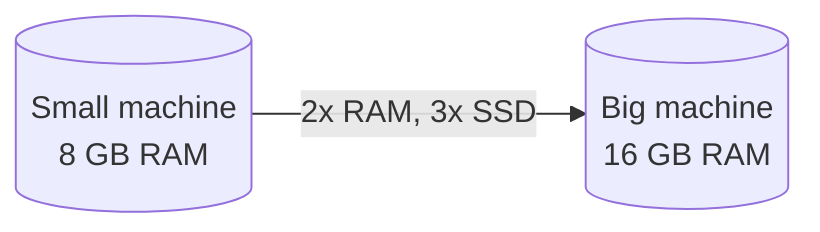
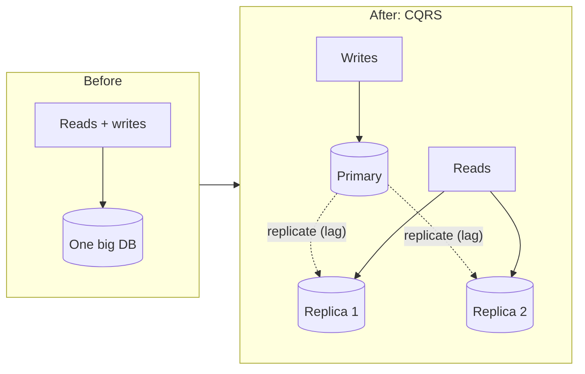
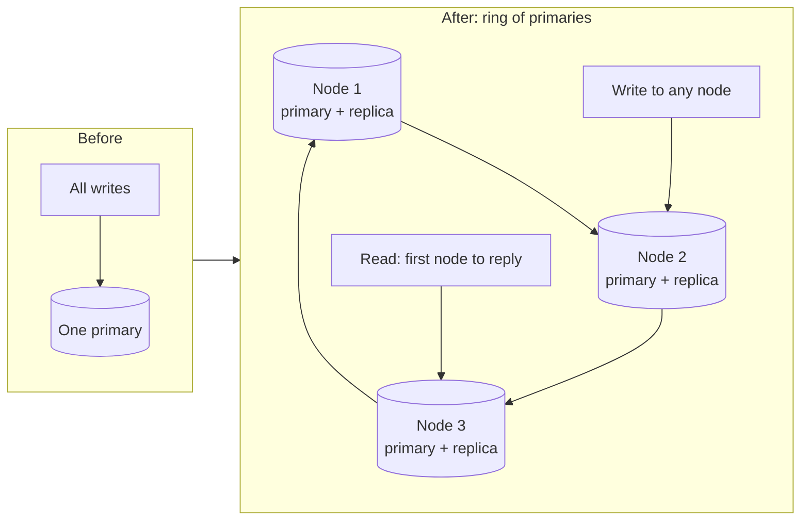
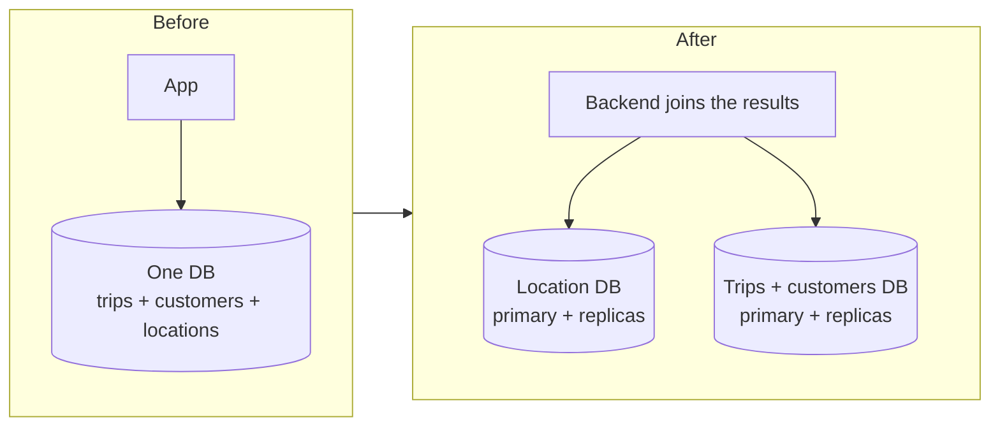
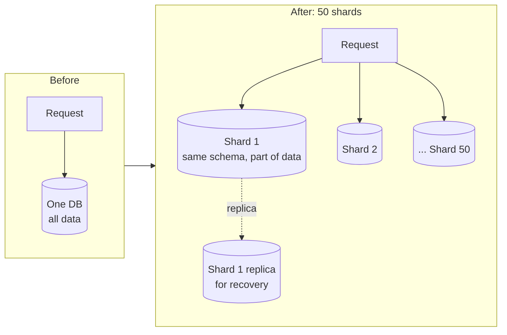
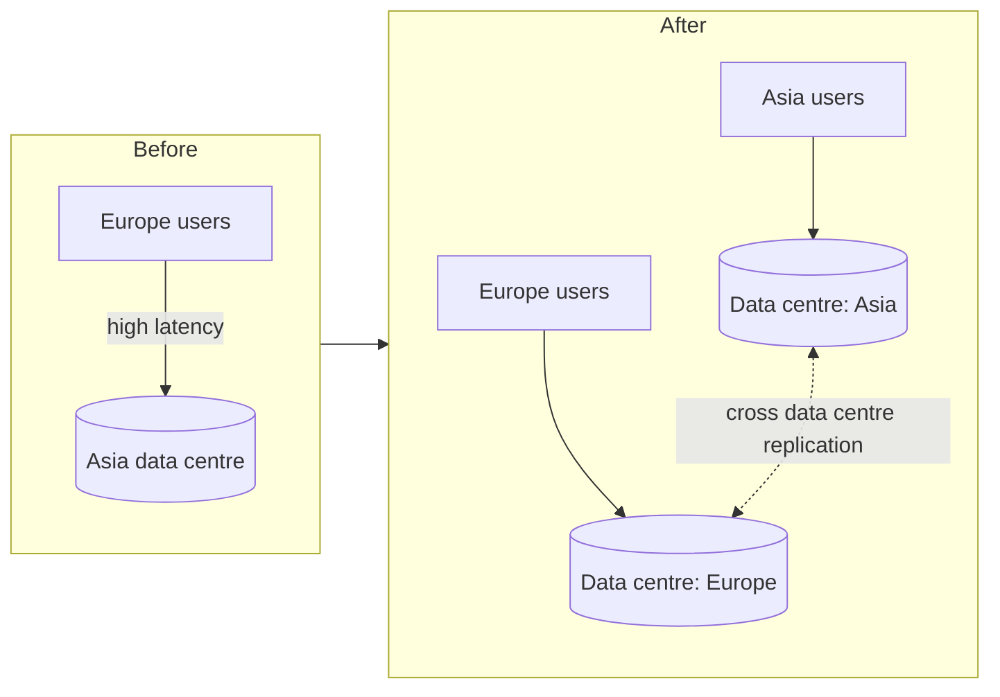

# Lecture 19: Database Scaling Patterns

> **The story:** You start a cab booking app with 10 customers and one small DB. The app gets famous. Each time the load grows, the DB starts to hurt, and you apply the next scaling pattern.

| Stage | Load | Pattern |
|---|---|---|
| 1 city | 30 bookings/min | Optimise queries and pool connections. |
| 2 cities | 100 bookings/min | Scale up the machine. |
| 5 cities | 300 bookings/min | Split reads and writes (CQRS). |
| 7 cities | Writes overload the primary. | Let every node take writes. |
| 12 cities | 50 requests/sec | Split data by functionality. |
| New country | The data is too big for one DB. | Shard across many machines. |
| New continents | Latency is high. | Add a data centre per continent. |

## 1. The app gets famous: optimise first

Bookings jump from 1 per 5 minutes to 30 per minute. APIs slow down, and transactions deadlock and fail.

| Fix | What it does |
|---|---|
| Cache | It stores data that rarely changes, such as booking history and profiles. |
| Redundancy | It adds DB redundancy, or moves some data to NoSQL. |
| Connection pool | It reuses cached DB connections across many app threads. |

## 2. One more city: scale up

Load reaches 100 bookings per minute. You buy a bigger machine.

> **Interview:** Scale up is cheap only at first. Beyond a point, the cost grows exponentially.

## 3. Three more cities: split reads and writes (CQRS)

Load reaches 300 bookings per minute. One machine cannot serve all reads and writes.

CQRS stands for Command Query Responsibility Segregation. It puts reads and writes on separate machines.

| Problem left | Why it hurts |
|---|---|
| Write overload | The single primary still takes every write. |
| Replication lag | A replica can return stale data to the user. |

## 4. Writes overload the primary: multi-primary

Two more cities join. You let every node accept writes.

Every node is both primary and replica. The nodes form a logical ring.

## 5. Fifty requests per second: split by functionality

Five more cities join. You move the location tables into their own DB.

> **Interview:** The DB can no longer join across these DBs. The backend must join the results.

## 6. A new country: shard (scale out)

The data is now too big for one schema on one machine. You spread it over 50 machines.

| Sharding rule | Detail |
|---|---|
| Schema | Every shard has the same schema. |
| Data | Each shard holds only a part of the data. |
| Locality | Related data should live on the same shard. |
| Replicas | Each shard can have replicas for failure recovery. |
| Cost | Sharding is hard to apply, but it scales the furthest. |

## 7. New continents: a data centre per region

Requests that cross continents are slow. You place a data centre on each continent.

Users hit the nearest data centre, so latency drops. Cross data centre replication gives disaster recovery and keeps the system available.

## 8. All seven patterns at a glance

| # | Pattern | Solves | New cost |
|---|---|---|---|
| 1 | Query optimisation + pool | It removes slow queries and connection overhead. | None yet. |
| 2 | Scale up | It adds CPU, RAM and disk to one machine. | Cost grows exponentially. |
| 3 | CQRS | It moves reads to replicas. | Replication lag appears. |
| 4 | Multi-primary | It spreads writes over all nodes. | Nodes must sync writes. |
| 5 | Split by functionality | It puts each feature's data on its own DB. | The backend must join. |
| 6 | Sharding | It spreads data over many machines. | It is hard to build. |
| 7 | Data centre per region | It cuts cross-continent latency. | Data centres must replicate. |
