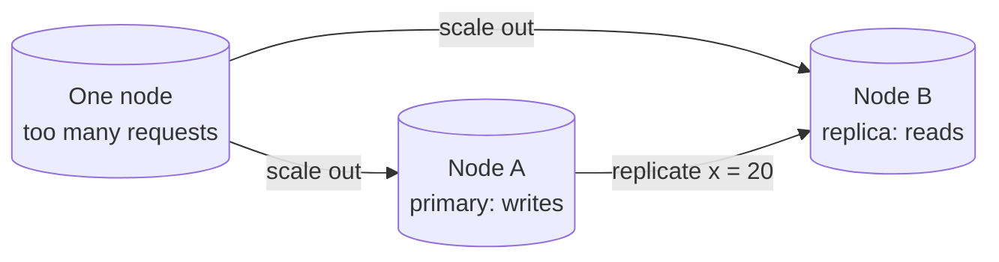
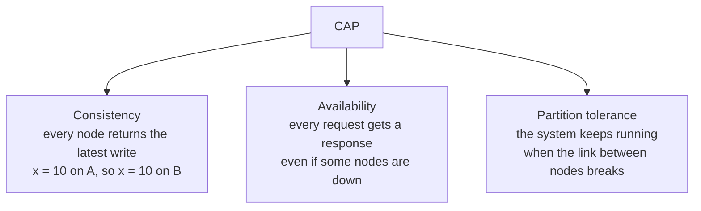
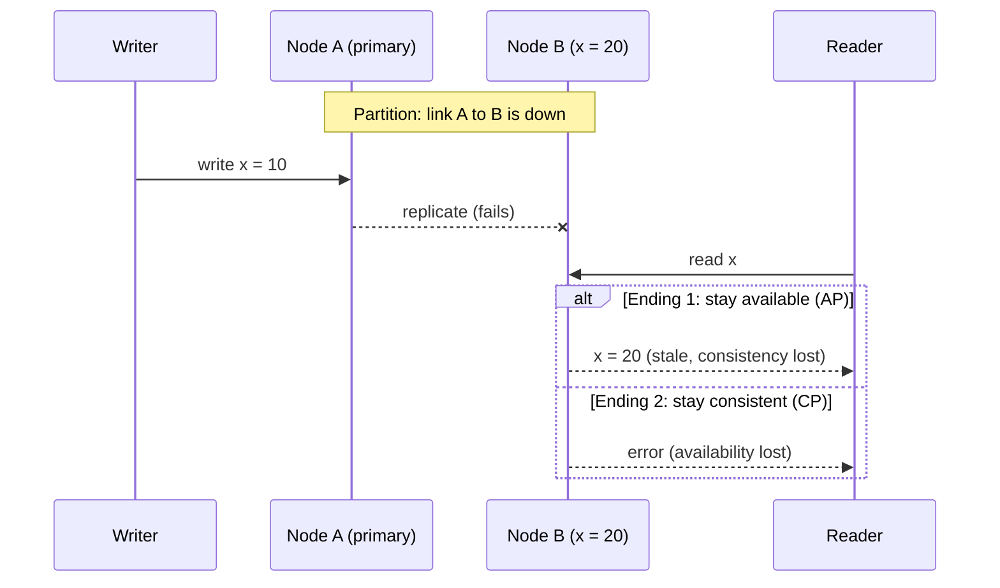
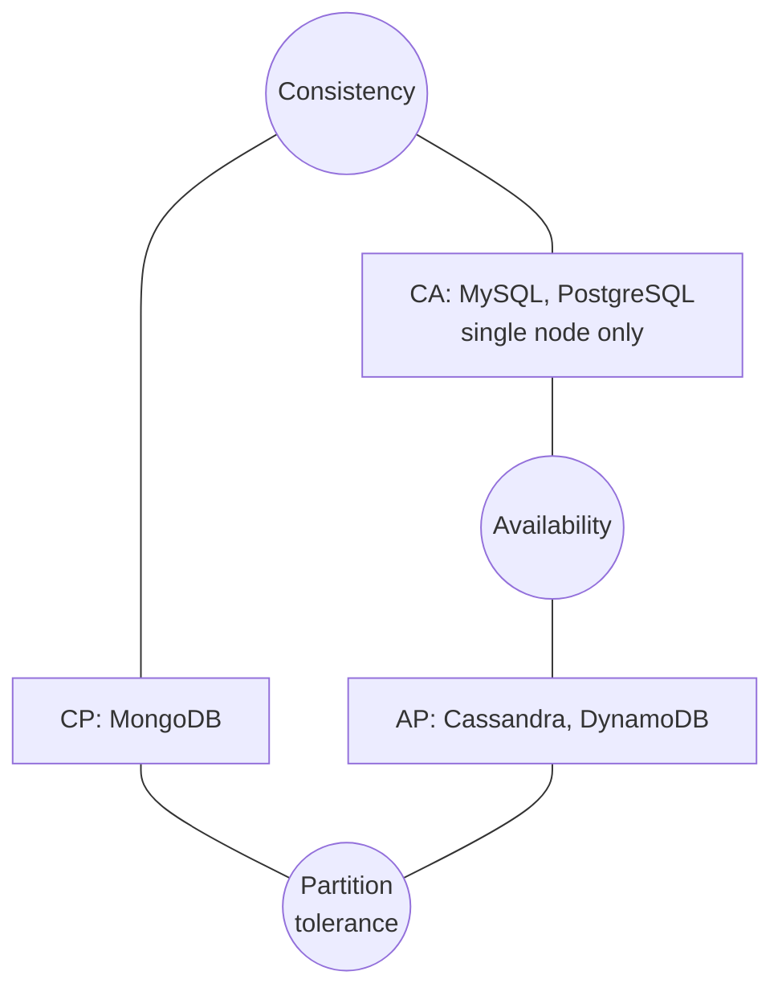
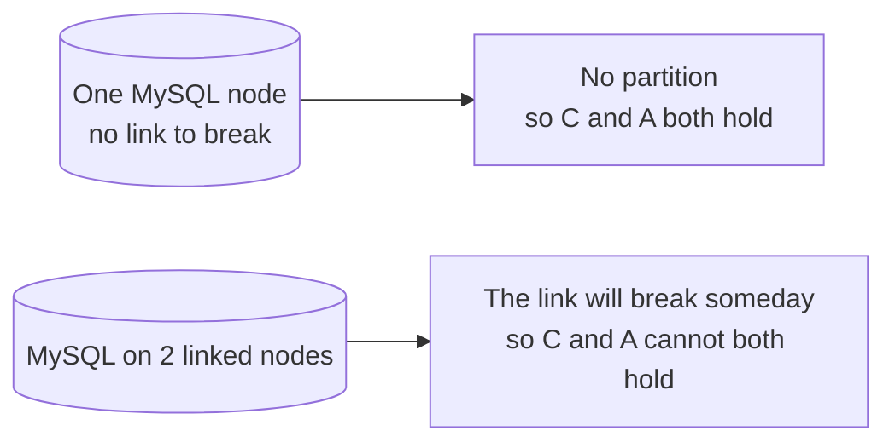
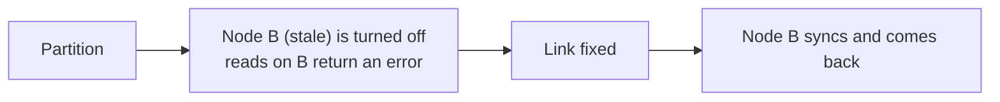
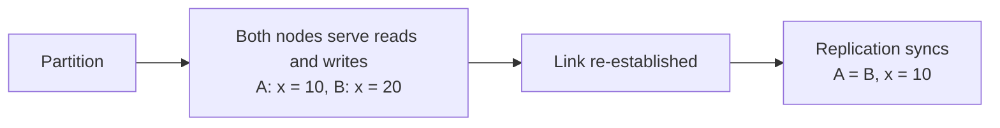
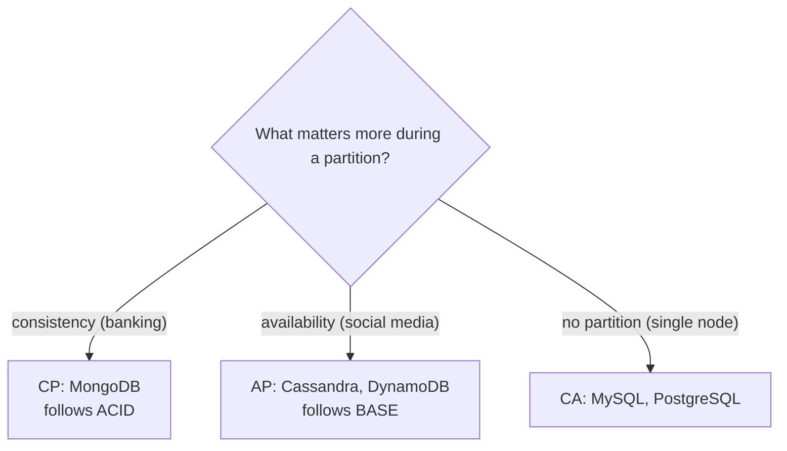

# Lecture 20: CAP Theorem

> **The story:** Your app's database grew too big for one machine. You split it into Node A (primary, takes writes) and Node B (replica, takes reads). One day the network link between them breaks.

## 1. Why there are two nodes at all

One node could not handle the load. You scaled up as far as you could, then scaled out.

## 2. The three properties

Each letter of CAP is one promise the system can make.

| Property | Promise |
|---|---|
| Consistency | Every read returns the most recent write, on every node. |
| Availability | Every request gets a response. The response may be stale. |
| Partition tolerance | The system survives dropped or delayed messages between nodes. |
| Partition | A partition is a break in communication between nodes. |

## 3. The link breaks

A writer sets x = 10 on Node A. The link is down, so Node B still holds x = 20. A reader now asks Node B for x.

The CAP theorem says this: during a partition, you must give up either consistency or availability. A distributed system gets only two of the three.

## 4. Pick two

Partitions always happen in a distributed system. So the real choice is CP or AP.

| Type | Gives | Gives up | Examples |
|---|---|---|---|
| CA | It gives consistency and availability. | It gives up partition tolerance. | MySQL, PostgreSQL on one node |
| CP | It gives consistency and partition tolerance. | It gives up availability. | MongoDB |
| AP | It gives availability and partition tolerance. | It gives up consistency. | Cassandra, DynamoDB |

## 5. CA: the single-node ending

CA works only when a partition can never happen. That means one node, which is not distributed.

## 6. CP: the bank's ending

A bank cannot show 1 lakh on one node and 2 lakh on another. It switches off the stale node until the link is fixed.

| CP fact | Detail |
|---|---|
| Writes | Only one primary node takes all writes in a replica set. |
| Failover | A secondary takes over if the primary fails. |
| Example | MongoDB is a schema-less document DB and is CP. |
| Use case | Banking uses CP. Downtime is acceptable, wrong balances are not. |

## 7. AP: the social media ending

A feed must never go down. Both nodes keep serving, and they agree again later.

This is **eventual consistency**: the nodes become consistent once the partition heals.

| AP fact | Detail |
|---|---|
| Primary | Cassandra has no primary node, so every node stays available. |
| Stale reads | A user on a stale node may see old data for a while. |
| Recovery | The nodes sync after the partition is resolved. |
| Use case | Social media uses AP. A slightly old feed is acceptable, downtime is not. |

## 8. Which database do you choose?

The business decides what matters more during a partition.

## 9. ACID vs BASE

> **Interview:** ACID vs BASE is a common interview question.

| | ACID | BASE |
|---|---|---|
| Stands for | It stands for Atomicity, Consistency, Isolation, Durability. | It stands for Basically Available, Soft state, Eventual consistency. |
| Priority | It puts correctness first. | It puts availability first. |
| Consistency | Data is consistent after every transaction. | Data becomes consistent eventually. |
| Fits | It fits CP systems such as banking. | It fits AP systems such as social media. |
