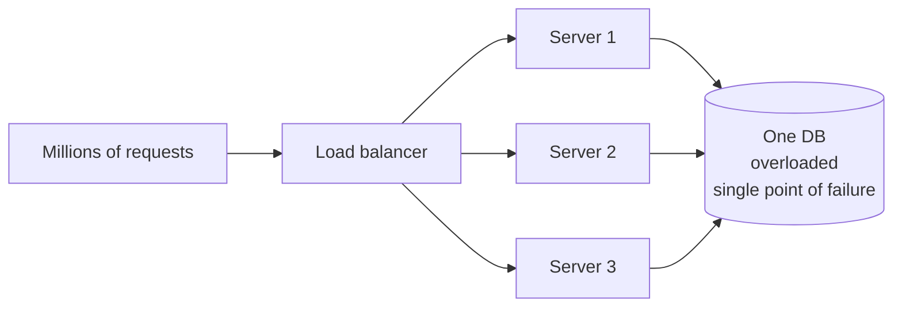
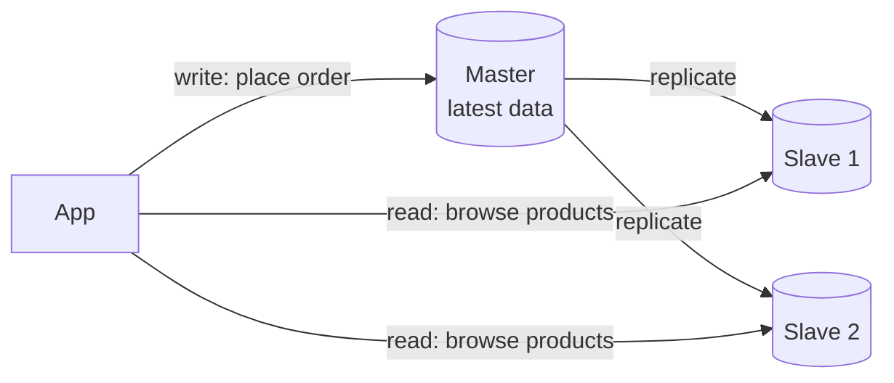
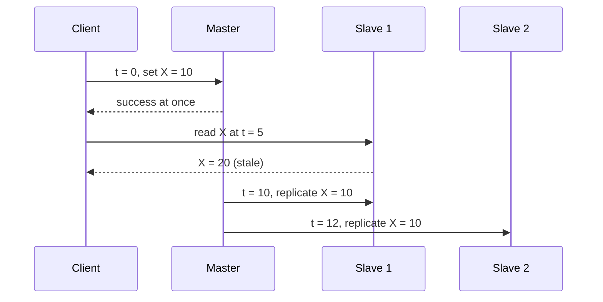
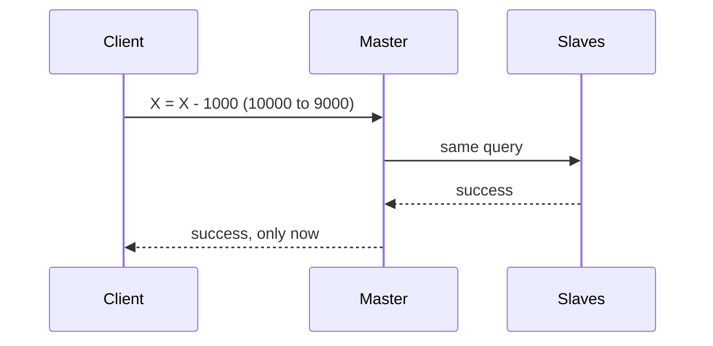
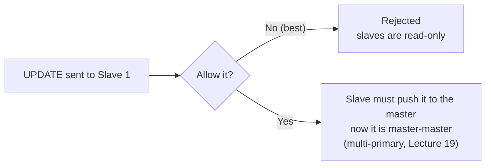
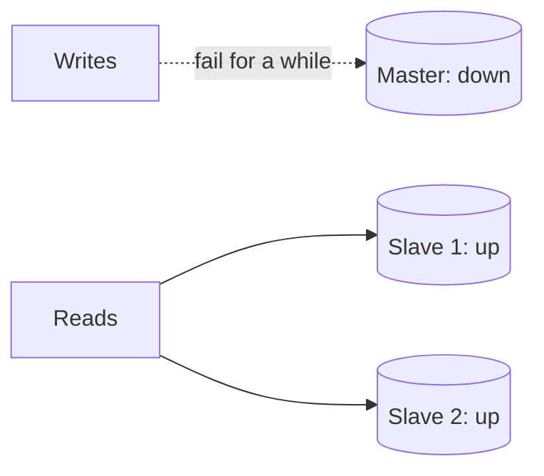

# Lecture 21: Master-Slave Database

> **The story:** Your shop goes viral. Millions of people browse products, but only a few place orders. One database cannot keep up, so you give it helpers.

## 1. One DB drowns

Three servers sit behind a load balancer, but all of them hit the same DB. If that DB crashes, the whole shop stops.

## 2. Hire helpers: master and slaves

You copy the DB onto more machines. The master takes every write. The slaves copy from the master and serve every read.

| Role | Takes | Other names |
|---|---|---|
| Master | It takes only writes. It always holds the latest data. | It is also called the primary or owner DB. |
| Slave | It takes only reads. It copies new data from the master. | It is also called a replica. |

> **Interview:** "What is the master-slave model?" is asked directly. Today it is often called primary-replica. It is the CQRS pattern from Lecture 19.

The master and slaves can use different data models, such as a PostgreSQL master with MongoDB slaves. Then you must write code to translate the replicated data.

## 3. Replication, ending 1: asynchronous

A customer changes X from 20 to 10. The master says "done" at once. The slaves catch up a few seconds later, so an early read can be stale.

## 4. Replication, ending 2: synchronous

A UPI payment drops a balance from 10000 to 9000. A stale 10000 would be wrong, so the master waits for every slave before saying "done".

| Type | Write returns | Read on slave | Use when |
|---|---|---|---|
| Asynchronous | It returns right after the master writes. | It may be stale for a few seconds. | A small delay is fine, as in cab booking. |
| Synchronous | It returns after all slaves also succeed. | It is always the latest. | No delay is allowed, as in banking or UPI. |

The async delay must stay in seconds, never hours.

## 5. A write lands on a slave

A buggy server sends an update to Slave 1. The rule says slaves never accept writes.

## 6. The master dies

The master crashes during a sale. Customers can still browse, but nobody can order until the master returns.

Only part of the system fails, not the whole system. For writes that survive a dead master, use multi-primary.

## 7. Why it pays off

| Advantage | Meaning |
|---|---|
| Backup | Reads still work when the master goes down. |
| Read scale-out | You add slaves instead of buying one huge machine. |
| Lower latency | Reads spread out, so responses come faster. |
| Availability | Reads no longer have a single point of failure. |
| Parallelism | Slaves serve read requests at the same time. |

It fits apps with few writes and many reads.
