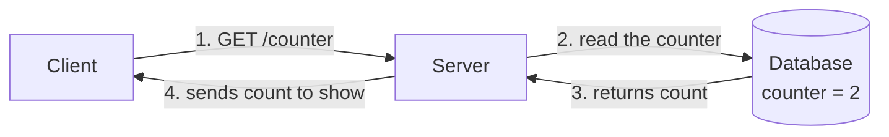

# 1. Why System Design

Any developer can build a small app that runs on one PC. System design asks what happens when many users use that app at once. It builds on development and Core CS, and it separates a senior engineer from a junior one.

## Key terms

| Term | Meaning |
|------|---------|
| System design | System design is planning how the parts of a software system fit together so it works at scale. It has two parts, HLD and LLD. |
| HLD | HLD (high-level design) picks the big parts, such as servers and databases, and shows how requests flow between them. These notes cover HLD. |
| LLD | LLD (low-level design) plans the classes and code inside one part. |
| Client | A client is the user's device or browser. It sends requests and shows the results. |
| Server | A server is a machine that runs the backend code. It answers client requests. |
| Database (DB) | A database stores the app's data so it lasts. The server reads and writes it. |

## How it works

The example app is the Live Counter. Its page shows one number and two buttons. **Increase** adds 1 to the count, and **Refresh** reads the latest count. Real products show the same kind of counter, such as likes on Instagram, live views on JioHotstar and likes on YouTube.

The app has a React frontend (the client), an Express backend (the server) and a MongoDB database. A junior engineer sees this data flow:

1. **API call:** The client sends `GET /counter` to the server.
2. **Query:** The server asks the DB for the count.
3. **Result:** The DB returns the count, for example 2.
4. **Show:** The server sends the count back, and the frontend shows it.

A second endpoint, `POST /increment`, adds 1 to the count in the same way.

## Trade-offs

| | Junior engineer | Senior engineer |
|---|-----------------|-----------------|
| Skills | The engineer knows development and one cloud platform, such as launching an AWS EC2 server. | The engineer also knows system design. |
| What they see | They see the data flow. | They see the issues in the same flow: too many users at once, a server crash, the limit of the DB and connection problems. |

A senior engineer also asks the right questions before building anything:

- **Load:** What happens if 1 million users call `GET /counter`?
- **Same moment:** What happens if 100 users call it at the exact same time?
- **DB failure:** What happens if the DB is slow or down?
- **Correctness:** Is `counter = 2` always correct?
- **Product:** What does the product need?

> **Interview:** Do not jump to a solution or name every component. First ask what the product needs, then finish a design you can defend.

## Likely questions

- **What is system design?** It is planning how the parts of a system fit together so it works at scale. It has two parts, HLD and LLD.
- **How is HLD different from LLD?** HLD picks the big parts and how they connect. LLD plans the classes and code inside one part.
- **What does a junior engineer miss?** A junior engineer sees only the data flow. A senior engineer also sees what breaks under load, crashes and slow databases.
- **What do you do first in a design round?** You ask what the product needs. The answers become the requirements (topic 2).
- **What does system design build on?** It builds on development and Core CS, which both rest on basic programming and DSA.
