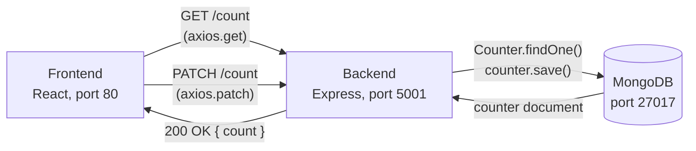
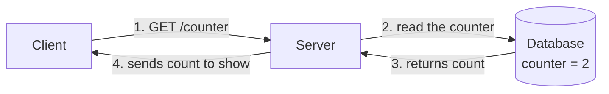

# 1. Why System Design

## The example app: Live Counter

The page shows one number and two buttons.

- **Count card:** It shows the current count, for example `2`.
- **Increase button:** It adds 1 to the count.
- **Refresh button:** It reads the latest count again.

The same problem appears in real products.

| Product | Counter it shows |
|---------|------------------|
| Instagram or X post | Likes (36.7K), comments (7.4K) |
| JioHotstar live stream | Live views (50.3 crore) |
| YouTube video | Likes (13K) and dislikes (122K) |

In 2021, YouTube hid the public dislike count. The goal was to reduce "dislike attacks", where many users dislike one video together.

## How the app is built

The app has three parts: a React frontend, an Express backend, and a MongoDB database. Docker runs all three.



1. **Frontend (React):**
   - **State:** It keeps three values: `count`, `loading` and `error`.
   - **fetchCount:** It calls `axios.get(API_URL)` and shows `response.data.count`. On failure it shows "Failed to connect to server".
   - **increaseCount:** It calls `axios.patch(API_URL)` and shows the new count.
   - **Buttons:** Both buttons stay disabled while a request is loading.

2. **Backend (Express):**

   ```js
   // GET /count - Get current count
   app.get('/count', async (req, res) => {
     let counter = await Counter.findOne();
     if (!counter) {
       counter = new Counter({ count: 0 });
       await counter.save();
     }
     res.json({ count: counter.count });
   });

   // PATCH /count - Increment count
   app.patch('/count', async (req, res) => {
     let counter = await Counter.findOne();
     if (!counter) counter = new Counter({ count: 0 });
     counter.count += 1;
     await counter.save();
     res.json({ count: counter.count });
   });
   ```

   - **Errors:** The full code wraps each route in `try/catch`. On an error, it returns `500` with the error message.

3. **Database (MongoDB with Mongoose):**
   - **Schema:** One field, `count`, of type Number with default 0.
   - **Model:** `mongoose.model('Counter', counterSchema)`.
   - **connectWithRetry:** The backend tries to connect to `MONGO_URI`. If it fails, it logs the error and retries every 5 seconds.

4. **Docker Compose:**

   ```yaml
   services:
     mongodb:
       image: mongo:latest
       ports: ["27017:27017"]
       volumes: [mongo-data:/data/db]
     backend:
       build: ./backend
       ports: ["5001:5001"]
       environment:
         - MONGO_URI=mongodb://mongodb:27017/live-counter
       depends_on: [mongodb]
     frontend:
       build: ./frontend
       ports: ["80:80"]
   ```

## Engineer levels

Anyone who learns development can build this app and run it on a PC. The levels differ in what else the engineer knows.

| Level | Skills |
|-------|--------|
| Learner (DEV) | HTTP and HTTPS basics, client-server architecture, REST APIs, databases (SQL and NoSQL), authentication and authorization, Git and version control |
| Junior Engineer (DEV + CLOUD) | Everything above, plus one cloud platform (for example launching an AWS EC2 instance), debugging and logging, deployment and hosting, environment variables and configuration, unit and integration testing |
| Mid-Level or Senior Engineer (DEV + CLOUD + ?) | Everything above, plus system design |

- **EC2 launch:** You pick a name, an OS image (AMI, for example Amazon Linux 2023), an instance type (for example `t2.micro`), a security group (firewall) and storage (for example 8 GiB).
- **The edge:** Cloud skills alone do not give you an edge. System design does.

## What a junior engineer sees

A junior engineer sees the data flow. From here on, the endpoints are written as `GET /counter` and `POST /increment`. They do the same job as `GET /count` and `PATCH /count` above.



1. The client makes an API call.
2. The server queries the DB.
3. The DB returns the count.
4. The server sends it back to the frontend to show.

## What a senior engineer sees

A senior engineer sees **potential issues** in the same flow.

- **Traffic:** What if too many users use it at the same time?
- **Crash:** What if the server crashes?
- **Database limit:** What is the limit of the database?
- **Network:** What about connection issues?

A senior engineer also asks the **right questions**.

1. If 1 million users call `GET /counter`, what happens?
2. If 100 users call it at the exact same time, what happens?
3. If the DB is slow or down, what happens?
4. Is `counter = 2` always correct?
5. What does the product need?

> **Interview:** Do not jump to a solution. First ask what the product needs. The answers become the requirements.

## The learning path

| Level | DSA | Development | HLD |
|-------|-----|-------------|-----|
| Level 1 | Learn a language | HTML, CSS, JS, Git | Concepts in these notes |
| Level 2 | Solve 200 to 400 LeetCode problems on different topics | Build one full-stack app end to end | Tactics and concepts used in industry |
| Level 3 | Learn problem patterns and tactics | Cloud deployment, Docker, performance tuning | Standard books like DDIA (Designing Data-Intensive Applications) |
| Level 4 | Prepare for ICPC | GSoC, Kubernetes (K8s) | Deep dives into real technologies |

- **Level 3 and 4 topics:** You are not expected to know storage engine internals or deep database tuning before level 3 or 4.
