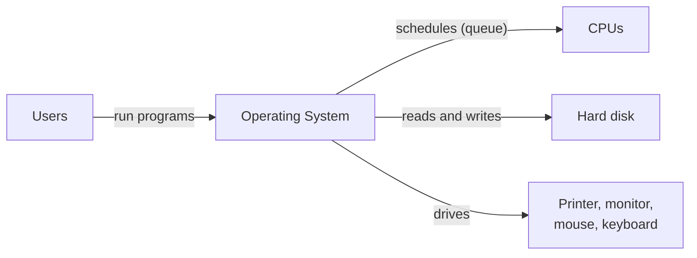
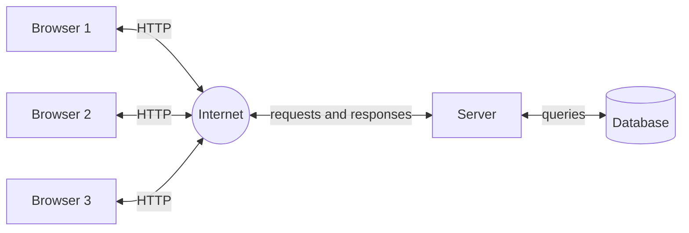
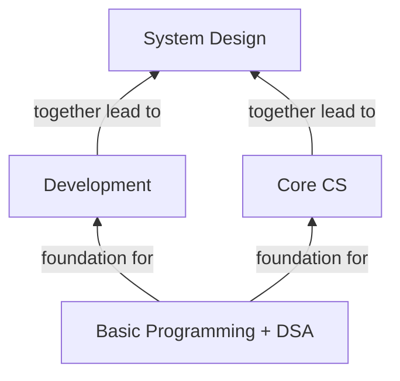
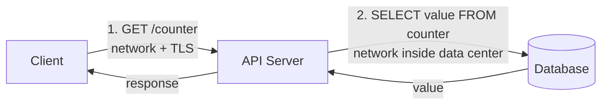

# 3. One Computer, Many Computers, and Latency

Ready-made software and hardware pieces already solve most NFRs (topic 2). AWS alone has hundreds of services. You only need to know a few of them to solve about 95% of problems. You must know how to use them.

## One computer first

A computer has a motherboard, a CPU (for example Intel Core i7), a hard disk and RAM.

1. **Compile:** You write code in `test.c`. The compiler turns it into assembly.

   ```c
   int main(){
       int x = 5;     // line 1
       int y = x+2;   // line 2
   }
   ```

   `gcc -S -o test.s test.c` gives `test.s`. Part of it:

   ```asm
   mov  w8, #5          ; x = 5
   str  w8, [sp, #12]   ; store x
   ldr  w8, [sp, #12]   ; load x
   add  w8, w8, #2      ; x + 2
   str  w8, [sp, #8]    ; store y
   ```

2. **Run:** The instructions run on the CPU.
   - **Instruction format:** `opcode r1, r2, r3`.
   - **Register file:** It reads two registers (Read Reg 1, Read Reg 2) and gives Read Data 1 and Read Data 2. It writes the result back to a Write Register.
   - **ALU:** It does the operation chosen by the 3-bit "ALU op" signal. It outputs the Result and a Zero flag.

3. **Many programs:** Many programs run at once. They all need the same CPU.
   - **Fairness:** Programs wait in a queue (enqueue at the back, dequeue at the front). Each one gets a fair turn.

4. **Other hardware:** Programs also need the printer, monitor, mouse, keyboard and disk.

5. **Many users:** Many users share the same computer.

6. **The OS:** The operating system manages all of this. It sits between the users, the programs, the CPUs, the disk and the devices.



## Many computers

A web app spreads one computer's job over many computers.



- **Different places:** The client, the server and the database can sit in different parts of the world. For example, the client is in North America, the server in Europe and the database in India.
- **Core CS:** CPUs, the OS, networks and databases are studied in Core CS subjects.

**Where system design sits:**



## Latency: the problem

Every request crosses two network hops. Each hop adds time.



### 1) Client to server (network + TLS)

| Situation | Added latency |
|-----------|---------------|
| Same region (client nearby, good network) | 10 to 50 ms |
| Cross-country, mobile, or bad network | 50 to 200+ ms |
| TLS handshake (only for a new connection) | adds 20 to 100 ms |

- **TLS:** The encryption layer of HTTPS. A new connection first runs a handshake to agree on keys.

### 2) Server to DB (network inside the data center or VPC)

| Situation | Added latency |
|-----------|---------------|
| Same VPC, same region | 0.2 to 2 ms |
| Across AZ, or slightly farther | 1 to 5 ms |
| DB outside, over VPN or public internet | 10 to 50 ms. Avoid this. |

- **VPC:** Virtual Private Cloud. A private network for your servers inside the cloud.
- **AZ:** Availability Zone. A separate data center inside one region.

> **Interview:** Keep the server close to the user and the DB close to the server. A server near the user but far from the DB is still slow, because every query crosses the long hop.
