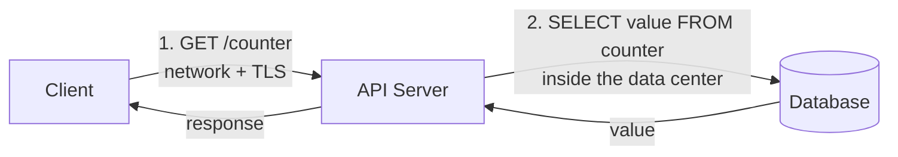

# 3. One Computer, Many Computers, and Latency

Ready-made software and hardware already solve most NFRs (topic 2). You need only a few of them for about 95% of problems, but you must know how to use them. This topic starts with one computer, then spreads the app over many computers and shows where the time goes.

## Key terms

| Term | Meaning |
|------|---------|
| Disk | The disk is slow storage that keeps all files, such as a hard disk (HDD) or an SSD. |
| RAM | RAM is fast memory. A program is loaded from the disk into RAM when it needs to run. |
| Network call | A network call is a request one machine sends to another over the network, such as client to server. |
| Latency | Latency is the time one request takes to get a response. Every network call adds latency. |

## How it works

**One computer:**

1. **Compile:** The compiler turns your code into assembly instructions.
2. **Run:** The instructions run on the CPU. Data sits on the disk, is loaded into RAM, and is worked on in the CPU.
3. **Many programs:** Many programs need the same CPU. They wait in a queue, so each one gets a fair turn.
4. **Other hardware:** Programs also need the disk, printer, monitor, mouse and keyboard.
5. **Many users:** Many users share the same computer. The operating system (OS) manages the users, programs, CPUs, disk and devices.

**Many computers:** A web app spreads this job over many machines. Browsers reach the server over the internet, and the server queries the database. The client, server and DB can sit on different continents, such as North America, Europe and India. Every request then makes two network calls, and each one adds latency. TLS is the encryption layer of HTTPS. A new connection first runs a TLS handshake to agree on keys.

A VPC (virtual private cloud) is a private network for your servers in the cloud. An AZ (availability zone) is a separate data center inside one region.

## Trade-offs

| Hop | Situation | Added latency |
|-----|-----------|---------------|
| Client to server | The client is in the same region on a good network. | 10 to 50 ms |
| Client to server | The client is cross-country, on mobile or on a bad network. | 50 to 200+ ms |
| Client to server | A new connection runs the TLS handshake. | It adds 20 to 100 ms. |
| Server to DB | Both are in the same VPC and region. | 0.2 to 2 ms |
| Server to DB | They are in different AZs or slightly farther apart. | 1 to 5 ms |
| Server to DB | The DB is outside, over a VPN or the public internet. | 10 to 50 ms, so avoid this. |

**Numbers:** A RAM read takes about 50 to 100 ns. An HDD read takes about 5 to 15 ms, and an SSD read takes about 10 to 150 µs.

> **Interview:** Keep the server close to the users and the DB close to the server. A server near the user is still slow if the DB is far away, because every query crosses the long hop.

## Likely questions

- **What is latency?** Latency is the time one request takes to get a response.
- **Where does the latency of `GET /counter` come from?** It comes from two network calls, client to server and server to DB.
- **Why is the first request slower?** A new connection runs a TLS handshake, which adds 20 to 100 ms.
- **Why must the DB sit near the server?** Each query crosses the server-to-DB hop. In one VPC it costs 0.2 to 2 ms, but over the public internet it costs 10 to 50 ms.
- **Why is RAM used for fast data?** A RAM read takes nanoseconds, while a disk read takes microseconds to milliseconds.
