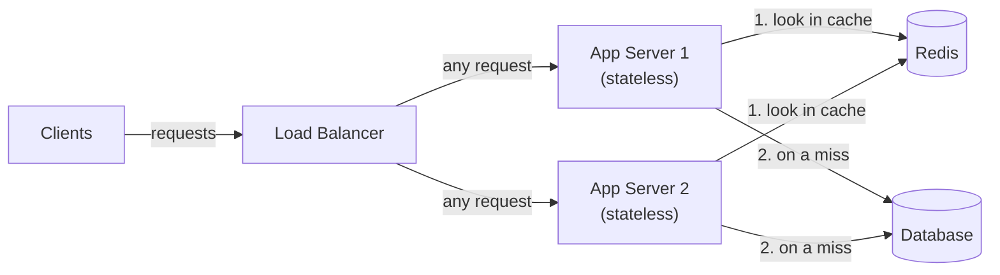

# 4. Performance, Throughput and Load Balancing

One server breaks as users grow. A cache fixes slow responses (latency). More servers behind a load balancer fix too many requests (throughput).

## Key terms

| Term | Meaning |
|------|---------|
| Latency | Time for one request to get a response |
| Throughput (QPS) | Requests the system handles per second |
| Cache | Fast store in RAM (Redis) that holds copies of hot data |
| Vertical scaling | Make one server bigger (more CPU, RAM) |
| Horizontal scaling | Add more servers |
| Load balancer (LB) | Spreads requests across servers. Examples: AWS ELB, NGINX. |
| Stateless server | Keeps no client data. Any server can serve any request. |
| Stateful server | Keeps client data. That client must always reach the same server. |

## How it works

Each fix creates the next problem:

1. **One server goes down:** Nobody is served. Fix: run many servers.
2. **Each server has its own data:** Data drifts apart. Fix: move data to one shared DB.
3. **Responses are slow:** Every request hits the DB. Fix: a cache. Look in Redis first. On a miss, read the DB and store the result in Redis (cache-aside, topic 11).
4. **Too many requests for one server:** Fix: add servers (horizontal) behind an LB.
5. **Servers keep state in RAM:** The LB cannot send any request anywhere. Fix: make servers stateless. Keep shared state in Redis or the DB.

## Trade-offs

| Vertical scaling | Horizontal scaling |
|------------------|--------------------|
| One bigger server | More servers |
| Has a ceiling. Big machines cost a lot. | Almost no ceiling |
| No LB needed | Needs an LB and stateless servers |

**LB strategies:**

- **Round robin:** Server 1, 2, 3, then repeat.
- **Weighted round robin:** A stronger server gets more requests.
- **Load-aware:** Send to the least busy server.

**Numbers:** A Redis read takes about 1 ms. One small server handles about 1,000 QPS.

> **Interview:** Say "the app servers are stateless, so the LB can send any request anywhere". This is the base of horizontal scaling.

## Likely questions

- **Vertical or horizontal?** Horizontal. Vertical hits a ceiling and costs more.
- **What does a load balancer do?** It spreads requests across servers, so no server gets all the load.
- **Why stateless servers?** Any server can take any request. So you just add servers to scale.
- **Where does the state go then?** Shared state goes in Redis. Durable data goes in the DB.
- **Why add a cache?** RAM is about 1 ms. A DB read is much slower. Hot reads skip the DB.
