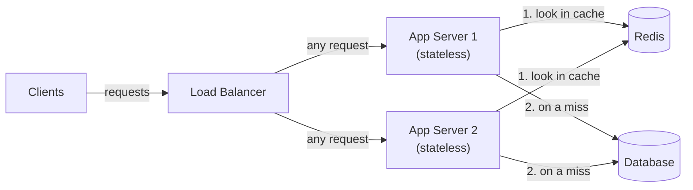

# 4. Performance, Throughput and Load Balancing

One server breaks as users grow. A cache lowers [latency](03-one-computer-and-latency.md). More servers behind a load balancer let the system handle more requests.

## Key terms

| Term | Meaning |
|------|---------|
| Throughput (QPS) | Throughput is the number of requests the system handles per second. QPS means queries per second. |
| Cache | A cache is a fast store in RAM that keeps copies of often-read data. Redis is the usual cache. |
| Vertical scaling | Vertical scaling means making one server bigger, with more CPU or RAM. |
| Horizontal scaling | Horizontal scaling means adding more servers. |
| Load balancer (LB) | A load balancer spreads requests across many servers. AWS ELB and NGINX are examples. |
| Stateless server | A stateless server keeps no client data, so any server can serve any request. |
| Stateful server | A stateful server keeps a client's data, so that client must always reach the same server. |

## How it works

Each fix creates the next problem.

1. **One server goes down.** Then nobody is served. The fix is to run many servers.
2. **Each server has its own data.** Then the copies drift apart. The fix is to keep all data in one shared database.
3. **Responses are slow.** Every request reads the database. The fix is a cache. The server looks in Redis first. If the data is not there (a cache miss), it reads the database and saves the result in Redis. This pattern is called cache-aside (topic 11).
4. **One server gets too many requests.** The fix is horizontal scaling: add servers behind a load balancer.
5. **Servers keep data in their own RAM.** Then the load balancer cannot send a request to just any server. The fix is to make the servers stateless and keep shared data in Redis or the database.

## Trade-offs

| | Vertical scaling | Horizontal scaling |
|---|------------------|--------------------|
| What you do | You make one server bigger. | You add more servers. |
| Limit | One machine has a ceiling, and big machines cost a lot. | There is almost no ceiling. |
| What you need | You need nothing extra. | You need a load balancer and stateless servers. |

**Load balancer strategies:**

- **Round robin:** The LB sends requests to server 1, then 2, then 3, and then starts again.
- **Weighted round robin:** The LB sends more requests to the stronger servers.
- **Load-aware:** The LB sends each request to the least busy server.

**Numbers:** A Redis read takes about 1 ms. One small server handles about 1,000 QPS.

> **Interview:** Say "the app servers are stateless, so the load balancer can send any request to any server". This is the base of horizontal scaling.

## Likely questions

- **Vertical or horizontal scaling?** Choose horizontal scaling. Vertical scaling hits a ceiling and costs more.
- **What does a load balancer do?** It spreads requests across servers, so no single server gets all the load.
- **Why keep servers stateless?** Any server can then take any request, so you scale by adding servers.
- **Where does the state go then?** Shared state goes in Redis. Data that must last goes in the database.
- **Why add a cache?** A Redis read takes about 1 ms, which is much faster than a database read.
