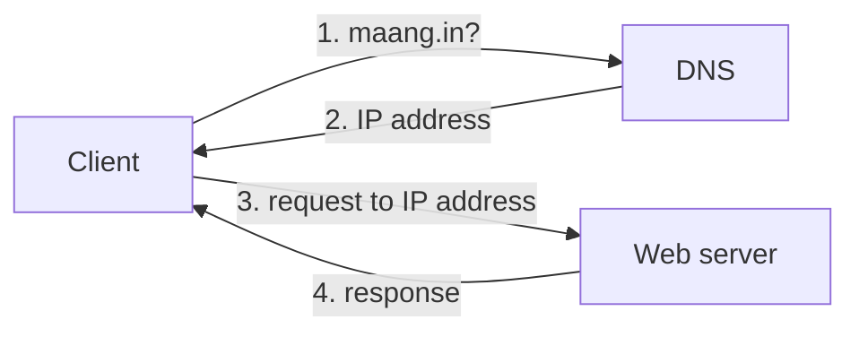
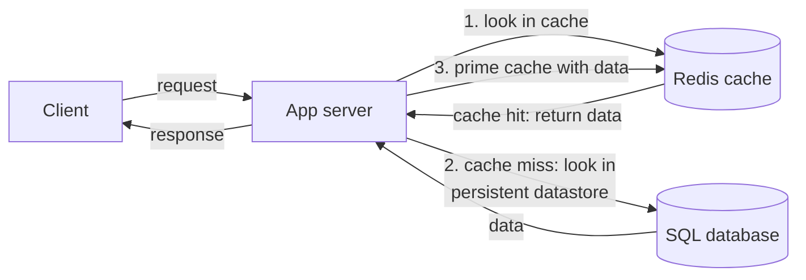
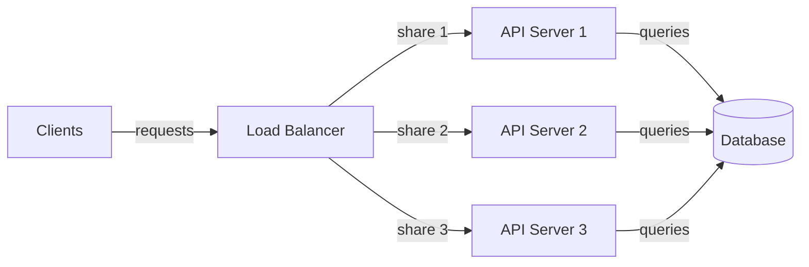
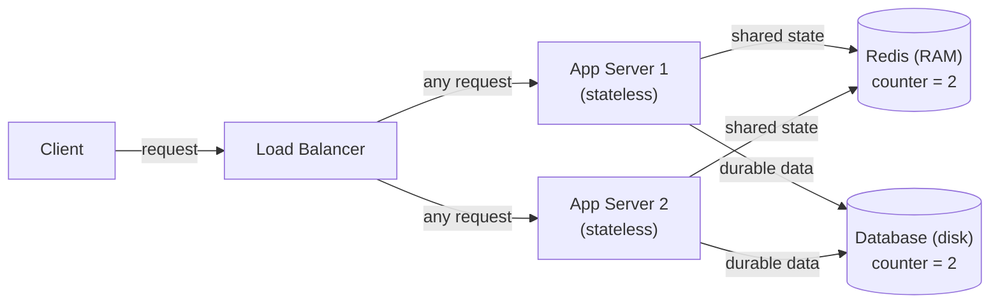

# 4. Performance, Throughput and Load Balancing

The Live Counter starts as one server and one DB. Users come from all over the US, then the world. This topic fixes the first two NFRs: latency and throughput.

## Single server setup

The client first asks DNS for the server's address.

- **DNS:** DNS only returns the IP address. It does not serve the page.
- **Problem:** If the single server is down, nobody answers client requests.
- **Fix:** Run multiple servers. If the system is used globally, place servers on different continents.
- **New problem:** With many servers, data can become inconsistent. A client moves from server 1 to server 2. Server 2 does not have that client's data for some time.
- **Fix:** Keep the servers in sync. Better, move the data to a separate database server that all app servers share.
- **Concurrency:** The server's specs (CPU, RAM) decide how many requests it can handle at the same time.

## Performance (latency): reduce response time

Put a cache in front of the database. Redis is the usual cache.

1. **Look in the cache:** On a hit, return the data at once.
2. **On a miss:** Read the persistent database.
3. **Prime the cache:** Write the value into the cache for the next request.

This pattern is called cache-aside. Topic 11 covers it and the other cache patterns.

**Why Redis?**

- **Almost a database, but on RAM:** It stores data in memory.
- **Extremely fast:** About 1 ms per operation.
- **ACID properties available:** Single operations are atomic.
- **Ready-made data structures:** Strings, hashes, lists, sets and sorted sets.
- **Can be scaled:** It runs as a cluster.

## Throughput: avoid the server bottleneck

More users means more QPS. One server has a limit.

**Rule-of-thumb QPS per instance:**

| vCPU | A) CPU-only endpoint | B) DB read per request | C) DB write per request |
|------|----------------------|------------------------|-------------------------|
| 1 | 500 to 5,000 | 100 to 800 | 50 to 400 |
| 2 | 1,000 to 10,000 | 200 to 1,500 | 100 to 800 |
| 4 | 3,000 to 20,000 | 500 to 3,000 | 250 to 1,500 |
| 8 | 8,000 to 50,000 | 1,000 to 6,000 | 500 to 3,000 |

- **A) CPU-only:** No DB call and a tiny response. Examples: `GET /health`, a cached `/count`, simple computations.
- **B) DB read:** For example, `GET /count` hitting Postgres. The DB or its connection pool usually becomes the limit before the EC2 CPU does.
- **C) DB write:** For example, `POST /increment`. Writes cost the most.

## Scaling instances

| | Vertical scaling | Horizontal scaling |
|---|------------------|--------------------|
| What you do | Make one server bigger (more RAM, faster CPU) | Add more servers |
| Example | 2 GB RAM handles 10 QPS. 4 GB RAM handles 20 QPS. | 10 servers handle 10 QPS each |
| Limit | A single machine has a ceiling. 1000 QPS would need about 200 GB RAM, which is very expensive. | Almost no ceiling |
| Cost | Very high-spec machines cost a lot. Avoid relying on them. | Many reasonable machines are cheaper |
| Extra need | Nothing | A load balancer in front |

- **Global users:** Put servers near users, for example one in North America and one in Europe. Both still talk to the single DB in India.

## Load balancer

A load balancer (LB) redirects traffic to multiple instances. The instances form a **target group**. It makes sure each server gets a fair share, for example 10 QPS each, so no single server gets 100 QPS.

**Tech stack:**

| Tool | How it works |
|------|--------------|
| AWS ELB (Elastic Load Balancer) | A **listener** checks for connection requests on a protocol and port. Example rules: `HTTPS:443` and `HTTP:80` both forward 100% of traffic to the target group `cz-prod`. Target group stickiness is Off. |
| NGINX | Runs as a reverse proxy in the data center. It sits between users and the app servers. The app servers talk to the DBs. |

- **Stickiness:** With stickiness on, the LB sends one user to the same instance every time. With it off, any instance can serve any request.

### Load balancing strategies

| Strategy | How it works | Problem |
|----------|--------------|---------|
| Round robin | Request 1 goes to server 1, request 2 to server 2, and so on in a loop | Requests do not all take the same time. Some are more expensive. Servers can also have different specs, so a weaker server slows the system. |
| Weighted round robin | Each server gets a weight based on its power. A stronger server gets more requests. | Weights are fixed and do not see the live load |
| Load-aware | The LB checks each server's current state (load) and then decides where to send | Needs live stats from each server |

## Stateless vs stateful servers

If each app server keeps state in its own RAM, the copies diverge. App Server 1 holds `counter = 2` in RAM, and App Server 2 holds a different value.

| | Stateless server | Stateful server |
|---|------------------|-----------------|
| What it stores | No client-specific data | Client-specific data |
| Which server a client uses | Any client can connect to any server | Client 1 must always reach server 1 |
| Scaling | Easy. Add servers behind the LB. | Hard. You must keep each client's data up to date on its server. |
| Use | Most web apps | Small websites, or when speed needs in-memory state (see topic 25) |

- **Rule:** Servers should run the app and stay stateless. Keep shared state in Redis or the DB.

> **Interview:** Say "the app servers are stateless, so the LB can send any request anywhere". This is the base of horizontal scaling.

## Data centers

A data center is a building full of servers. Large systems run several data centers in different regions. Each one has its own LB, app servers, caches and DB replicas. DNS sends each user to the nearest data center.
