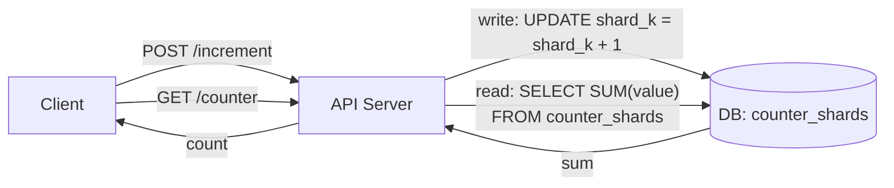
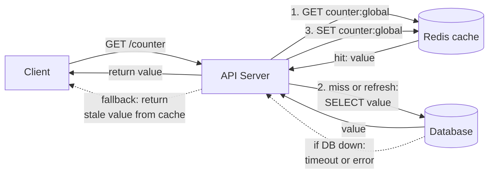
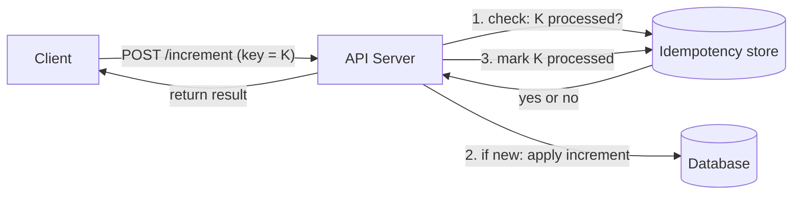
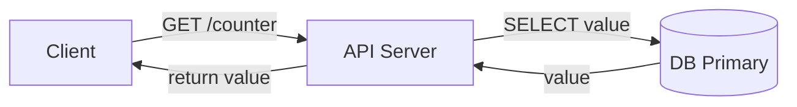
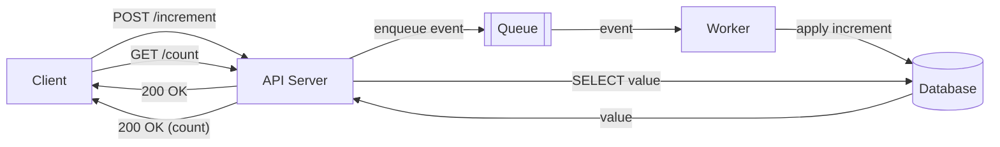
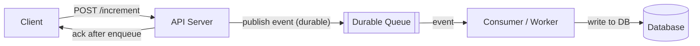

# 5. Scalability, Availability, Reliability, Consistency and Durability

This topic fixes NFRs 3, 4, 5, 6 and 7 on the Live Counter.

## Scalability: the one-row bottleneck

The DB has one row: `counter = 2`. Every `POST /increment` from every server updates that same row. The row becomes a hotspot.

Now add a second DB to share the load. Client 1 sends `POST /increment` to DB 1, so DB 1 now says `counter = 3`. Client 2 reads DB 2 and still sees `counter = 2`. The two DBs disagree.

**Fix: sharded counters.** Split the one counter into many rows (shards). Each write updates one shard. A read adds them all.

- **Write:** Pick a shard `k` (for example at random) and add 1 to it. Writes spread over many rows, so no single row is hot.
- **Read:** `SELECT SUM(value) FROM counter_shards` gives the total.
- **Trade-off:** Writes get cheap. Reads get a little more expensive, because they add many rows.

## Availability: keep serving when parts fail

### When a server fails

Without health checks, the LB keeps sending traffic to every server, even a dead one. The requests sent to the dead server fail.

**Fix: health checks.** The LB keeps checking each instance. It moves traffic away from unhealthy instances.

| Health check setting (AWS ELB) | Value |
|--------------------------------|-------|
| Protocol | HTTP |
| Path | `/` |
| Port | Traffic port |
| Healthy threshold | 3 consecutive successes |
| Unhealthy threshold | 3 consecutive failures |
| Timeout | 5 seconds |
| Interval | 30 seconds |
| Success codes | 200 |

- **Meaning:** Every 30 seconds the LB calls `GET /` on each instance. A reply needs code 200 within 5 seconds. Three failures in a row mark the instance unhealthy. Three successes in a row bring it back.

### When the DB fails

**Fix: serve from the cache, and fall back to a stale value.**

1. Read `counter:global` from Redis. On a hit, return it.
2. On a miss, or when the cached value is too old, read the DB. Then `SET counter:global` in Redis.
3. If the DB times out or errors, return the old (stale) value from the cache.

- **Trade-off:** The user sees a slightly old count instead of an error. For a counter this is acceptable.

## Reliability: correct under retries

A client sends `POST /increment`. The response times out. The client retries. The server already applied the first request, so the count goes up twice.

**Fix: an idempotency key store.** The client sends a unique key `K` with each logical request. A retry reuses the same `K`.

- **Idempotent:** Doing the operation twice gives the same result as doing it once.
- **If K is new:** Apply the increment and mark K as processed.
- **If K was seen:** Skip the increment and return the earlier result.

## Consistency: strong vs eventual

- **Primary and replicas:** The primary is the main DB copy. It takes every write. Replicas copy from it a little later (topic 18).

Many users look at the counter at the same time.

| | Strong consistency | Eventual consistency |
|---|--------------------|----------------------|
| What users see | All windows show the same value (2, 2, 2) | One window shows 3 while others still show 2 for a short time |
| Guarantee | Every read returns the latest write | Every reader gets the latest value, but it may take some time |
| Cost | Slower. Reads go to the primary. | Faster. Writes are async. |

### Option A: strong consistency (read the primary)

- **How:** Every read goes to the primary DB, which has every write.

### Option B: eventual consistency (async updates)

- **How:** The API puts an "increment" event on a queue and replies 200 at once. A worker applies it to the DB later.
- **Effect:** A read right after a write can still see the old count.

### Three levels of consistency

| Type | Meaning |
|------|---------|
| Strong | The update is visible immediately to every reader |
| Eventual | Every reader definitely gets the data, but it may take some time |
| Weak | A reader may never see the update. Example: a dropped frame in a video call. |

### Why consistency is hard with many DBs

- **Copies must match:** If several DBs hold the same data, a change in one must reach the others.
- **Failures:** If one DB is down, it misses changes. The copies stop matching.
- **Latency:** Copying data to other DBs (replication) increases the time a request takes.
- **All or nothing:** A bank transfer moves money from your account (in one DB) to a friend's account (in another DB). Both changes must happen together, or neither. The DBs can never be left inconsistent.
- **Trade-off:** Some designs reply very fast but risk wrong data. Others make sure the data is correct but reply slower. The goal is a system that is fast and also consistent enough for the product.

Topic 14 (CAP) and topic 18 (Replication) go deeper.

## Durability: the durable queue as commit point

In Option B, the queue holds events that are not yet in the DB. If the queue crashes, those increments are lost, even though users got 200 OK.

**Fix: a durable queue.** The queue writes each event to disk before it acknowledges.

- **Commit point:** The write counts as done once the durable queue stores it. The API acks only after that.
- **Consumer:** It reads the event and writes to the DB. If it crashes, the event is still in the queue.

Topic 13 covers queues (RabbitMQ, Kafka, SQS) in detail.

> **Interview:** For each NFR, name the problem and its fix. Scalability: sharded counters. Availability: health checks and a cache fallback. Reliability: idempotency keys. Consistency: read the primary, or accept eventual. Durability: ack only after a durable queue stores the write.
