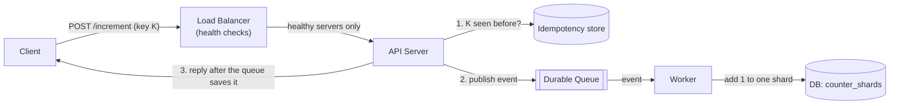

# 5. Scalability, Availability, Reliability, Consistency and Durability

These five NFRs decide whether the [Live Counter](01-why-system-design.md) keeps working as traffic grows and parts fail. Each NFR has one standard fix.

## Key terms

| Term | Meaning |
|------|---------|
| Scalability | Scalability is the ability to grow smoothly as users and traffic grow. |
| Availability | Availability is the share of time the system is up and answers requests. |
| Single point of failure | A single point of failure is one part whose failure stops the whole system. |
| Reliability | Reliability means the system stays correct when things fail, such as timeouts and retries. |
| Consistency | Consistency means every reader sees the same, latest data after a write. |
| Replica | A replica is a copy of the DB. It copies every write from the main copy, which is called the primary. |
| Durability | Durability means data is never lost once the system says it is saved. |

## How it works

Each NFR names a problem, and each problem has a fix.

1. **Scalability: one row gets every write.** Every `POST /increment` updates the same `counter` row, so that row becomes the bottleneck. A second DB does not help, because the two DBs then show different counts. The fix is a sharded counter: split the counter into many rows, called shards ([topic 12](12-scaling-databases.md)). Each write adds 1 to one random shard, and a read adds up all the shards.
2. **Availability: a server dies.** The [load balancer](04-performance-throughput-load-balancing.md) still sends it requests, and those requests fail. The fix is a health check: the LB calls each server again and again, and it moves traffic away from servers that fail.
3. **Availability: the DB dies.** Then every read fails. The fix is to read through [Redis](07-storing-data-and-redis.md), a fast store in RAM. If the DB times out, the server returns the last value in Redis, even if it is slightly old (stale). One Redis server is itself a single point of failure, so run more than one.
4. **Reliability: the client retries a write.** The first request timed out, but the server had already applied it, so the count goes up twice. The fix is an idempotency key. An idempotent action gives the same result whether it runs once or twice. The client sends a unique key K with each request, and a retry reuses K. The server skips any K it has already processed.
5. **Consistency: a read misses the newest write.** A replica copies writes a little late, so a read from it can show an old count. The fix is a choice. For strong consistency, every read goes to the primary. For eventual consistency, the server puts the write on a queue (a list of waiting jobs, [topic 13](13-message-queues.md)) and replies at once. A worker applies it to the DB later.
6. **Durability: the queue crashes.** Writes still in the queue are lost, even though users were told they were saved. The fix is a durable queue, which saves each write to disk first. The server replies only after the queue has saved the write, so that moment is the commit point.

## Trade-offs

| | Strong consistency | Eventual consistency | Weak consistency |
|---|--------------------|----------------------|------------------|
| What a reader sees | Every reader sees the update at once. | Every reader gets the update, but it may take some time. | A reader may never see the update. |
| Speed | It is the slowest, because reads go to the primary. | It is fast, because writes are applied later. | It is the fastest. |
| Example | A bank transfer needs it. | A view count or a social feed is fine with it. | It suits data that is fine to lose. |

- **Sharded counter:** Writes get cheap, but reads cost a little more, because they add up many rows.
- **Many DB copies:** A change in one copy must reach the others, and a copy that is down misses changes. Copying also adds latency. A bank transfer between two DBs must change both accounts or neither.

**Numbers:** An AWS health check runs every 30 seconds with a 5 second timeout, and 3 failures in a row mark a server unhealthy. 99.9% availability allows about 8 h 46 m of downtime a year, and 99.99% allows about 52 minutes.

> **Interview:** For each NFR, name the problem and its fix. Say "sharded counters for scale, health checks and a cache fallback for availability, idempotency keys for retries, and a durable queue for durability".

## Likely questions

- **How do you scale writes to one counter?** Split it into many shard rows. Each write updates one shard, and a read adds them up.
- **What if the DB goes down?** The server returns the last value from Redis. The user sees a slightly old count instead of an error.
- **How do you stop a retry from counting twice?** The client sends an idempotency key, and the server skips any key it has already processed.
- **Strong or eventual consistency for a counter?** Eventual is fine, because a count that is a few seconds old does no harm. A bank transfer needs strong consistency.
- **When is a write safe from loss?** It is safe once a durable queue has saved it to disk. The server replies only after that.
