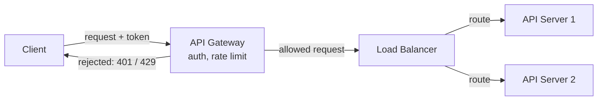
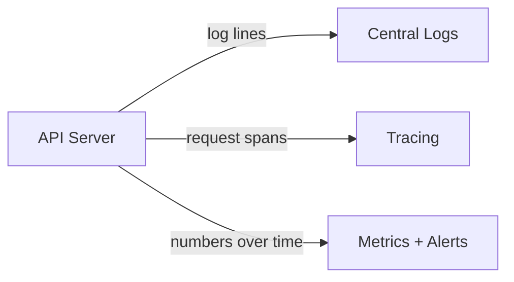
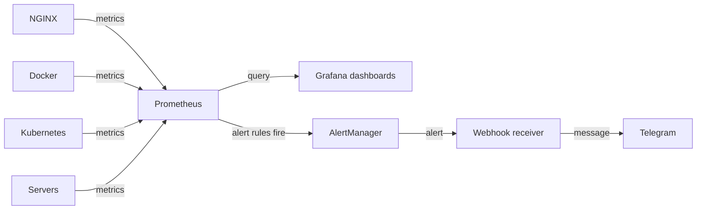
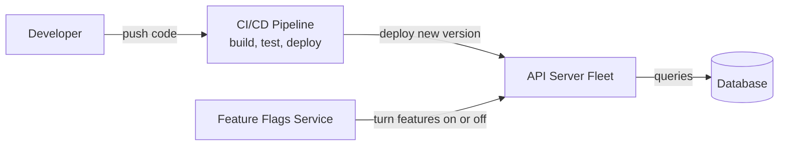
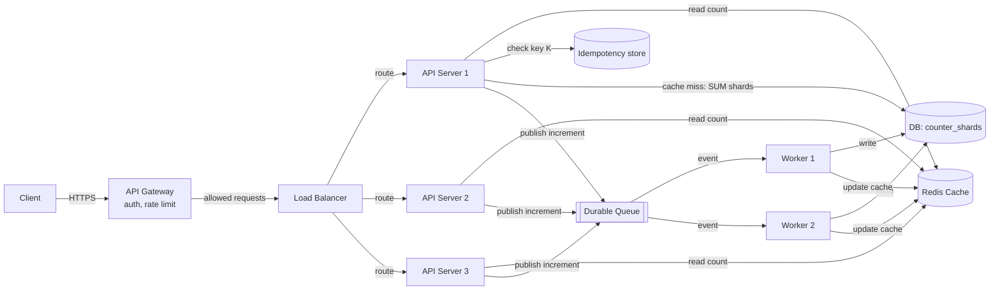

# 6. Security, Observability and Maintainability

This topic fixes the last three NFRs on the Live Counter. It ends with every piece put together.

## Security: API Gateway (Auth + Rate Limit)

An API Gateway is one entry point in front of all your services. Every request passes through it first.

**What an API Gateway does:**

| No. | Function | Details |
|-----|----------|---------|
| 1 | Authentication and Authorization | **AuthN** checks who you are: JWT, API keys, OAuth. **AuthZ** checks what you may do: permissions. |
| 2 | Rate limiting / throttling | Limits requests per user, per IP or per API. Excess requests get `429 Too Many Requests`. |
| 3 | Load balancing and routing | Sends each request to the right service and instance. Uses health checks. |
| 4 | Caching | Returns cached responses for repeated requests. |
| 5 | Request / response transformation | Rewrites paths and headers. Validates the schema. Converts JSON to XML and back. Adds or removes fields. |
| 6 | Service discovery | Finds where each service runs. Useful with microservices and Kubernetes, where instances move. |
| 7 | Circuit breaking, timeouts, retries | Fails fast when a service is unhealthy. This avoids cascading failures. |

- **JWT (JSON Web Token):** A signed token that carries the user's id. The gateway checks the signature without a DB call.
- **API key:** A secret string that identifies a calling app.
- **OAuth:** A login flow through another provider, such as "Sign in with Google".
- **Cascading failure:** One slow service makes its callers wait. They run out of threads and fail too. The failure spreads.
- **Circuit breaker:** After many failures, the gateway stops calling the broken service for a while. It returns an error at once instead of waiting.
- **TLS termination:** The gateway also handles HTTPS. It decrypts the request so the services behind it do not have to.

## Observability: logs, metrics, tracing

You cannot fix what you cannot see. Every API server sends three kinds of data out.

| Signal | What it is | Question it answers |
|--------|------------|---------------------|
| Logs | Text records of events, like debug prints | What happened in this request? |
| Metrics | Numbers over time: QPS, error rate, p95 latency, CPU | Is the system healthy right now? |
| Tracing | The path of one request across all services, with time per hop | Which service made this request slow? |

### Tech stack: Prometheus, AlertManager, Grafana

| Tool | Job |
|------|-----|
| Prometheus | Pulls (scrapes) metrics from every target at fixed intervals and stores them |
| AlertManager | Receives alerts from Prometheus. Groups them and sends them out, for example via a webhook to Telegram. |
| Grafana | Draws dashboards from the metrics |

### On-call

- **Rule:** If more than X% of requests fail, the system files a bug automatically.
- **Escalation:** It also calls the on-call engineer automatically.

> **Interview:** Name what you would monitor: QPS, error rate, p95 latency, queue depth. Say what triggers an alert.

## Maintainability: safe changes and deployment

| Piece | Job |
|-------|-----|
| CI/CD pipeline | **CI** (continuous integration) builds and tests every change. **CD** (continuous deployment) ships it to the servers automatically. No manual deploys. |
| Feature flags | A switch per feature, stored outside the code. You can turn a feature on for 1% of users, then everyone. You can turn it off without a redeploy. |

## All pieces together

**How each NFR is met:**

| NFR | Fix |
|-----|-----|
| Performance | Redis cache in front of the DB |
| Throughput | Many stateless API servers behind an LB |
| Scalability | Sharded counter rows |
| Availability | Health checks. Stale value from cache if the DB is down. |
| Reliability | Idempotency keys |
| Consistency | Read the primary (strong) or queue + worker (eventual) |
| Durability | Ack only after the event is in a durable queue |
| Security | API Gateway with auth and rate limiting |
| Observability | Logs, metrics, tracing, alerts |
| Maintainability | CI/CD and feature flags |

## Base setup of almost every system

Most designs start from these pieces:

| Piece | Job |
|-------|-----|
| DNS | Turns the domain (for example `a.com`) into an IP |
| CDN | Serves static files near the user (topic 10) |
| Load balancer | Spreads requests over servers |
| Web / app servers | Run the business logic, stateless |
| Message queue | Moves slow work to background workers (topic 13) |
| Workers | Process queued jobs |
| DB server | Stores the data |
| Cache server | Serves hot data from RAM |
| Logging and metrics | Observability |
| NoSQL store | Holds stateful things like sessions |
| Auth cookies / tokens | Identify the user on every request |
| Automated deployment | CI/CD |
| Alerts and monitoring | On-call |

> **Interview:** This is your goal. Build a framework to answer any design question. Start from these pieces, then change them for the product.
