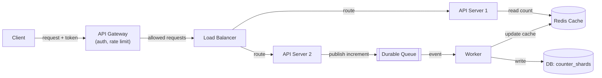

# 6. Security, Observability and Maintainability

These are the last three NFRs on the [Live Counter](01-why-system-design.md). Security keeps out bad requests, observability shows what is going on, and maintainability makes changes safe.

## Key terms

| Term | Meaning |
|------|---------|
| API gateway | An API gateway is the one entry point in front of all services. Every request passes through it first. |
| Microservice | A microservice is a small service that does one job. A big app runs as many microservices. |
| Rate limiting | Rate limiting caps how many requests a user, an IP or an API may send in a time window. |
| Observability | Observability is how well you can see what the system is doing, through logs, metrics and traces. |
| Logs | Logs are text records of events, like debug prints. |
| Metrics | Metrics are numbers over time, such as QPS, error rate, p95 latency and CPU use. |
| Traces | A trace is the path of one request across all services, with the time spent at each step. |
| Maintainability | Maintainability means you can change and deploy the system safely. |

## How it works

1. **Anyone can call the API.** A bad user can pretend to be someone else or flood the servers. The fix is an API gateway. It checks who the user is (authentication) and what the user may do (authorization). It checks one of three things. A JWT is a signed token that holds the user's id. An API key is a secret string for a calling app. OAuth is a login through another provider, such as "Sign in with Google".
2. **One user sends too many requests.** The servers slow down for everyone. The fix is rate limiting at the gateway. Extra requests get 429 Too Many Requests. This is a status code, the number in a reply that says how the request went ([topic 8](08-rest-and-blob-storage.md)).
3. **One broken service makes its callers wait.** The callers run out of threads and fail too, so the failure spreads (a cascading failure). The fix is a circuit breaker: after many failures, the gateway stops calling that service for a while and fails fast.
4. **You cannot see why requests fail.** The fix is observability. Every server sends logs, metrics and traces to central tools. Prometheus pulls metrics from every server, Grafana draws dashboards from them, and AlertManager sends alerts, for example to Telegram.
5. **Nobody notices a failure at night.** The fix is an on-call rule. If more than X% of requests fail, the system files a bug and calls the on-call engineer automatically.
6. **A manual deploy breaks things.** The fix is a CI/CD pipeline and feature flags. CI (continuous integration) builds and tests every change, and CD (continuous deployment) ships it to the servers automatically. A feature flag is a switch stored outside the code, so you can turn a feature on or off without a redeploy.

The gateway also routes each request to the right service, caches common responses, rewrites requests and finds where each microservice runs (service discovery).

This diagram puts together every fix from [topics 4](04-performance-throughput-load-balancing.md), [5](05-scalability-availability-consistency.md) and 6. Most designs start from these same pieces. DNS turns a domain name into an IP address. A CDN is a set of servers near the user that serve static files ([topic 10](10-caching-and-cdn.md)). Then come a load balancer, stateless servers, a cache, a queue with workers ([topic 13](13-message-queues.md)), a DB, logs and metrics, automated deploys and alerts.

## Trade-offs

| Signal | What it shows | Question it answers |
|--------|---------------|---------------------|
| Logs | It shows the events of one request. | What happened in this request? |
| Metrics | It shows numbers over time. | Is the system healthy right now? |
| Traces | It shows the path of one request across services. | Which service made this request slow? |

> **Interview:** Name what you would monitor: QPS, error rate, p95 latency and queue depth. Then say what triggers an alert, such as "more than X% of requests fail".

## Likely questions

- **What does an API gateway do?** It checks auth and applies rate limits before a request reaches any service. It also routes requests and can cache responses.
- **What does a client get when it is rate limited?** It gets status code 429 Too Many Requests.
- **What is a circuit breaker for?** It stops calls to a failing service for a while. This stops one failure from spreading to its callers.
- **Logs, metrics or traces: which one finds a slow service?** Traces do, because they show the time each service spent on one request.
- **How do you ship a risky feature safely?** Ship it through CI/CD behind a feature flag. If it breaks, turn the flag off without a redeploy.
