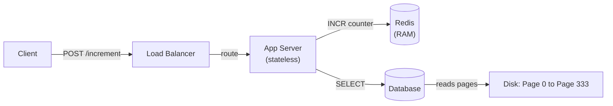

# 7. Storing Data, Database Pages and Redis

Data flow is the core of system design. Data moves from the client, through the load balancer and the app server, into Redis and the DB. Each store keeps data in a different place, so each has a different speed.

## Key terms

| Term | Meaning |
|------|---------|
| Row id | A row id is a hidden id the DB gives every row. The DB creates and maintains it, not you. |
| Page | A page is a fixed-size block of rows. The DB stores and reads pages, not single rows. |
| IO | An IO (input/output) is one read request to the disk. It reads a page or more. |
| Redis | Redis is an in-memory database. It keeps the active data in RAM, so reads and writes avoid disk IO. |
| Key-value store | A key-value store saves each value under a key and finds it only by that key. Redis is one. |
| TTL | TTL (time to live) is the number of seconds a stored entry stays valid. After that, the entry expires. |
| SQL | A SQL database stores data in tables with a fixed schema (the set of columns every row must have, [topic 9](09-data-modelling.md)) and supports joins and transactions. PostgreSQL and MySQL are examples. |
| NoSQL | A NoSQL database is any store that is not a SQL table, such as a document, key-value or graph store. |

## How it works

1. **Where data lives.** All files live on disk. A file is loaded into RAM when it must run, and the CPU works on it while it runs. A database is a program that keeps data on disk in an organised way and answers queries on it.
2. **Rows are stored in pages.** Every row has a row id. In MySQL (InnoDB) it is the primary key, which is the column that uniquely names a row ([topic 9](09-data-modelling.md)). In Postgres it is a separate system column called the tuple id. The DB packs rows into pages of 8 KB in Postgres or 16 KB in MySQL.
3. **The DB reads pages with IOs.** One IO reads a whole page, so the other rows in that page come for free. IOs are expensive, so a good DB design reads as few pages as it can. Some IOs are served from the OS cache instead of the disk. An index ([topic 9](09-data-modelling.md)) exists to cut the pages a query reads.
4. **Disk is slow.** The fix is Redis, which keeps data in RAM. Each key is a string. The value can be a string, a hash (an object with fields) or a list (a queue). It can also be a set (unique items) or a sorted set (scored items, for leaderboards). A live counter uses `INCR counter`, which is atomic (it runs as one step), so two clients never lose an update.
5. **RAM is lost on a crash.** The fix is Redis persistence. RDB saves a snapshot of all data to disk every few minutes. AOF (append-only file) logs every write, and Redis replays the log after a restart.
6. **Each app server has its own RAM.** With two servers, each keeps its own `counter`, so the values drift apart and die on restart. The fix is to keep app servers [stateless](04-performance-throughput-load-balancing.md). Shared fast state goes in Redis, and durable state goes in the DB.
7. **A cached entry goes out of date.** A user changes a name from ABC to BCD, but the cache still shows ABC. The fix is a TTL, so the entry expires after a set number of seconds.

Every arrow is a [network call](03-one-computer-and-latency.md), so each one adds latency and can fail. Draw only the arrows you need. Data can also live in the browser: localStorage survives a restart, sessionStorage lasts for one tab, and IndexedDB holds large data offline.

## Trade-offs

| | Database | Redis |
|---|----------|-------|
| Storage | It stores data on disk. | It stores data in RAM. |
| Durability | It is durable. | It can lose data on a crash unless persistence is on. |
| Queries | It runs complex queries, joins and indexes. | It looks up values by key. |
| Good for | It is the source of truth. | It suits counters, sessions, caches, rate limits and leaderboards. |

[Topic 9](09-data-modelling.md) shows which database to pick for each need.

**Numbers:** One access takes about 5 to 15 ms on an HDD and 50 to 150 µs on a SATA SSD. It takes 10 to 50 µs on an NVMe SSD and 50 to 100 ns in RAM. A Redis read takes about 1 ms, and a DB read about 50 to 100 ms. If a page holds 3 rows, 1001 rows need 334 pages.

> **Interview:** Start with PostgreSQL, and use another store only when a requirement needs it. Say "Redis holds the hot data in RAM, and the DB on disk is the source of truth".

## Likely questions

- **Why is Redis fast?** It keeps the data in RAM, and RAM is about 100,000 times faster to access than an HDD.
- **Why not keep the counter in the app server's RAM?** Each server would hold a different value, and the value dies on restart. Servers must stay stateless.
- **What happens to Redis data on a crash?** It is lost unless persistence is on. RDB snapshots and the AOF log save it to disk.
- **Why does a DB read pages and not rows?** One IO always reads a whole page. Reading fewer pages means fewer IOs, which makes queries faster.
- **SQL or NoSQL?** Start with SQL for transactions and joins. Choose NoSQL when you need a flexible schema, key lookups or huge writes.
