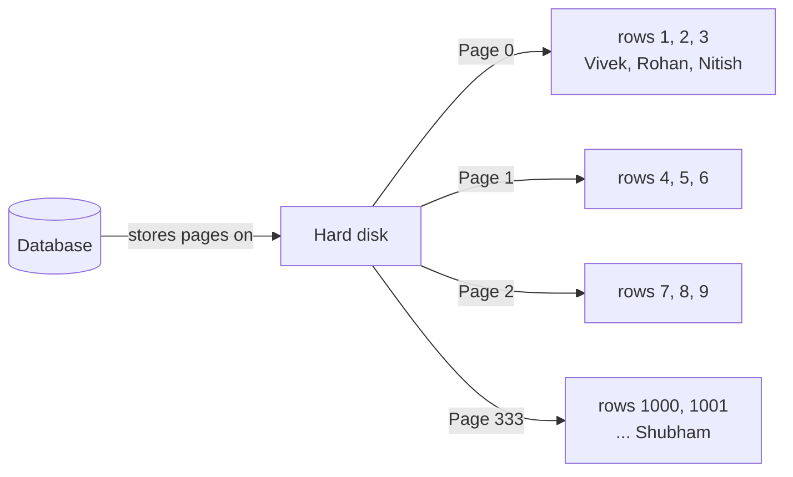

# 7. Storing Data, Database Pages and Redis

Data flow is the core of system design. Follow the data from the client, through the LB and app server, into Redis and the DB.

## Where data lives

| Place | When data is there |
|-------|--------------------|
| Disk | All files live on disk by default |
| RAM | A file is loaded into RAM when it must run or be used |
| CPU | Data is in the CPU registers while the CPU works on it |

A database is a program that keeps your data on disk in an organised way. It answers queries on that data.

## Tables and the hidden row_id

A table stores rows and columns.

| emp_id | emp_name | emp_dob | emp_salary |
|--------|----------|---------|------------|
| 101 | Vivek | 1/1/1998 | 1,10,100 |
| 102 | Rohan | 2/2/1998 | 2,20,200 |
| 107 | Nitish | 3/3/1998 | 3,30,300 |

Internally every row also has a **row_id**. The DB creates and maintains it. You do not.

| row_id | emp_id | emp_name | emp_dob | emp_salary |
|--------|--------|----------|---------|------------|
| 1 | 101 | Vivek | 1/1/1998 | 1,10,100 |
| 2 | 102 | Rohan | 2/2/1998 | 2,20,200 |
| 3 | 107 | Nitish | 3/3/1998 | 3,30,300 |

| Database | What the row_id is |
|----------|--------------------|
| MySQL (InnoDB) | The same as the primary key |
| Postgres | A separate system column, called the tuple id |

## Pages

The DB does not store or read single rows. It groups rows into fixed-size **pages**.

- **Page size:** 8 KB in Postgres. 16 KB in MySQL.
- **Storage model:** How rows are packed in a page depends on the storage model (row store or column store).
- **Example:** If one page holds 3 rows, then 1001 rows need 1001 / 3 = 333.7, rounded up to 334 pages (Page 0 to Page 333).

## IO

An **IO** (input/output) is one read request to the disk.

- **Unit:** An IO reads a whole page, or more. It cannot read a single row. You get all the other rows in that page for free.
- **Cost:** IOs are expensive. Good DB design keeps the number of IOs as small as possible.
- **Size:** One IO can fetch more than one page. The DB and the OS decide this, for example by reading ahead.
- **OS cache:** Some IOs are served from the operating system cache, not the disk.

> **Interview:** Indexes (topic 12) exist to cut the number of pages a query must read.

## Storage speeds

| Storage | Latency (access time) | Bandwidth (transfer speed) |
|---------|-----------------------|----------------------------|
| HDD | about 5 to 15 ms | 100 to 250 MB/s |
| SATA SSD | about 50 to 150 µs | 450 to 550 MB/s |
| NVMe SSD | about 10 to 50 µs | 2 to 7+ GB/s |
| RAM | about 50 to 100 ns | 30 to 100+ GB/s |

RAM is about 100,000 times faster to access than an HDD. This gap is why caches exist.

## Redis: the in-memory database

Redis keeps the active dataset in RAM. Reads and writes avoid disk IO.

Everything in Redis is stored under a **key**, which is a string. The value can be one of these types:

| Type | Example | Use |
|------|---------|-----|
| String | `"counter"` holds `"2"` | Counters, cached values |
| Hash | `"user:42"` holds `{name: "Umang", role: "admin"}` | Objects with fields |
| List | push and pop at the ends | Queues |
| Set | unique items | Tags, "who liked this" |
| Sorted Set (ZSET) | items with scores | Leaderboards |

- **Live counter in Redis:** `INCR counter`. The increment is atomic, so two clients never lose an update.

### Database vs Redis

| | Database | Redis |
|---|----------|-------|
| Storage | Disk | RAM |
| Durability | Durable | Data can be lost on a crash unless persistence is on |
| Queries | Complex queries, joins, indexes | Lookups by key |
| Speed | Slower | Ultra fast, about 1 ms |
| Good for | The source of truth | Counters, sessions, caches, rate limits, leaderboards |

### Redis persistence

Redis can also save to disk.

| Method | How it works |
|--------|--------------|
| RDB snapshots | Saves the whole dataset to disk every few minutes |
| AOF (append-only file) | Logs every write to a file. Redis replays the file after a restart. |

## Why not keep the counter in the app server's RAM?

Each app server has its own RAM. With two servers behind an LB, each holds its own `counter`. They drift apart. A request to server 1 sees one value and a request to server 2 sees another. Also, the value dies when the server restarts.

So app servers must stay stateless. Shared fast state goes into Redis, and durable state goes into the DB (see topic 4).

## You can store data anywhere

| Where | Storage | Notes |
|-------|---------|-------|
| Browser | Variables in RAM | For example React state from `useState`. Lost on refresh. |
| Browser | localStorage | Key-value strings. Survives refresh and browser restart. |
| Browser | sessionStorage | Per tab. Cleared when the tab closes. |
| Browser | IndexedDB | Large, structured data. Works offline. |
| Browser | File-based | The user downloads a file |
| App server | Local files | Save some files locally if needed |
| Redis | RAM + disk | RDB snapshots + AOF |
| Database | Disk + RAM cache | The durable store |

## Arrows are not free

Every arrow in a diagram is a network call. Each one adds latency and can fail. Draw as few arrows as you need, and know the cost of each one (topic 3).
