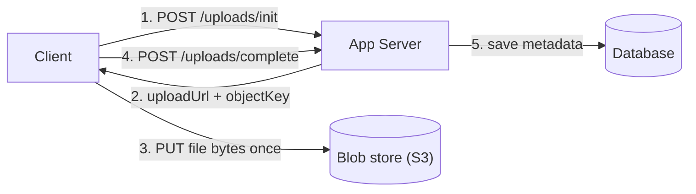

# 8. REST APIs and Blob Storage

The [client](01-why-system-design.md) calls the [server](01-why-system-design.md) through a REST API. Large files such as videos and PDFs do not belong on the app server or in the [database](01-why-system-design.md). They go to blob storage, and the database keeps only a small row about each file.

## Key terms

| Term | Meaning |
|------|---------|
| REST | REST is the usual way a client calls a server over HTTP. Each request names a method and a path, such as `GET /count`. The server replies with a status code and a body, usually JSON, a plain text format of keys and values. |
| HTTP methods | GET reads a resource. POST creates one or starts an action. PUT replaces a resource, PATCH changes part of it, and DELETE removes it. |
| Status codes | A status code is a number that tells the client how the request went. 200 means success, and 204 means success with no body. 301 and 302 are permanent and temporary redirects. 500 means the server failed. |
| Blob storage | Blob (binary large object) storage keeps large files, such as images, videos, PDFs and backups, as objects. You can only PUT, GET, DELETE and LIST objects. |
| S3 | Amazon S3 is the most common blob store. Cloudflare R2 and Google Cloud Storage are others. |
| Object key | An object key is the path that names one file in the blob store, such as `users/42/resumes/uuid-resume.pdf`. |
| Pre-signed URL | A pre-signed URL is a link to one object that carries a signature and an expiry time. Anyone with the link can do one action (PUT or GET) on that object until it expires. |
| Metadata | Metadata is the small row about a file, such as its owner, key, size and type. |

## How it works

1. **The file travels through every server.** A naive `POST /file` puts a 2 GB file inside the JSON body. The bytes then pass through the [load balancer](04-performance-throughput-load-balancing.md), the app server and the database, and they bloat all three. The fix is to keep the file in blob storage and only its metadata in the database.
2. **The client needs permission to write to the blob store.** The client calls `POST /uploads/init` with the file name, size and type. The backend checks that the user is logged in, that the size and type are allowed, and that the user is within quota.
3. **The backend signs a URL.** The backend makes an object key and a pre-signed PUT URL that lives 5 to 15 minutes. It signs the URL in its own memory with its cloud credentials, so it makes no [network call](03-one-computer-and-latency.md) to the blob store. It returns `uploadUrl` and `objectKey`.
4. **The client uploads only once.** The client sends the bytes straight to `uploadUrl`. The blob store checks the signature, stores the file and returns an ETag, which is a fingerprint of the stored file.
5. **The database must learn about the file.** The client calls `POST /uploads/complete` with the key and the ETag. The backend saves the metadata row and returns a `fileId`.
6. **The user wants the file back.** The client calls `GET /files/{fileId}/download`. The backend reads the metadata, checks that this user may read the file, and returns a pre-signed GET URL. The client then downloads the bytes straight from the blob store.

## Trade-offs

| | Database | Blob storage |
|---|----------|--------------|
| Best for | It is best for structured records and queries. | It is best for large files. |
| What you can do | You get tables, joins and [indexes](09-data-modelling.md), which find rows without a full scan. | You can only PUT, GET, DELETE and LIST objects. |
| Examples | Postgres, MySQL | Amazon S3, Cloudflare R2, Google Cloud Storage |

**Numbers:** A pre-signed URL usually lives 5 to 15 minutes. In an S3 URL, `X-Amz-Expires=900` means 900 seconds, which is 15 minutes.

> **Interview:** Say "large files never pass through the app servers". Store them in S3 through pre-signed URLs, and keep only the metadata in the database.

## Likely questions

- **Why not store files in the database?** The database is built for structured records and queries. A 2 GB file would bloat the database and every server it passes through.
- **What is a pre-signed URL?** It is a link to one object with a signature and an expiry. It lets the client do one PUT or GET straight on the blob store.
- **Does making a pre-signed URL call S3?** No, it does not. The app server signs it in its own memory, and S3 checks the signature later.
- **How does the database know the upload finished?** The client calls `POST /uploads/complete`. The backend then saves the metadata row.
- **How does a download work?** The backend checks the user can read the file and returns a pre-signed GET URL. The client downloads straight from the blob store.
