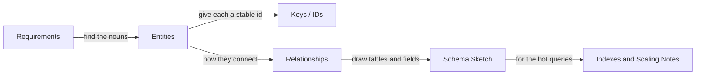
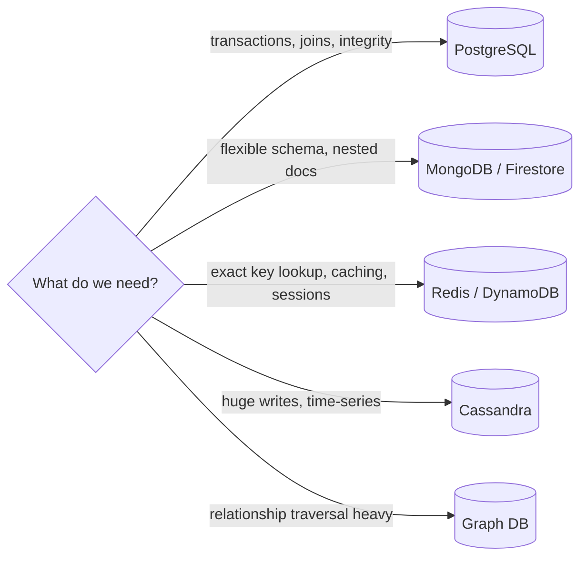
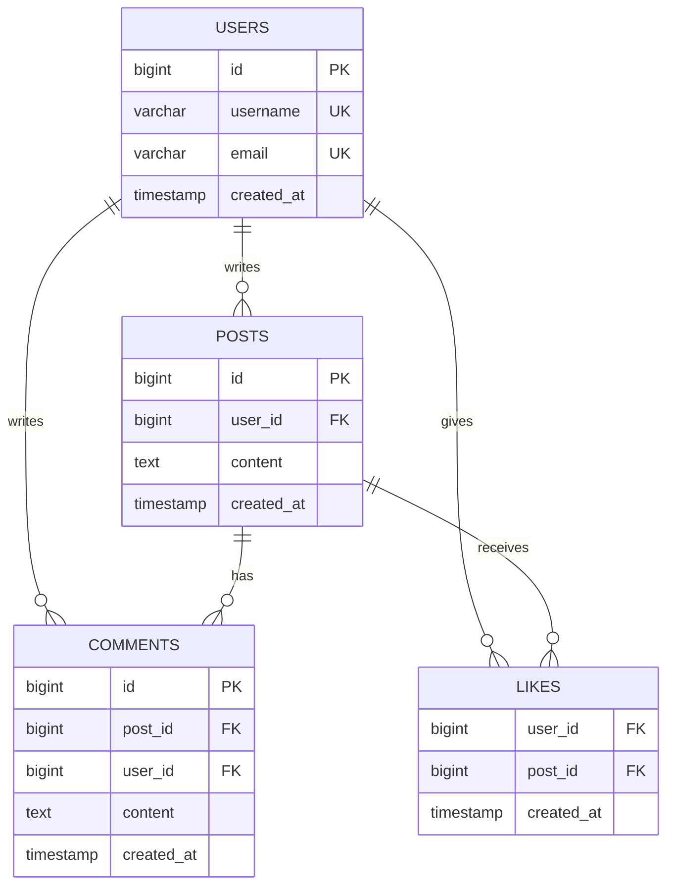
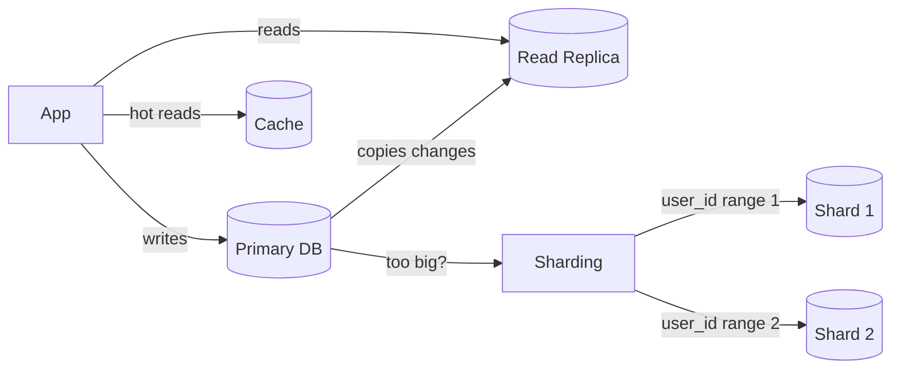

# 9. Data Modelling and Choosing a Database

How you keep data matters. The data model is the backbone of the system.

- **Bad schema:** Slow queries, messy scaling and inconsistent data.
- **Type of data store matters:** Database, cache or blob store.
- **Type of database matters:** SQL, document, key-value, wide-column or graph.

## From requirements to schema

## The 3 drivers of schema decisions

| Driver | Question | What to check |
|--------|----------|---------------|
| Volume | How big? | Storage size, growth rate, partitioning |
| Access patterns | How is it queried? | Read endpoints, hot queries, write endpoints |
| Consistency | How strict? | Is eventual OK? Is auditability needed? Is ACID needed? |

- **ACID:** Atomicity (all or nothing), Consistency (rules always hold), Isolation (parallel transactions do not see each other's half work), Durability (a commit survives a crash).

## SQL vs NoSQL

| | SQL (relational) | NoSQL |
|---|------------------|-------|
| Structure | Fixed tables, columns and types | No fixed structure needed |
| Joins | Supported | Mostly not supported |
| Data integrity | Enforced by the DB with checks and foreign keys | Left to the app code |
| Horizontal scaling | Harder | Easy |
| Pick it when | You know the structure of the data | You have no predefined structure in mind yet |

**SQL example (maang.in):**

| Table | Columns |
|-------|---------|
| users | user_id, first_name, last_name, ... |
| problems | problem_id, problem_statement, constraints, ... |
| submissions | submission_id, problem_id, user_id, ... |

- **Data integrity:** A submission cannot be made if the user does not exist in the users table. The DB enforces this with checks. There are different types of checks.

**Switching later:**

- **SQL to NoSQL:** Switching is practically not possible.
- **NoSQL to SQL:** This makes more sense, once the structure is clear.

## Data models

| Model | How data is stored | Pros | Cons | Examples |
|-------|--------------------|------|------|----------|
| Relational | Tables of rows, linked by keys | Joins, transactions, integrity, mature tools | Fixed schema. Sharding is hard. | PostgreSQL, MySQL |
| Document | JSON-like documents, nested fields | Flexible schema. One read gets a whole object. | Weak joins. Data is often duplicated. | MongoDB, Firestore |
| Key-value | A key maps to a value | Fastest exact lookups. Scales easily. | Only lookup by key. No complex queries. | Redis, DynamoDB |
| Wide-column | Rows with many columns, spread by partition key | Huge write throughput. Good for time-series. | Queries must follow the partition key | Cassandra |
| Graph | Nodes and edges | Fast relationship traversal (friends of friends) | Hard to scale. Niche. | Neo4j |

## Choosing the DB

Rule of thumb for interviews: start with PostgreSQL. Use another DB only if the requirements demand it.

- **Postgres scales far:** OpenAI scaled PostgreSQL to power 800 million ChatGPT users (openai.com/index/scaling-postgresql).

## Relational example: social media posts

Entities are users, posts, comments and likes.

| Relationship | Type |
|--------------|------|
| 1 user writes many posts | 1:N |
| 1 post has many comments | 1:N |
| Users like posts, via the likes table | N:M |

## Keys and relationships

- **System-generated IDs:** Use them. They are stable and never change.
- **Foreign keys:** They enforce integrity. At massive scale they are optional, because they slow writes and do not work across shards.
- **Composite key for likes:** Use `(user_id, post_id)` as the key. A user cannot like the same post twice.

## Normalization vs denormalization

| | Normalized | Denormalized |
|---|------------|--------------|
| Meaning | One source of truth. Each fact is stored once. | Fields are duplicated into other tables |
| Updates | Safe. Consistency is easy. | Hard. Every copy must change. |
| Reads | Need joins | Faster |
| Risk | Slow reads at scale | Inconsistency |

**Interview rule:**

1. Start normalized.
2. Denormalize only for a real read bottleneck.
3. Prefer a cache or a precomputed (materialized) view over duplicating the truth everywhere.

- **Materialized view:** A stored query result that the DB refreshes. Reads hit it directly.

## Scaling notes

SQL scales with read replicas, caching and sharding by access pattern. Topic 12 covers each one.

- **Sharding example:** With `user_id % 4`, a remainder of 0 sends the row to DB 1, 1 to DB 2, and so on. No single server scales forever. Many reasonable DB servers cost less than one huge one.
