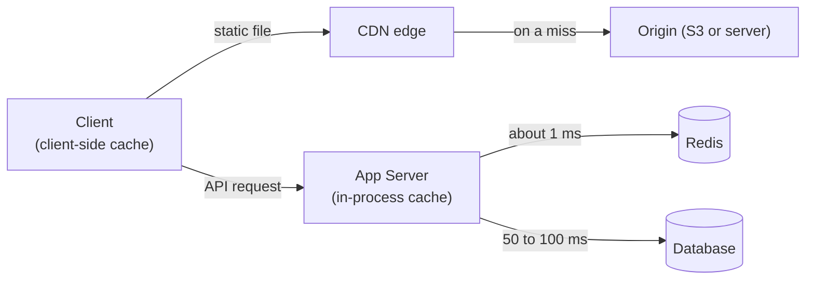

# 10. Caching and CDNs

Caching comes up almost every time a system has heavy read traffic. The database becomes the bottleneck, [latency](03-one-computer-and-latency.md) creeps up, and the interviewer waits for you to say "cache". A [cache](04-performance-throughput-load-balancing.md) can live in four places: Redis, a CDN, the app server and the client.

## Key terms

| Term | Meaning |
|------|---------|
| Cache hit ratio | A cache hit means the data was found in the cache. The cache hit ratio is the share of reads that are hits. |
| External cache | An external cache is a separate cache server, such as [Redis](07-storing-data-and-redis.md), that all app servers share. |
| CDN | A CDN (content delivery network) is a cache spread across the world. Its servers near users keep copies of files. AWS CloudFront is an example. |
| Edge server | An edge server is one CDN server near a group of users. A place where edge servers sit is a point of presence (PoP). |
| Origin server | The origin server is your own server, or [S3](08-rest-and-blob-storage.md), that holds the real copy. |
| In-process cache | An in-process cache keeps small data in the app server's own RAM. |
| Client-side cache | A client-side cache keeps data in the user's device RAM and disk. |

## How it works

1. **Reads overload the database.** A database read takes 50 to 100 ms. The fix is an external cache. A Redis read takes about 1 ms, and every app server sees the same value.
2. **Users far from the server wait long.** The server and database are in India, and a user in North America sends every request across the world. An app server in the USA does not help, because it still calls the database in India. The fix is a CDN, so the user gets files from a nearby edge server.
3. **The edge does not have the file yet.** In a pull CDN, the edge asks the origin on a [cache miss](04-performance-throughput-load-balancing.md), stores the file and returns it. In a push CDN, the origin uploads files to every edge in advance, for example a new movie.
4. **The user must reach the nearest edge.** With [DNS](06-gateway-observability-maintainability.md) geo routing, each edge has its own IP address, and DNS returns the closest one. With Anycast, all edges share one IP address, and the network picks the edge with the fewest hops.
5. **Even Redis costs a network call.** For small data the service reads again and again, use an in-process cache, which needs no [network call](03-one-computer-and-latency.md). Python's `lru_cache` is one example.
6. **Each app server has its own copy.** The copies can differ. So keep only small data that rarely changes in process. Good examples are config values, [feature flags](06-gateway-observability-maintainability.md), small reference data, hot keys (keys read very often) and precomputed values.
7. **Some apps must work without the internet.** A client-side cache needs no network at all. A smartwatch and an offline game like Candy Crush work this way.

A CDN mostly stores static content such as videos, images, CSS and JS, and it does not hold the app logic. It can also store a file in one format and deliver it in another, and it can keep versions of a file. The [TLS handshake](03-one-computer-and-latency.md) happens with the nearby edge, so it is quick. Many edges with a load balancer also improve availability.

## Trade-offs

| Layer | Where it lives | Shared by | Best for |
|-------|----------------|-----------|----------|
| Client-side | User's device | One user | Offline apps |
| CDN | Edge servers near users | Users near one edge | Static media |
| In-process | App server RAM | One app server | Config and flags |
| External | Redis | All app servers | Shared hot data |

| | Pull CDN | Push CDN |
|---|----------|----------|
| How | The edge asks the origin on a miss. | The origin uploads files in advance. |
| First request | The first request is slow. | The first request is fast. |

**Numbers:** A Redis read takes about 1 ms, and a database read takes 50 to 100 ms. An image request from the USA to a server in India takes 250 to 350 ms. From a nearby edge it takes 25 to 35 ms, which is 10 times faster.

> **Interview:** Say "cache" as soon as reads are heavy. The safest time to add a CDN is when the system serves static media at scale.

## Likely questions

- **Why add a cache?** A Redis read takes about 1 ms, and a database read takes 50 to 100 ms.
- **What does a CDN store?** It mostly stores static content such as images, videos, CSS and JS. Modern CDNs can also cache API responses.
- **Pull or push CDN?** A pull CDN fetches from the origin on a miss. A push CDN gets files in advance, which suits a known big release.
- **How does a user reach the nearest edge?** DNS geo routing returns the closest edge's IP address. Anycast gives all edges one IP address and routes by the fewest hops.
- **Why not cache everything in app server RAM?** Each server has its own copy, so the copies can differ. Keep only small data that rarely changes there.
