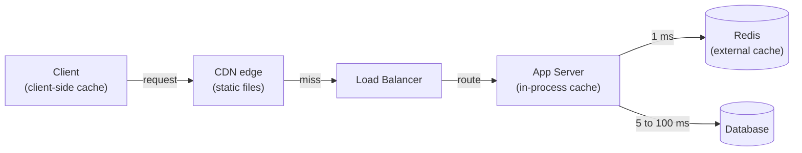
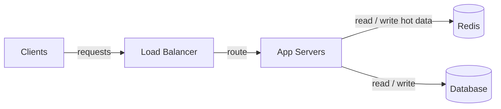
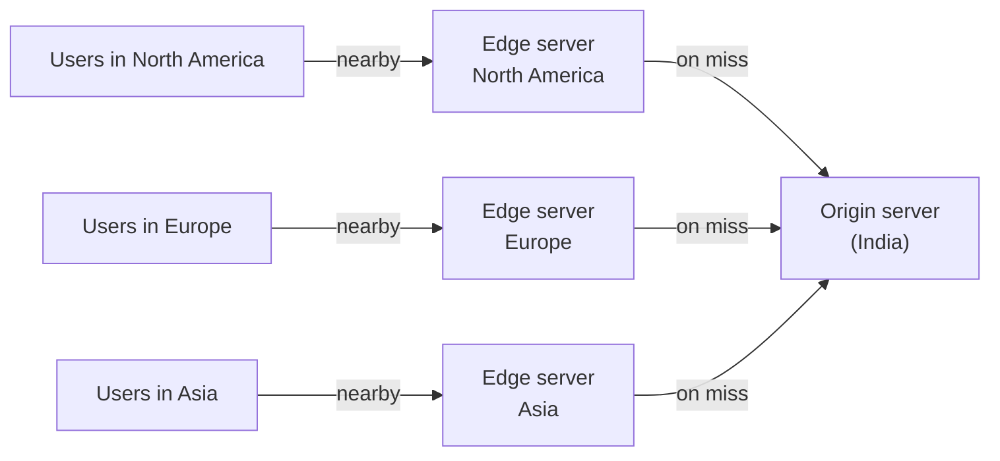
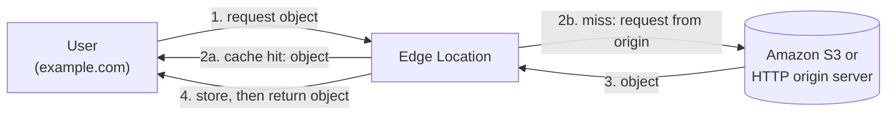

# 10. Caching and CDNs

## Why cache

Caching comes up almost every time a system has high read traffic. The database becomes the bottleneck and latency creeps up. The interviewer waits for you to say "cache".

| Read from | Typical latency |
|-----------|-----------------|
| Redis (RAM) | about 1 ms |
| Database (disk) | about 5 to 100 ms, depending on the query and disk |

- **Cache:** A fast store that holds copies of data. If a request was already processed, return the stored response. Do not process it again.
- **Cheaper per read:** A read from the cache costs less than a read from the DB.
- **What to cache:** Data that is read often and changes rarely.

Caches live in four places. Each is described below.



## 1. External caching

External caching uses a separate cache server, such as Redis. All app servers share it. The Live Counter uses this (topic 4).



- **Shared:** Every app server sees the same cached value.
- **Cost:** One network hop to Redis on each read.

## 2. CDN (Content Delivery Network)

### The problem

The server and DB are in India. A user in North America sends every request across the world. Latency is high and the network path is long. Adding an app server in the USA does not help much, because it still calls the DB in India.

### The fix

A CDN is a cache layer, but distributed globally. It is a large set of servers spread across the world. Each one is an **edge server**. A place where edge servers sit is a **point of presence (PoP)**.



### Numbers

| | Latency per image request |
|---|---------------------------|
| Without CDN (server in India, user in USA) | 250 to 350 ms |
| With CDN (nearby edge) | 25 to 35 ms |

That is a 10x difference. A CDN also reduces bandwidth on the origin.

### How a CDN serves a file (AWS CloudFront)



1. The user asks the nearest edge location for the object.
2. On a hit, the edge returns it at once.
3. On a miss, the edge fetches it from the origin (S3 or an HTTP server), stores it, then returns it.

CloudFront also has **regional edge caches** between the edge locations and the origin. Viewers hit edge locations. Edge locations ask regional edge caches. Those ask the origin.

### What a CDN stores

- **Mostly static content:** Videos, images, CSS, JS. Not the app logic.
- **Dynamic content:** Modern CDNs can also cache API responses and personalised content, and can run code at the edge.
- **Format change:** A CDN can store a file in format X and deliver it in format Y, for example resize an image.
- **Versions:** Put a version in the file name (for example `logo.v2.png`). A new version becomes a new cache entry.

### How the user reaches the nearest edge

| Method | How it works |
|--------|--------------|
| DNS geo routing | Every edge has a different IP. DNS returns the IP of the edge closest to the user. |
| Anycast | All edges share one IP. The network routes the user to the edge with the fewest hops. |

### Pull vs push CDN

| | Pull | Push |
|---|------|------|
| How | The CDN asks the origin when it does not have the data | The origin uploads content to the CDN in advance |
| First request | Slow (miss) | Fast |
| Use | Most websites | Known big releases, for example a new movie |

### Other benefits

- **TLS at the edge:** The TLS handshake (topic 3) takes several round trips. It happens with the nearby edge, so each round trip is short.
- **Availability:** Many edges, with load balancing across them. If one fails, another serves.

> **Interview:** The safest time to add a CDN is when the system serves static media at scale.

## 3. Client-side caching

The client keeps data in its own RAM and disk (see the storage table in topic 7).

- **Example:** Devices and apps that work without the internet, such as a smartwatch or an offline game like Candy Crush.
- **Benefit:** No network call at all.

## 4. Server (in-process) caching

The app server keeps small data in its own memory. Reading local memory is much faster than calling Redis, because there is no network call.

Python's `functools.lru_cache` is an example:

```python
import urllib.request, urllib.error
from functools import lru_cache

@lru_cache(maxsize=32)
def get_pep(num):
    'Retrieve text of a Python Enhancement Proposal'
    resource = f'https://peps.python.org/pep-{num:04d}'
    try:
        with urllib.request.urlopen(resource) as s:
            return s.read()
    except urllib.error.HTTPError:
        return 'Not Found'
```

```python
>>> for n in 8, 290, 308, 320, 8, 218, 320, 279, 289, 320, 9991:
...     pep = get_pep(n)
...     print(n, len(pep))

>>> get_pep.cache_info()
CacheInfo(hits=3, misses=8, maxsize=32, currsize=8)
```

Adding one line stores each result (memoization). Plain recursion becomes top-down dynamic programming:

```python
@lru_cache(maxsize=None)
def fib(n):
    if n < 2:
        return n
    return fib(n-1) + fib(n-2)

>>> [fib(n) for n in range(16)]
[0, 1, 1, 2, 3, 5, 8, 13, 21, 34, 55, 89, 144, 233, 377, 610]

>>> fib.cache_info()
CacheInfo(hits=28, misses=16, maxsize=None, currsize=16)
```

**The issue:** Each app server has its own local cache. The copies can differ. So cache only data that is small and rarely changes:

- Configuration values
- Feature flags
- Small reference datasets
- Hot keys
- Precomputed values

## Comparison

| Layer | Where | Speed | Shared by | Best for |
|-------|-------|-------|------------------------|----------|
| Client-side | User's device | Fastest, no network | One user | Offline apps, user's own data |
| CDN | Edge servers near users | 25 to 35 ms | Users near one edge | Static media |
| In-process | App server RAM | Nanoseconds | One app server | Config, flags, small hot data |
| External | Redis cluster | about 1 ms | All app servers | Shared hot data, sessions, counters |
