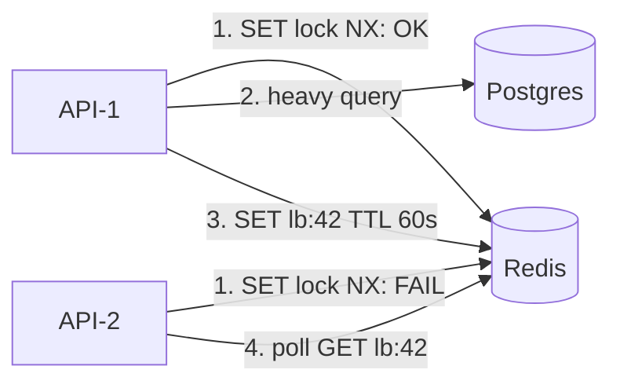

# 11. Cache Patterns and Cache Problems

A cache can be filled and kept in sync with the database in four ways. Each way trades fresh reads against fast writes. A cache also brings new problems: stale data, a thundering herd and hot keys.

## Key terms

| Term | Meaning |
|------|---------|
| Cache-aside | In cache-aside, the app reads the cache first. On a [cache miss](04-performance-throughput-load-balancing.md), it reads the DB and saves the result in the cache. |
| Write-through | In write-through, the app writes to the cache, and the cache writes to the DB before it replies. |
| Read-through | In read-through, the app reads only from the cache. On a miss, the cache itself loads the data from the DB. |
| Write-back | In write-back (also called write-behind), the app writes only to the cache. The cache writes to the DB later, in batches. |
| Eviction | Eviction is the removal of entries when the cache runs out of space. |
| LRU | LRU (least recently used) is an eviction policy that removes the entry not used for the longest time. |
| Invalidation | Invalidation means deleting or updating a cache entry when its data changes in the DB. |
| Thundering herd | A thundering herd is many requests that miss the cache at the same moment and all query the DB. |
| Hot key | A hot key is one cache key that gets a very large share of the traffic. |

## When to cache

- **Read-heavy data:** Cache data that is read often.
- **Costly data:** Cache data that is expensive to fetch or compute, so the DB CPU stays low.
- **Static files:** Serve static files from a [CDN](10-caching-and-cdn.md).
- **Extremely hot keys:** In rare cases, keep a hot key in each app server's own memory too.

## How it works

The example is `GET /leaderboard?contest_id=42`. The server computes the leaderboard from Postgres and caches it at key `lb:42` in [Redis](07-storing-data-and-redis.md) with a [TTL](07-storing-data-and-redis.md) of 60 s.

1. **The cache shows old data.** A new submission arrives, but users see the old leaderboard for up to 60 s. The fix is invalidation on every write, a short TTL, or accepting [eventual consistency](05-scalability-availability-consistency.md). A leaderboard a few seconds old is fine.
2. **The key expires and a herd hits the DB.** 200 users call in the same second, and every request misses. Each one runs the same heavy query, so DB CPU and IO spike. Only one result matters, but all of them burn DB time. This repeats at every expiry.
3. **The fix is a Redis lock.** A lock lets only one request do a task at a time ([topic 16](16-interview-framework.md)). Each server runs `SET lock:lb:42 NX` with a TTL of 10 to 30 s. NX means "set the key only if it does not exist", so only one server wins. The winner runs the query and saves `lb:42`. The others poll Redis for up to 200 to 500 ms, then serve stale data or a `503` error. The winner deletes the lock when done. If the winner dies, the lock's TTL frees it.
4. **One key gets most of the traffic.** In a popular contest, almost every read hits `lb:42`. The Redis shard that owns it hits high CPU and network. A shard holds one part of the data ([topic 12](12-scaling-databases.md)). The fixes are TTL jitter, stale-while-revalidate, a local copy in each server, or splitting the key. TTL jitter adds a few random seconds to each TTL, so keys stop expiring together. A split key stores smaller parts, such as `lb:42:top10`, `lb:42:page:1` and `lb:42:my_rank:U123`.

## Trade-offs

| | Cache-aside | Write-through | Read-through | Write-back |
|---|---|---|---|---|
| Loading | The app loads it on a miss. | The cache writes it on every write. | The cache loads it on a miss. | The cache writes it later in batches. |
| Reads | Reads can be stale until the TTL ends. | Reads are always fresh. | Reads can be stale until the TTL ends. | Reads from the cache are fresh. |
| Writes | Writes are fast. | Writes are slower, because they touch two stores. | Writes are not handled by the cache. | Writes are the fastest. |
| Risk | Stale data is the risk. | If one of the two writes fails, the cache and the DB disagree (the dual-write problem). | Stale data is the risk. | Data is lost if the cache crashes before it flushes. |
| Use | It is the default pattern. | Use it when reads must be fresh. | A CDN works this way. | Use it for analytics and metrics. |

| Thundering herd fix | How it works |
|---------------------|--------------|
| Redis lock | Only the request that holds the lock recomputes. The others wait for the cache. |
| Singleflight (request coalescing) | Inside one server, identical requests share one call to the DB. |
| Stale-while-revalidate | The server keeps serving the old value while one request refreshes it. |

- **Eviction policies:** LRU, LFU (least frequently used) and FIFO (first in, first out) are the common policies. A TTL also removes each entry once it is too old.

**Numbers:** A Redis read takes about 1 ms, and a DB read takes 50 to 100 ms. A lock TTL is 10 to 30 s, and losers poll for 200 to 500 ms.

> **Interview:** After you add a cache, name the pattern, the TTL and the invalidation rule. Then say how you stop a thundering herd (a Redis lock) and a hot key (TTL jitter or a split key).

## Likely questions

- **Write-through or write-back?** Write-through keeps reads fresh but slows writes. Write-back gives the fastest writes but can lose data, so use it only for analytics and metrics.
- **Why does a cache show stale data?** Reads come from the cache until the TTL ends. Invalidate the key on writes, or keep the TTL short.
- **What is a thundering herd?** A popular key expires, and many requests miss at once and run the same heavy query on the DB.
- **How do you stop it?** Use a Redis lock with `NX`, so only one request recomputes. Singleflight and stale-while-revalidate also work.
- **How do you handle a hot key?** Add TTL jitter, serve stale while one request refreshes, keep a local copy, or split the key into smaller keys.
