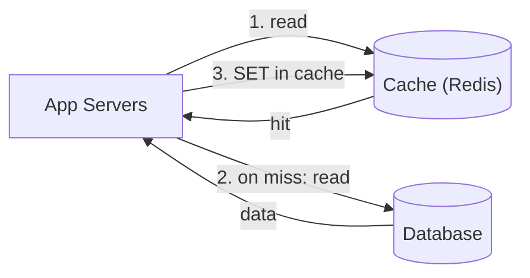
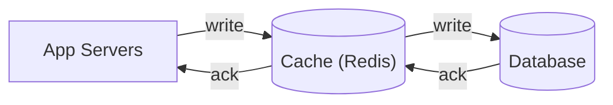
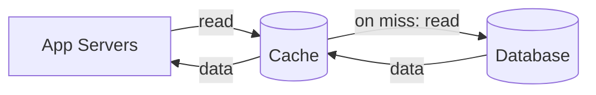
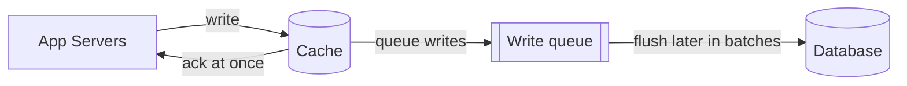
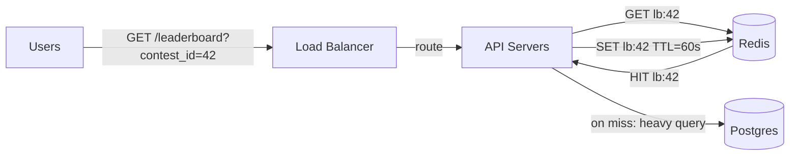
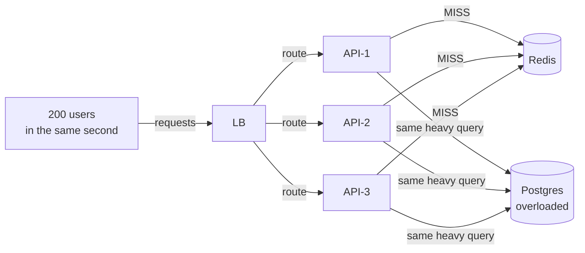
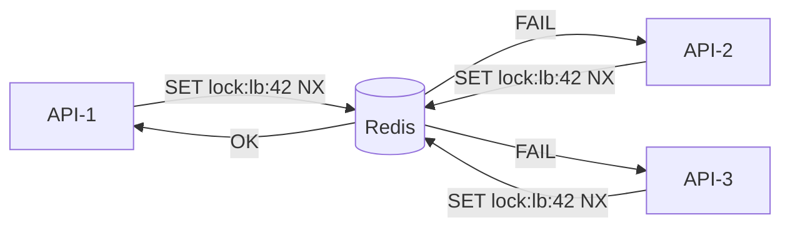
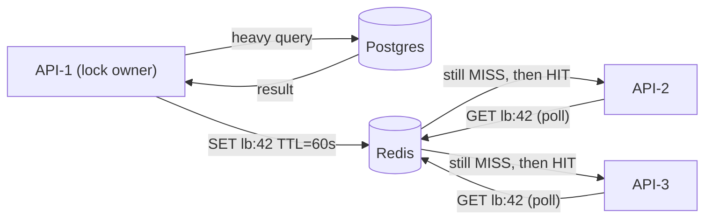
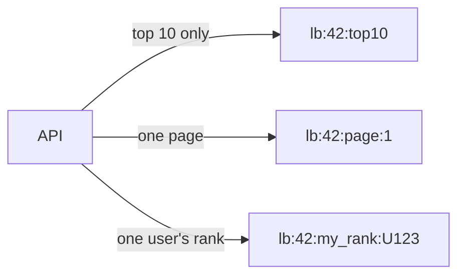

# 11. Cache Patterns and Cache Problems

## When to use caching

- **Read-heavy workload:** Focus on data that is read frequently.
- **High database CPU:** The data is expensive to fetch or compute.
- **Static files:** Use a CDN.
- **Extremely hot keys (rare):** In-process caching can make sense.

## Caching architectures

### 1. Cache-aside (lazy loading)

The app talks to both the cache and the DB. It loads data into the cache only on a miss. This is the pattern from topic 4.

### 2. Write-through

Every write goes to the cache, and the cache writes to the DB before it replies.

- **Goal:** Consistent reads with tolerable writes. Reads always return fresh data.
- **Cost:** Slower writes, because each write touches two stores.
- **Dual-write problem:** If one of the two writes fails, the cache and the DB disagree.
- **Use:** This is the usual choice when consistency matters. It adds latency but keeps the cache in sync.

### 3. Read-through

Similar to write-through, but for reads. The app reads only from the cache. On a miss, the cache itself loads from the DB.

- **Example:** A CDN is a form of read-through cache.

### 4. Write-behind (write-back)

The app writes only to the cache. The cache queues the writes and flushes them to the DB later, in batches.

- **Benefit:** Very high write throughput.
- **Risk:** If the cache crashes before flushing, data is lost.
- **Use:** Workloads where occasional data loss is acceptable, such as analytics and metrics.

### Comparison

| Pattern | Who loads the DB | Read freshness | Write speed | Data-loss risk |
|---------|------------------|----------------|-------------|----------------|
| Cache-aside | App, on a miss | Can be stale until TTL | Fast (DB only) | None |
| Write-through | Cache, on every write | Fresh | Slower | None |
| Read-through | Cache, on a miss | Can be stale until TTL | Fast | None |
| Write-behind | Cache, later | Fresh in cache | Fastest | Yes |

## Cache eviction

The cache has limited space, so it must remove entries.

| Policy | What it removes |
|--------|-----------------|
| LRU (Least Recently Used) | The entry not used for the longest time |
| LFU (Least Frequently Used) | The entry used the fewest times |
| FIFO (First In First Out) | The oldest entry added |
| TTL (Time To Live) | Each key has an expiry time. Entries older than that are removed. |

**Why TTL matters:** A user's name was "ABC". They change it to "BCD". The cache still shows "ABC". With a TTL, the entry becomes invalid after that many seconds, and the next read fetches "BCD".

## Why not always cache?

Caching makes systems faster, but it adds new failure modes.

**Scenario used below:**

- Endpoint `GET /leaderboard?contest_id=42` returns a leaderboard computed from Postgres.
- The result is cached at key `lb:42` in Redis for 60 s.
- On a miss, the API queries Postgres, computes the leaderboard, then `SET`s it in Redis with TTL 60 s.

On a hit, the response is fast with no DB work.

## Problem 1: cache consistency

A new submission arrives in the contest. The leaderboard stays old for up to 60 s, because reads come from Redis.

| Fix | How |
|-----|-----|
| Cache invalidation on writes | Delete or update `lb:42` whenever a submission changes the ranks |
| Short TTLs | Keep the stale window small |
| Accept eventual consistency | A leaderboard a few seconds old is fine for this product |

## Problem 2: thundering herd

The TTL expires and `lb:42` is gone. One API request starts the cold-cache recompute. It takes, say, 200 ms. In that time User 2 also calls the API, and so do many more.

- **The herd:** Instead of 1 recompute, you get N recomputes, one per request or per server.
- **DB saturation and contention:** All of them run the same heavy query (joins, sorts, aggregates). DB CPU and IO spike. Queries slow down. Locks and row contention may increase.
- **Wasted work:** All requests finish and write the cache. The same value is overwritten many times. Only one write matters, but all of them burned DB time.
- **It repeats:** The same thing happens on every expiry.

Knowing this can happen, and how to solve it, shows seniority.

### The 3 solutions

| Solution | Idea |
|----------|------|
| Redis lock based recompute | Only the request that gets a lock recomputes. Others wait for the cache. |
| Singleflight / request coalescing | Inside one server, many identical requests share one in-flight call |
| Stale-while-revalidate | Serve the old value while one request refreshes it in the background |

### Fix 1 in depth: Redis distributed lock

1. **Try the lock.** Each API runs `SET lock:lb:42 <id> NX` with a short TTL, for example 10 to 30 s.
   - **NX:** "Only set this key if it does not already exist."
   - API-1 gets `OK`. It is the lock owner. API-2 and API-3 get `FAIL`.

2. **Owner recomputes.** API-1 queries Postgres and runs `SET lb:42 TTL=60s`.
3. **Losers wait.** API-2 and API-3 run `GET lb:42` and still see a miss for a moment. Common patterns for losers:
   - Poll Redis for `lb:42` for up to 200 to 500 ms.
   - Short sleep and retry, with jitter (a small random delay).
   - If still missing, serve a fallback: stale data, partial data, or `503`.

4. **Cache is ready.** Everyone serves from the cache.
5. **Release the lock.** API-1 runs `DEL lock:lb:42`. If the owner dies, the lock TTL expires it safely.

## Problem 3: hot keys

A **hot key** is a cache key that gets a disproportionate share of traffic. Here it is `lb:42`. When a contest is popular, most users hit the same contest. All reads land on one Redis key and one DB query pattern. The one Redis shard that owns `lb:42` hits high CPU and network.

Every 60 s, one API owns the lock and runs the heavy Postgres query, while all other APIs poll the same Redis server.

| Fix | How |
|-----|-----|
| TTL jitter | Add a random few seconds to each TTL. Keys stop expiring at the same moment. |
| Stale-while-revalidate | Keep serving the old value while one request refreshes |
| Split the hot key | Store smaller keys, so each request loads less |
| Local cache | Keep the hot key in each app server's memory too |

## Problem 4: the cache as a single point of failure

- **Run many cache servers:** One cache server is a single point of failure. Run a Redis cluster with replicas.
- **Keep it in sync:** The cache must stay consistent with the DB. That costs latency.

> **Interview:** After you add a cache, say the TTL, the invalidation rule, and how you handle a thundering herd and a hot key.
