# 12. Scaling Databases and Consistent Hashing

Redis gives speed and saves the DB from load. This topic asks: can we optimize the database itself? Assume there is no Redis.

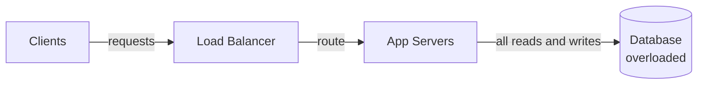

- **The 2 main issues:** Speed and connections.
- **Generally already solved by the DB:** Storage, reliability, concurrency and durability.

## 1. Speed: indexes

### No index

```sql
SELECT * FROM EMP
WHERE EMP_ID = 1234;
```

The rows live in **heap pages** (topic 7). Without an index, the DB reads every page from Page 0 to Page 333 to find `EMP_ID = 1234`. That is a full table scan.

### With an index

An **index** is another data structure, separate from the heap. It holds "pointers" into the heap.

- **Part of the data:** It stores only the indexed column(s), sorted. You can index one column or more.
- **Exact page:** It tells you exactly which heap page to fetch. You skip scanning every page.
- **Also pages:** The index is stored as pages too. Reading it costs IO.

Each index entry is `key (row_id, page)`:

| Index page | Entries |
|------------|---------|
| Page 0 | 101 (1,0), 102 (2,0), 107 (3,0), 108 (4,1), 109 (5,0), 111 (6,1), 112 (7,2), 120 (8,2), 121 (9,2) |
| Page 1 | 130 (10,3), 140 (11,3), 150 (12,3), 160 (13,4), 161 (14,4), 162 (15,4), 163 (16,5), 170 (17,5), 171 (18,5) |
| ... | ... |
| Page N | 1222 (998,333), 1233 (999,333), 1234 (1000,333) |

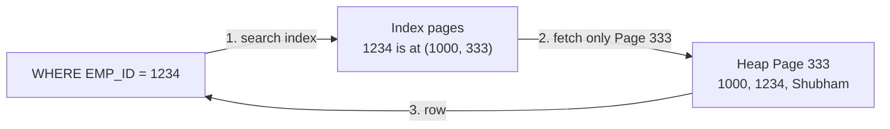

### B+ tree

Indexes use a **B+ tree**. It stores a large sorted dictionary on a block storage device (HDD or SSD). It supports fast access and updates.

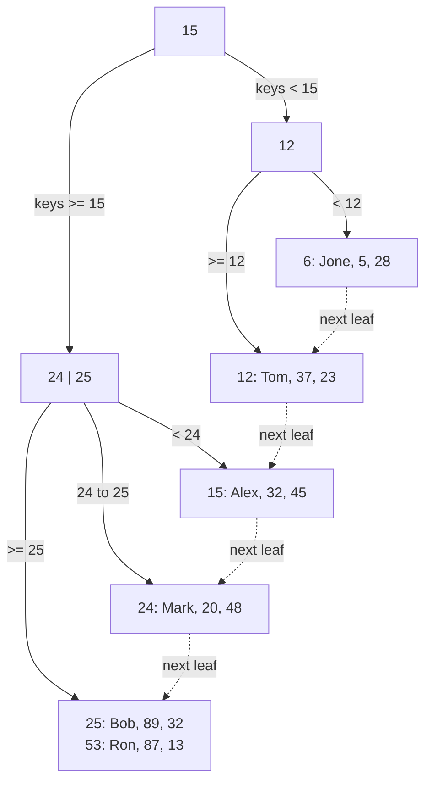

- **Inner nodes:** Hold only keys, to guide the search.
- **Leaves:** Hold the entries, linked left to right. A range scan walks along the leaves.
- **Cost:** A lookup reads O(log N) pages.
- **Default:** Most DBs index the primary key automatically.

### Is an index free?

No.

| Cost | Why |
|------|-----|
| Slower writes | Every insert, update and delete must also update each index |
| More storage | The index takes extra pages |
| IO | Reading the index costs IO too |

The owner chooses which columns to index, based on the hot queries.

## 2. Vertical scaling (hardware upgrades)

Not an interview answer, but good to know.

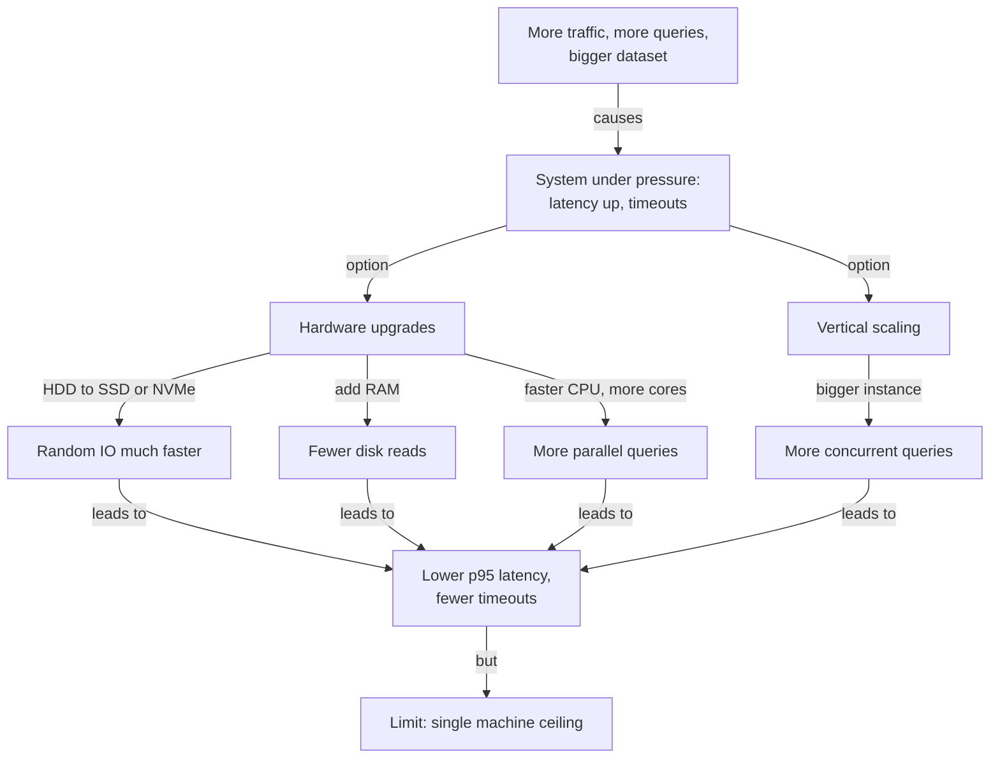

## 3. Denormalization

`GET /orders/12345` is called thousands of times per second. It must show the user name, order date, product names and prices.

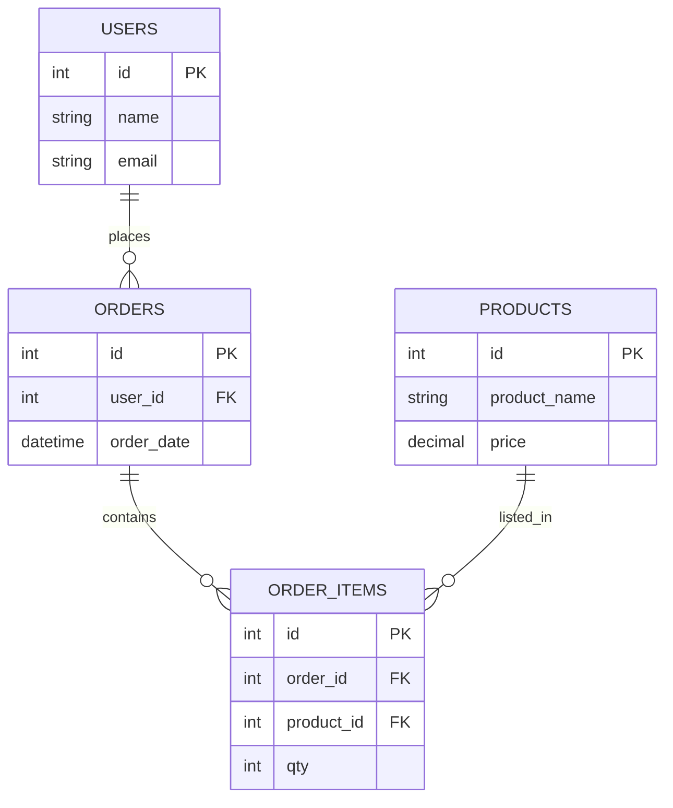

**Normalized:** Each request joins 4 tables (users, orders, order_items, products) and assembles rows.

**Denormalized:** Store one wide table, `order_summary`. Now it is one query and no joins.

| order_summary column | Type |
|----------------------|------|
| order_id | int |
| order_date | datetime |
| user_id | int |
| user_name | string |
| product_id | int |
| product_name | string |
| price | decimal |
| qty | int |

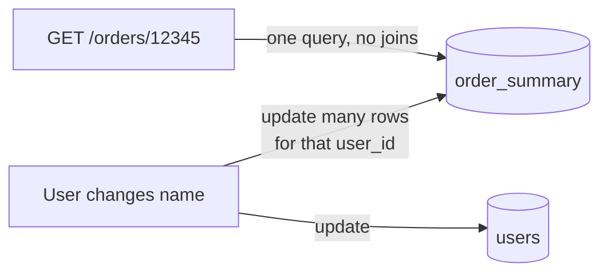

- **Trade-off:** Writes become harder. A rare write, such as a name change, now fans out to many rows.
- **So not for all tables:** Use it only for a real read bottleneck (topic 9).

## 4. Read replicas

Beyond one machine, scale horizontally with read replicas and sharding.

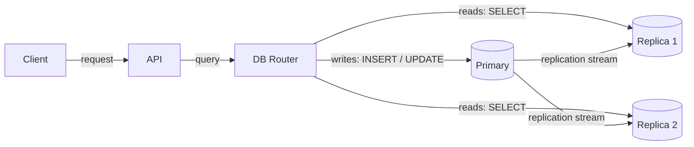

- **Routing:** Write to the primary. Read from replicas. A DB-aware router or library in the app layer does this.
- **Benefit:** The primary is protected from heavy read QPS.

### Synchronous vs asynchronous replication

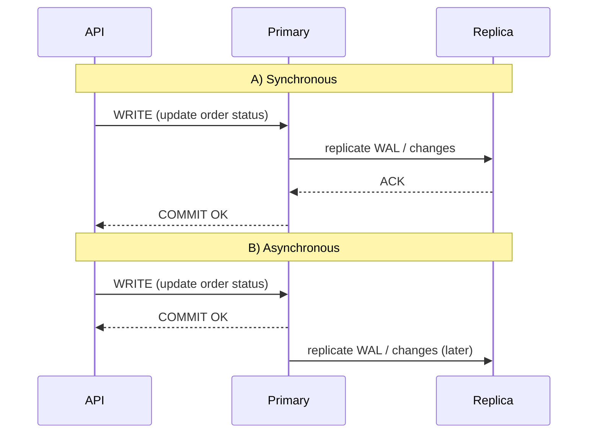

| | Synchronous | Asynchronous |
|---|-------------|--------------|
| Primary confirms the write | After the replica acks | At once |
| Consistency | Replicas are up to date | Replicas can be stale |
| Write latency | Higher | Lower |

- **WAL:** Write-ahead log. The primary's log of every change. Replicas replay it (topic 18).

### Replication lag

The user writes, then reads from a replica that has not caught up. They cannot see their own update.

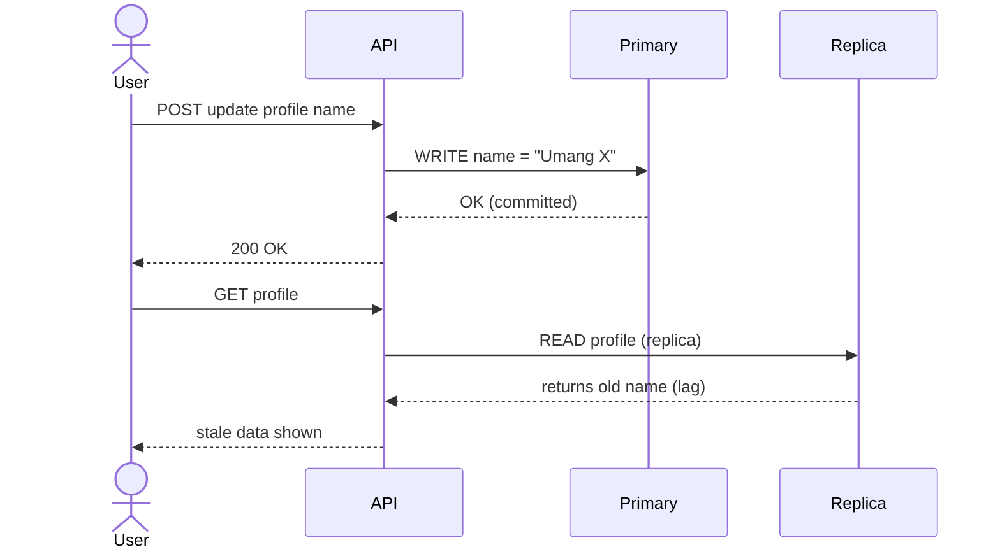

The system became read-scalable, but reads may not be immediately consistent.

**Fix: pin reads after write.** After a user writes, route that user's reads to the primary for a short window (for example 5 to 30 s), or until the replica catches up. Other users still read from replicas.

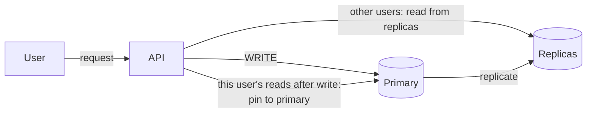

Other fixes use the WAL position (LSN). Topic 18 covers them.

### Why read replicas are not enough

Every replica still holds the full dataset. If the dataset is huge, even indexed queries get slow: bigger indexes, more cache misses, more IO. Reads scale, but each DB still stores all the data.

## 5. Sharding

**Sharding** splits the dataset across multiple databases. Each shard holds a subset.

- **Smaller shards:** Smaller indexes and more in-memory hits, so queries are faster.
- **Load spreads:** Reads and writes spread across many DBs, not just replicas of one.

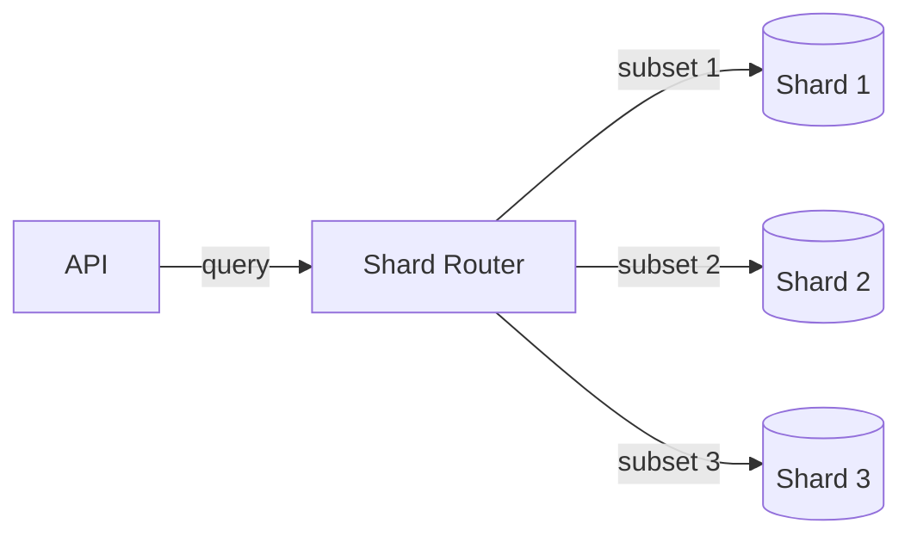

Example, sharded by price range:

| Shard | Range | Rows |
|-------|-------|------|
| 1 | $0 to $49.99 | TRINKET $37, THINGAMAJIG $18 |
| 2 | $50 to $99.99 | GIZMO $88, DOODAD $60 |
| 3 | $100+ | WIDGET $118, TCHOTCHKE $999 |

### Sharding strategies

**1. Range-based sharding**

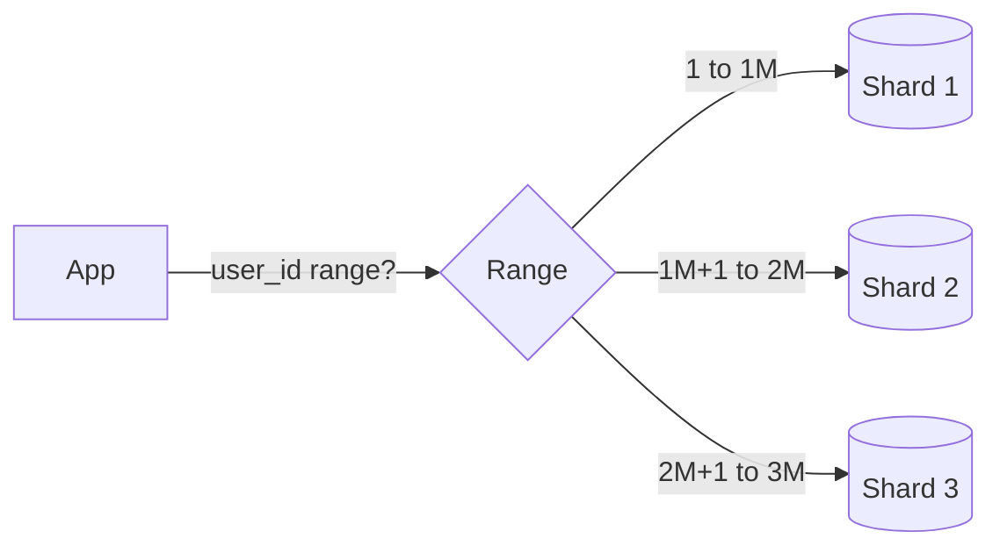

- **Classic problem, hot shard:** With shard key `created_at` (monthly shards), most traffic is recent. The newest shard gets high QPS and all new writes. Old shards are almost idle.

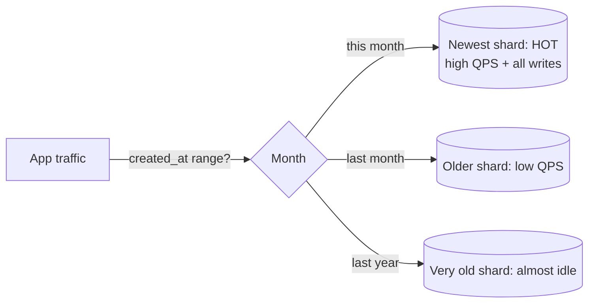

**2. Geographic sharding**

Store US users in a US DB and EU users in an EU DB. Users read from nearby servers. Latency drops, and so does load per region.

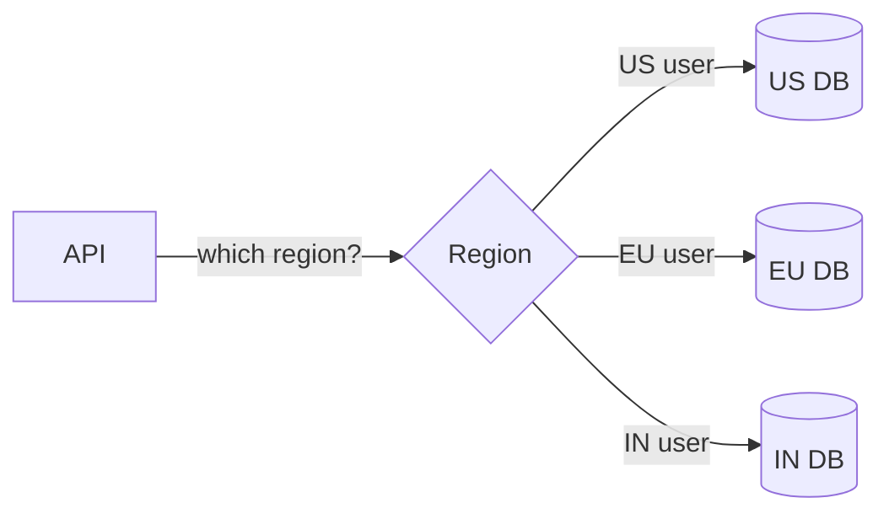

**3. Hash-based sharding (the default)**

Pick a shard key, commonly `user_id`. Compute `shard = hash(user_id) % N`.

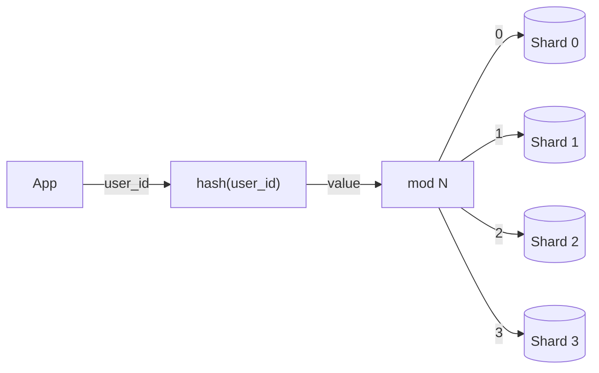

- **Why it is great:** Uniform load.
- **Big downside:** Resharding with modulo. The fix is consistent hashing.

| Strategy | Routing | Strength | Weakness |
|----------|---------|----------|----------|
| Range | Simple | Range scans | Hot shard |
| Geographic | By user region | Low latency per region | Uneven regions |
| Hash | `hash % N` | Even distribution | Resharding moves almost all keys |
| Directory | A shard map service | Any mapping | The directory is a dependency |
| Functional | By feature: Users DB, Orders DB, Products DB | Simple split | Cross-feature joins |

## 6. Consistent hashing

### The problem with modulo

Four key-value servers. `f(key) % 4` picks the server.

| f(key) % 4 | Server | Keys |
|------------|--------|------|
| 0 | S1 | k1, k2 |
| 1 | S2 | k3, k4 |
| 2 | S3 | k5, k6 |
| 3 | S4 | k7, k8 |

Add S5. Now it is `f(key) % 5`. Almost every key maps to a new server. Every key must be redistributed. The same happens when a server is removed.

### The ring

1. Take a hash range from 0 to 2^x - 1. Bend it into a ring.
2. Hash each server, `f(server)`, to place it on the ring.
3. Hash each key, `f(key)`, to place it on the ring.
4. A key belongs to the first server found going **clockwise**.

The hash function must be uniform and fast.

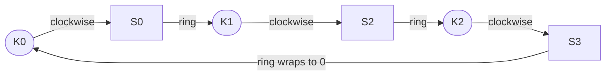

**Remove a server:** If S1 is removed, only S1's keys move. They go to the next server clockwise (S2). No other key moves.

**Add a server:** If S4 is added between S3 and S2, only part of S2's keys move to S4.

Example ring 0 to 95 with DB1 at 0, DB2 at 25, DB3 at 50, DB4 at 75. Adding DB5 at 90: only keys that hashed to 75 to 90 move (from DB1 to DB5).

| | Keys moved when a server is added or removed |
|---|---------------------------------------------|
| `hash % N` | About all K keys |
| Consistent hashing | About K / n keys on average (not always) |

- **Ring size:** x must be large. Use `2^x - 1 >= y * S`, where S is the number of servers and y is a large factor. Collisions of server positions then become rare.

### The problem: uneven ranges

Servers can land close together on the ring. One server, say S1, then owns a huge range and gets overloaded.

### Virtual nodes

Place each real server on the ring many times, as S1-a, S1-b, S1-c. Each virtual node maps back to its real server.

| Ring position | Node | Real server |
|---------------|------|-------------|
| 0 | DB1 | DB1 |
| about 5 | DB4 (virtual) | DB4 |
| about 10 | DB3 (virtual) | DB3 |
| about 15 | DB2 (virtual) | DB2 |
| about 20 | DB1 (virtual) | DB1. Keys hashed to 16 to 20 go to DB1. |
| 25 | DB2 | DB2 |
| ... | ... | ... |

- **Better balance:** Each server covers many small ranges. More virtual nodes give a more even spread.
- **Failure spreads:** A dead node's load spreads over many servers, not one neighbour.
- **Stronger servers:** Give a stronger server more virtual nodes.
- **Very important key:** A celebrity key (for example a Cristiano Ronaldo post) can get a dedicated server.
- **Cost:** More metadata to store.

> **Interview:** Say "hash-based sharding with consistent hashing and virtual nodes". Then say how a key moves when a node joins or leaves.

## Sharding is not easy

Sharding adds complexity:

- Routing logic and a shard map
- Cross-shard queries and transactions
- Rebalancing when a shard grows hot
- Backups and restore per shard
- Schema migrations across many DBs

Introduce sharding when writes or dataset size exceed what a single primary can handle. Do not shard just to scale reads.

## DB optimization techniques

| Area | Techniques |
|------|------------|
| Measure and diagnose | Metrics: QPS, p95, p99, error rate, network. Profiling: EXPLAIN plan, slow query log, CPU bound. Bottlenecks: locks and waits, lock contention, IO bound. |
| Vertical scaling | Better hardware: SSD or NVMe, more RAM, more CPU cores. DB configuration: work memory tuning, buffer cache sizing. |
| Concurrency and contention | Connections: limit max connections, pooling. Transactions: choose isolation carefully, keep them short. Locks: avoid hot rows, optimistic concurrency. |
| Specialized patterns | Fast read tables (CQRS read models). Search engine for full-text queries. Pre-aggregation for counters and leaderboards. |
| Schema and data modelling | Data types: avoid large blobs in hot tables, right-sized columns. Denormalization: summary tables, faster reads. Normalization: easier writes, less redundancy, materialized views. |
| Read scaling | Read replicas: sync or async, route reads to replicas, read-your-writes pinning, LSN caught-up reads. Geo replicas: read close to users, accept staleness. Archival: move cold data out, separate analytics store. |
| Caching | CDN edge: static assets, public pages. L1 in-process: small TTL, singleflight coalescing. L2 distributed (Redis, Memcached): stale-while-revalidate, TTL and jitter. Hot keys: local cache, split keys. |
| Sharding across DBs | Consistent hashing: hash ring, virtual nodes. Hash: even spread, resharding challenge, hot shard risk. Range: simple routing, range scans. Directory: shard map service, directory dependency risk. Functional: Products DB, Orders DB, Users DB. |
| Dataset scaling in one DB | Partitioning: hash or range partitions, pruning. Query tuning: select only needed columns, keyset pagination, avoid N+1, reduce heavy sorts and rows scanned. Indexing: composite, covering, partial, secondary, primary and unique. Maintenance: VACUUM and ANALYZE, reindex when needed. |

- **CQRS:** Command Query Responsibility Segregation. Writes go to one model, reads to a separate model built for fast reads.
- **Keyset pagination:** Page with `WHERE id > last_id LIMIT 20` instead of `OFFSET`. It does not scan skipped rows.
- **N+1:** One query for a list, then one query per item. Replace it with one join or one batch query.
- **Covering index:** An index that holds every column the query needs, so the heap is never read.
- **Partial index:** An index on only the rows that match a condition.
