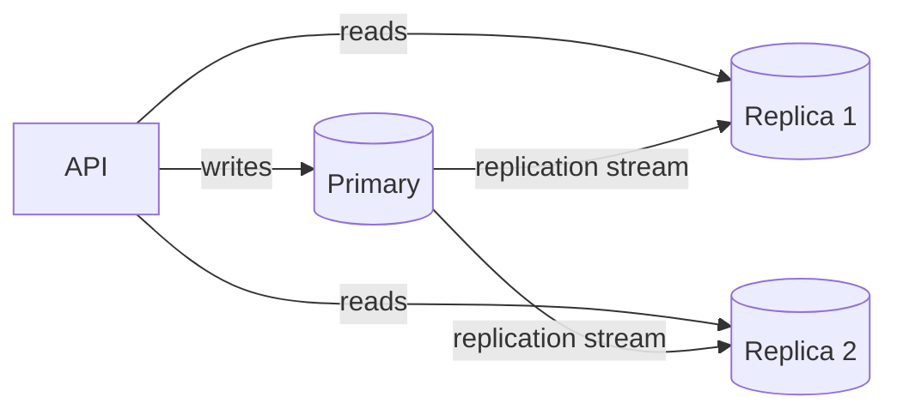

# 12. Scaling Databases and Consistent Hashing

When the database is the bottleneck, first make each query cheaper, then spread the data over more machines. The usual order is an index, bigger hardware, denormalization, read replicas and then sharding.

## Key terms

| Term | Meaning |
|------|---------|
| Replication | Replication keeps a copy of the same data on more than one DB. A read replica serves only reads. |
| Sharding | Sharding splits the dataset across many DBs. Each DB, called a shard, holds only a subset of the rows. |
| Shard key | The shard key is the column that decides which shard a row goes to, such as `user_id`. |

## How it works

Each fix creates the next problem.

1. **A query scans every page.** Without an index, `WHERE EMP_ID = 1234` reads every page from page 0 to page 333. The fix is an [index](09-data-modelling.md) on `EMP_ID`. It stores the column sorted, with a pointer to each row's page, so the DB reads only page 333. Indexes use a B+ tree, a sorted tree stored in disk pages ([topic 17](17-storage-engines.md)). A lookup then reads O(log N) pages.
2. **An index is not free.** Every insert, update and delete must also update each index, and the index takes extra pages. So index only the columns the hot queries use.
3. **One machine is too small.** An SSD, more RAM and more CPU cores help, but [vertical scaling](04-performance-throughput-load-balancing.md) hits a ceiling.
4. **A hot read joins many tables.** `GET /orders/12345` joins users, orders, order_items and products, thousands of times per second. The fix is to [denormalize](09-data-modelling.md) into one `order_summary` table. The cost is that a rare write, such as a name change, must now update many rows.
5. **Reads overload one DB.** The fix is read replicas. A DB router in the app sends writes to the [primary](05-scalability-availability-consistency.md) and reads to the replicas.
6. **A user cannot see their own update.** With async replication, the primary confirms a write at once and the replicas copy it later ([topic 18](18-replication.md)). So a replica can lag behind, and the user reads the old value. The fix is to send that user's reads to the primary for 5 to 30 s after a write.
7. **The dataset is too big.** Every replica still holds all the data, so indexes grow and queries slow down. The fix is sharding. Each shard has smaller indexes and more data in RAM, and the load spreads over many DBs.
8. **Adding a shard moves almost every key.** With `hash(key) % N`, changing N changes nearly every key's shard. The fix is consistent hashing, which places servers and keys on a ring ([topic 20](20-partitioning.md)). Hash each server and each key to a point on a ring from 0 to 2^x - 1. A key belongs to the first server found going clockwise. When a server joins or leaves, only the keys next to it move.
9. **One server owns a huge part of the ring.** Servers can land close together, so one gets most of the keys. The fix is virtual nodes. Each real server is placed on the ring many times, so it owns many small ranges. A stronger server gets more virtual nodes. When a server dies, its keys spread over many servers, not one neighbour.

## Trade-offs

| Sharding strategy | How it works | Result |
|-------------------|--------------|---------|
| Range | Each shard holds a range, such as `user_id` 1 to 1M. | Routing is simple. With `created_at` as the shard key, the newest shard gets all new writes and becomes a hot spot (one shard with most of the load, [topic 20](20-partitioning.md)). |
| Geographic | US users go to a US DB, and EU users go to an EU DB. | Users read from a nearby DB, so latency and load per region drop. |
| Hash (the default) | The server computes `shard = hash(user_id) % N`. | Load is even, but changing N moves almost every key. |

- **Sharding is not easy:** It adds routing, cross-shard queries and transactions, rebalancing, and backups and schema changes per shard. Shard only when writes or data size outgrow one primary, not just to scale reads.
- **Virtual nodes cost metadata:** Each virtual node is one more entry to store.

**Numbers:** With K keys and n servers, `hash % N` moves about all K keys, but consistent hashing moves about K / n on average. One ring runs from 0 to 95, with DB1 at 0, DB2 at 25, DB3 at 50 and DB4 at 75. Adding DB5 at 90 moves only the keys from 75 to 90.

> **Interview:** Say "add an index first, then read replicas for reads, then hash-based sharding with consistent hashing and virtual nodes". Then say which keys move when a node joins or leaves.

## Likely questions

- **Is an index free?** No. Every write must also update the index, and the index takes extra storage.
- **Why can a user not see their own update?** The read went to a replica that has not copied the write yet. Send that user's reads to the primary for a short window.
- **Why are read replicas not enough?** Each replica holds the full dataset, so a huge dataset stays slow. Sharding splits the data itself.
- **Why not `hash % N`?** Adding or removing a server moves almost every key. Consistent hashing moves only about K / n keys.
- **What do virtual nodes fix?** They stop one server from owning a huge range, and they spread a dead server's keys over many servers.
