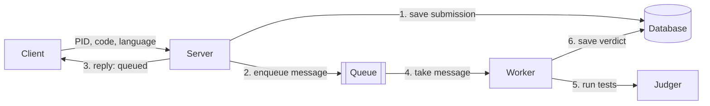

# 13. Message Queues and Async Processing

Some work takes too long to finish inside one request. A message queue lets the server reply at once and hand the work to background workers. This keeps the server free and lets each part scale on its own.

## Key terms

| Term | Meaning |
|------|---------|
| Message queue | A message queue holds tasks between the part that creates work and the part that does it. |
| Producer | A producer publishes messages to the queue. |
| Consumer | A consumer, or worker, takes messages from the queue and processes them. |
| Broker | The broker is the queue server that stores the messages in between. |
| ACK | An ACK (acknowledgement) is the consumer telling the broker that it finished a message. |
| At-least-once | At-least-once delivery keeps a message until the consumer sends an ACK. A message is never lost, but it can arrive twice. |
| Dead letter queue (DLQ) | A DLQ is a separate queue that holds messages that keep failing. |
| Pub/Sub | In Pub/Sub (publish and subscribe), every subscriber gets its own copy of each event. |
| Kafka | Kafka is an event stream: a log on disk that keeps messages for a set time, so many consumers can read and replay them. |

## How it works

The example is an online judge. The user sends the problem id (PID), the code and the language. A judger runs the code against every test case.

1. **A long request ties up the server.** The server waits seconds for the judger. If the judger is slow or down, the server's requests pile up and fail too. Each waiting request also holds a connection, and a server has only so many. The user only needs to know that the submission arrived.
2. **The fix is a queue.** The server saves the submission and puts a message on the queue. It replies "submission queued" at once. A worker takes the message, calls the judger and saves the verdict. The client fetches the verdict later by polling, which means asking again every few seconds ([topic 16](16-interview-framework.md)).
3. **Contest submissions wait behind practice ones.** The fix is a priority queue, or SLA queues (service level queues). SLA queues give each service level its own queue and its own workers. Paid and free users can get separate queues in the same way.
4. **Traffic arrives in bursts.** The queue absorbs the burst, and workers drain it at a steady rate. This is called load leveling.
5. **The queue grows too long.** The server stops taking new work and replies `429 Too Many Requests`. The client retries later. This is called backpressure.
6. **The broker crashes.** The broker stores every message on disk. On restart, it reloads the messages, so no task is lost.
7. **A worker crashes mid-task.** With at-least-once delivery, the broker sends the message again. The worker is [idempotent](05-scalability-availability-consistency.md): it checks the submission id (SID) and skips work already saved.
8. **A message keeps failing.** The worker puts it back on the queue to retry, or moves it to a DLQ.

## Trade-offs

| Guarantee | If the worker crashes | Trade-off | Example |
|-----------|-----------------------|-----------|---------|
| At-most-once | The message is lost forever. | It is fast but unreliable. | IoT sensor data |
| At-least-once | The message is delivered again. | Nothing is lost, but duplicates arrive. | Most systems |
| Exactly-once | Nothing is lost or duplicated. | It is very hard and costly, and often needs Kafka and transactions. | Payments |

| | Message queue | Event stream |
|---|---|---|
| Examples | RabbitMQ, Amazon SQS | Kafka, AWS Kinesis |
| After a read | The message is deleted once it is ACKed. | The message stays in the log for a set time, such as 7 days. |
| Consumers | Each message goes to one consumer (1 to 1). | Many consumer groups read the same events (Pub/Sub). |
| Progress | The broker tracks who read what. | Each consumer tracks its own offset, which is its place in the log. |
| Replay | Replay is not possible. | A consumer can rewind its offset to replay old events. |

| Stay synchronous | Use async workers |
|------------------|-------------------|
| The design is simpler. | The first response is fast. |
| There is less to monitor. | A failure stays inside the workers. |
| Data is consistent at once. | Workers scale on their own. |
| There are no jobs to track. | Progress can be tracked. |

- **When to use workers:** Use workers when a task takes over 5 s or needs heavy CPU or a GPU. Also use them for very high volume, rate-limited external APIs, fan-out to many users, and tasks that need progress updates.
- **Pub/Sub example:** One "order placed" event goes to three subscribers. They record the payment, send an email and add the order to a batch.

**Numbers:** Move a task to workers if it takes over 5 s. Kafka keeps events for a set time, such as 7 days.

> **Interview:** When work is slow, heavy or bursty, say "put it on a queue and process it with workers". Then say "at-least-once delivery with idempotent workers, and a DLQ for failed messages".

## Likely questions

- **Why use a queue?** The server replies at once, and the slow work runs in workers. Producer and consumer scale and fail on their own.
- **Which delivery guarantee do you choose?** Choose at-least-once, and make consumers idempotent with a unique id, so a duplicate does no harm.
- **What is a DLQ for?** It holds a message that keeps failing, apart from the main queue.
- **Kafka or RabbitMQ?** RabbitMQ deletes a message once it is ACKed. Kafka keeps a log, so many consumer groups can read and replay it.
- **What happens when the queue is full?** The server applies backpressure and replies `429`, and the client retries later.
