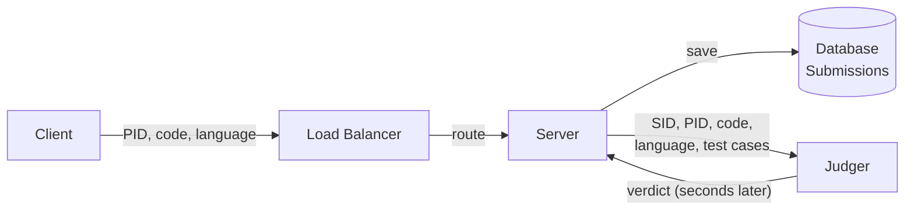
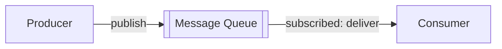
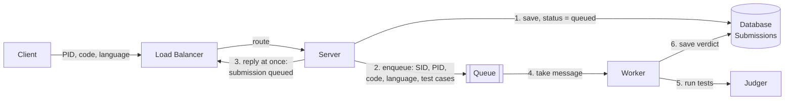
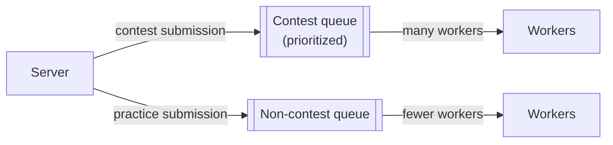
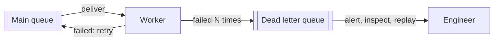
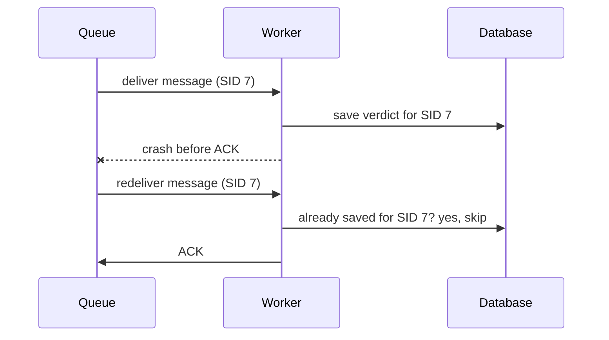
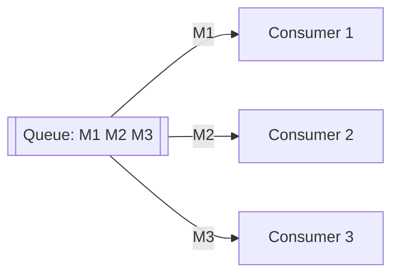
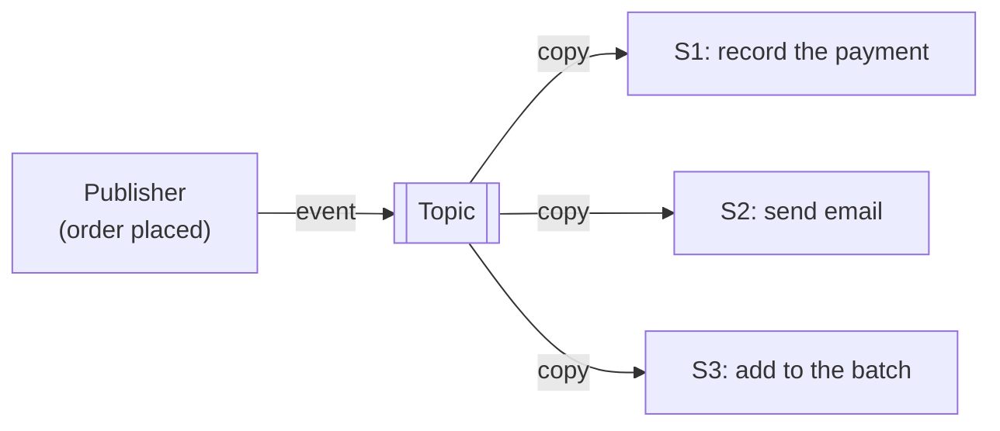
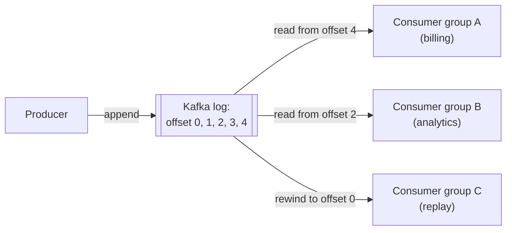
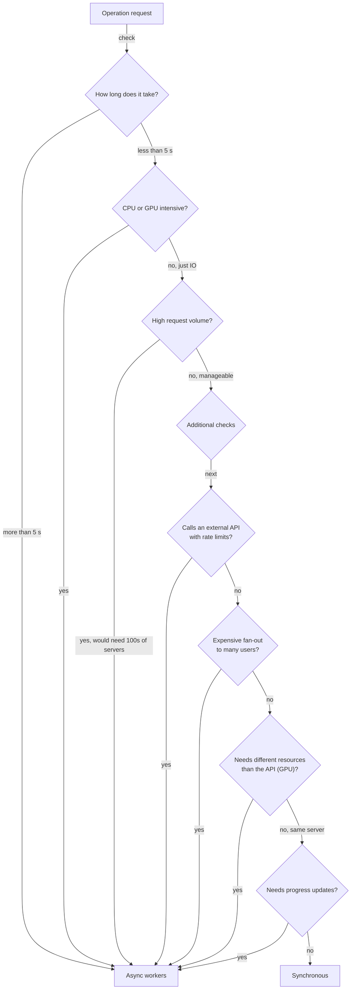

# 13. Message Queues and Async Processing

## Why: the online judge

A user submits code on an online judge (for example maang.in). The request carries the problem id (PID), the code and the language. The server saves the submission, then calls the judger. The judger runs the code against every test case.

### Problems with long synchronous requests

- **Cascading failure and dependency:** The server waits on the judger. If the judger is slow or down, the server's requests pile up and fail too (topic 6).
- **Limited connections:** Each waiting request holds a connection and a thread. A server can hold only so many. Long requests use them up fast.
- **The user does not need to wait:** The user only needs confirmation that the solution reached the server. The verdict can come later.

## What a message queue is

A **message queue** sits between the part that creates work and the part that does it.

- **Producer:** Publishes messages (tasks) to the queue.
- **Consumer (worker):** Subscribes to the queue, takes messages and processes them.
- **Broker:** The queue server that stores the messages in between.

**Main advantage: producer and consumer are decoupled.** Each one scales, fails and deploys on its own. You can run many consumers on one queue.

### The online judge with a queue

1. The server saves the submission and pushes a message to the queue.
2. It replies "submission queued" at once. The connection is freed.
3. A worker takes the message, calls the judger and writes the verdict to the DB.
4. The client fetches the verdict later (polling or a push).

## Queue features

### Scheduling strategies

| Strategy | How |
|----------|-----|
| FIFO | First in, first out. The oldest message is processed first. |
| Priority | Higher priority messages go first. Contest submissions beat practice submissions. |

### SLA queues (service level queues)

Use separate queues for work with different service levels. Each queue gets its own workers.

- **Same idea elsewhere:** Paid users get a separate queue from free users. Image generation gets a separate queue from text chat (topic 23).
- **Alternative:** Keep one queue, but give contest messages a higher priority.

### Load leveling

Traffic arrives in bursts. The queue absorbs the burst. Workers drain it at a steady rate they can handle. The DB and the judger never see the spike.

### Backpressure (429)

If the queue grows too long, the server stops accepting new work. It replies `429 Too Many Requests`. The client retries later. This protects the system instead of letting the queue grow forever.

### Persistence

Messages must be persistent: the broker stores them on disk. If the broker crashes and restarts, it reloads the tasks from disk. Without this, every queued task is lost. Topic 5 shows the durable queue as a commit point.

### Retries and the dead letter queue (DLQ)

A worker may fail to process a message. Two ways to retry:

| Way | How |
|-----|-----|
| Re-queue | Put the message back in the same queue. Try again. |
| Dead letter queue | After N failed tries, move the message to a separate queue, the DLQ |

- **Why a DLQ:** A "poison" message that always fails would block or loop forever. The DLQ moves it aside. An engineer inspects it and replays it after a fix.

## Delivery guarantees (ACK configs)

An **ACK** (acknowledgement) is the worker telling the broker "I finished this message".

| Guarantee | How | If the worker crashes | Trade-off | Example |
|-----------|-----|----------------------|-----------|---------|
| At-most-once | Delivered once. Removed at once. | The message is lost forever | High performance, low reliability | IoT sensor telemetry |
| At-least-once | Kept until the worker sends an ACK | The message is redelivered | No data loss, but duplicates | Most systems |
| Exactly-once | No loss, no duplicates | Handled by transactions | Notoriously hard and expensive. Often needs Kafka and transactional logic. | Payments inside Kafka |

**Rule:** Always design for at-least-once delivery. Make consumers **idempotent** using unique transaction IDs (topic 5). Then a duplicate message does no harm.

## One-to-one vs one-to-many

### Message queue: 1 to 1

Each message is processed by exactly one of the consumers. Many consumers share the work.

**Chained example (YouTube):** A video is uploaded in 480p. Workers push it through queues to produce 720p, 1080p and other formats (topic 27).

### Pub/Sub: 1 to many

For one event, several different actions must happen. Each action has its own subscriber. Every subscriber gets a copy of every event.

## Message queues vs event streams

| | Message queue | Event stream (distributed log) |
|---|---------------|--------------------------------|
| Examples | RabbitMQ, Amazon SQS | Apache Kafka, AWS Kinesis |
| After a read | Once consumed and ACKed, the message is deleted forever (transient) | Messages are appended to a log on disk and kept for a retention period, for example 7 days. Reading does not delete. |
| Consumers | Point-to-point. Usually one consumer group per task. | Pub/Sub. Many consumer groups read the same stream at their own pace. |
| Replay | Not possible | Rewind a consumer's offset to replay yesterday's events |
| Who tracks progress | Smart broker, dumb consumer. The broker tracks who consumed what. | Dumb broker, smart consumer. The broker only stores the log. Each consumer tracks its own **offset** (where it left off). |
| Use | Background jobs, tasks | Event pipelines, analytics, many independent readers |

- **Redis:** Also offers lists, Pub/Sub and Streams for simple queues.
- **Interview question:** Kafka vs RabbitMQ is commonly asked. Answer with the table above.

## When to use async workers

| Consider synchronous | Consider async workers |
|----------------------|------------------------|
| Simple architecture | Fast initial response |
| Less monitoring | Fault isolation |
| Immediate consistency | Independent scaling |
| No job tracking | Progress tracking |

## Problems with workers

The queue and workers are new parts that can fail:

- **Worker crash mid-task:** Use at-least-once delivery and idempotent workers.
- **Poison message:** Use a DLQ.
- **Queue grows without limit:** Autoscale workers on queue depth. Apply backpressure (429).
- **Queue is a single point of failure:** Run a broker cluster with replicated, persistent messages.
- **Monitoring:** Watch queue depth, message age and DLQ size (topic 6).

> **Interview:** When an operation is slow, heavy or bursty, say "put it on a queue and process it with workers". Then state the delivery guarantee (at-least-once), how workers stay idempotent, and what happens to failed messages (DLQ).
