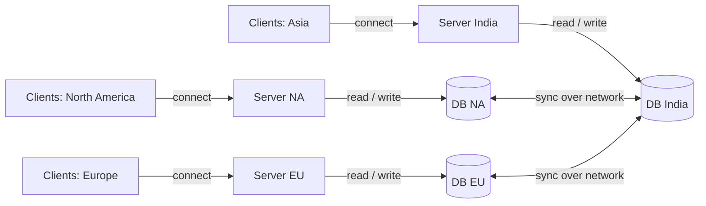
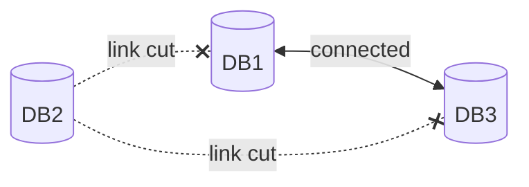
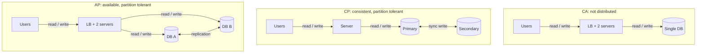
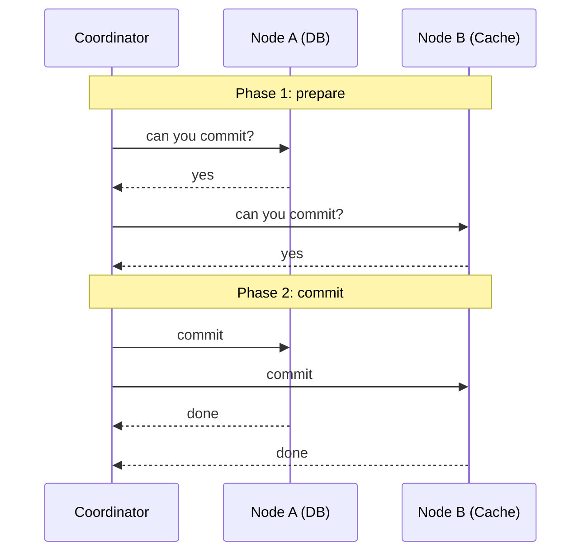
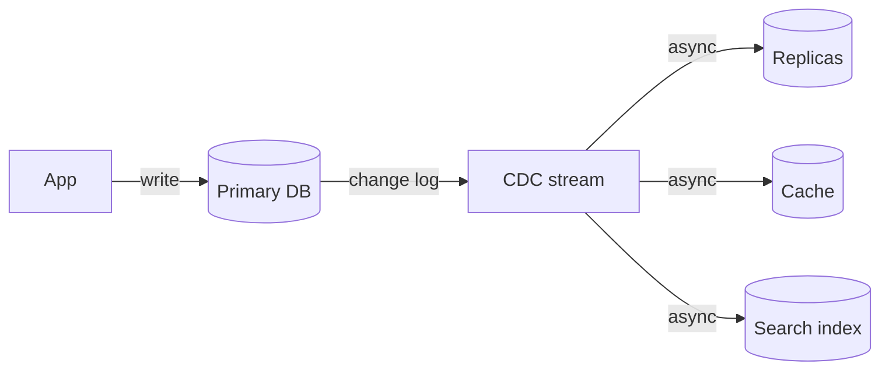
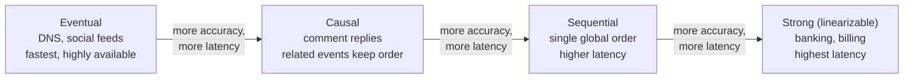

# 14. CAP Theorem

## How we got here

1. **One region:** The server, client and DB sit in India. There is one copy of the data, so there is no CAP question yet.
2. **Users worldwide:** Clients in North America, Europe and East Asia all connect to the server in India. It cannot handle that many connections.
3. **Web servers near users:** We add servers near each region for quick connections. They all still call the one DB in India.
4. **The DB is overwhelmed:** Every region's servers hit one DB.
5. **Distributed database:** We place DB copies near North America and Europe too. Now the same data lives on many nodes. CAP applies.

## The three properties

| Letter | Property | Meaning |
|--------|----------|---------|
| C | Consistency | All nodes see the same data at the same time. After a write to one node, every later read from any node returns the new value. |
| A | Availability | Every request to a non-failing node gets a response. The response may not hold the latest data. |
| P | Partition tolerance | The system keeps working despite message loss or failure of part of the system. A **network partition** means some nodes cannot reach others. |

**Example with three DBs:** A client updates DB2. DB2 sends the change to DB1 and DB3 over the network.

- **Consistency:** Clients on DB1 and DB3 also see the update.
- **Partition:** Packets can be lost on the network. Part of the data may not arrive, or it arrives late.

## Split brain

The links from DB2 to DB1 and DB3 are cut.

- **DB2 thinks:** "I cannot reach the other two."
- **DB1 and DB3 think:** "DB2 is down."

Each side believes it is the healthy one. This is the **split brain problem**. It is always possible. We cannot control the network.

## Pick two of three

| System | Gives | Design | Fails how |
|--------|-------|--------|-----------|
| CA | Consistency + availability | Users, two servers behind an LB, one single DB | Not a distributed design. No partition can happen, because there is one DB. |
| CP | Consistency + partition tolerance | A server writes to the primary. The primary writes to the secondary before it replies. | During a partition, writes are refused. Not available. |
| AP | Availability + partition tolerance | Two servers, each with its own DB. The DBs replicate to each other. | During a partition, both sides accept writes. Not consistent. |

### Why CA does not exist in a distributed system

The network will fail at some point. Say a write reaches DB2, and DB2 replies only after it has updated DB1 and DB3. During a partition, DB2 can never reach them. It gets stuck and never sends a success response. The system is no longer available. So a real distributed system cannot be CA.

### CP during a partition

The client tries to update DB2. DB2 cannot reach the others. A write happens only when it reaches all the DBs, so DB2 refuses it. The data stays consistent, but the client cannot write. Availability is sacrificed.

### AP during a partition

The client updates DB2. DB2 saves it and sends a success response at once. It does not wait for DB1 and DB3. The system stays available. But clients on DB1 and DB3 read old data until the partition heals. Consistency is sacrificed.

## For interviews: one choice

In any distributed system, partition tolerance is a must. Network failures will happen. So CAP becomes one question:

**When a network partition occurs, do you prefer consistency or availability?**

In about 90% of cases, the answer is availability.

**The key question:** "Would it be catastrophic if users briefly saw inconsistent data?" If yes, choose consistency. If no, choose availability.

| Choose consistency (CP) | Why |
|-------------------------|-----|
| Ticket booking | User A books seat 6A. During a partition, User B sees 6A as free and books it too. Two people show up for one seat. |
| E-commerce inventory | One toothbrush is left. It shows as available to many users. The store oversells. |
| Financial systems | A trading platform must show the true order book. Stale data gives trades at wrong prices. |
| Banking transactions | A balance must never be wrong |

| Choose availability (AP) | Why |
|--------------------------|-----|
| Social media | A friend sees your old profile picture for a few minutes. Fine. |
| Content platforms (Netflix) | An old movie description shows briefly. Not catastrophic. |
| Review sites (Yelp) | Slightly outdated opening hours beat no information |
| Shopping cart (Amazon) | The cart must always accept items |

### How to build for consistency

- **Distributed transactions:** Keep several stores (for example cache and DB) in sync with a **two-phase commit (2PC)**. A coordinator first asks every node "can you commit?" (prepare). Only if all say yes, it tells all to commit. This guarantees consistency but adds latency and complexity.
- **Single-node solutions:** Use one database instance as the single source of truth. It limits scale but removes propagation problems.
- **Technology:** Traditional RDBMS (PostgreSQL, MySQL), Google Spanner, DynamoDB in strong consistency mode.

If any node says no in phase 1, the coordinator tells all nodes to abort.

### How to build for availability

- **Multiple replicas:** Add read replicas with asynchronous replication (topic 12). Any replica can serve reads, even if slightly behind.
- **Change Data Capture (CDC):** Track every change in the primary DB and push it asynchronously to replicas, caches and other systems. The primary stays available while updates flow through.
- **Technology:** Redis clusters, Cassandra, DynamoDB across multiple availability zones.

### Conflict resolution in AP systems

During a partition, both sides accept writes. When the partition heals, the copies disagree. They must be merged.

**Amazon cart example:** The same user's cart has three copies.

| Copy | Items |
|------|-------|
| X | a, b |
| Y | a, b, c |
| Z | d, e |

Amazon merges the copies: the final cart is a, b, c, d, e. No item the user added is lost. Availability matters more than a perfect cart. The copies become the same in the end. This is **eventual consistency**. Topic 18 covers conflict resolution in depth.

## The consistency spectrum

It is not just strong or eventual (topic 5). There is a range. Moving right gains accuracy but loses availability and speed.

| Level | Guarantee | Example |
|-------|-----------|---------|
| Eventual | Copies agree in the end. Reads may be stale for a while. | DNS, social feeds |
| Causal | If event B depends on A, everyone sees A before B. Unrelated events can appear in any order. | A reply never shows before its comment |
| Sequential | Everyone sees all writes in the same single order | Banking, billing |
| Strong (linearizable) | Every read returns the latest write, as if there were one copy | Banking, billing |

> **Interview:** State CAP first in the NFRs (topic 2). Say "partition tolerance is a must, so I choose availability (or consistency) because ...". Give the product reason. Then name the tool: async replicas and CDC for AP, a single primary or 2PC for CP.
