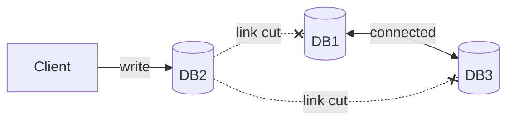

# 14. CAP Theorem

When users are worldwide, one database in India gets overwhelmed, so we put copies of the data near each region. The network between the copies can fail. CAP says what the system can still promise when it does.

## Key terms

| Term | Meaning |
|------|---------|
| CAP | CAP names three properties of a database whose data lives on many nodes: consistency (C), availability (A) and partition tolerance (P). |
| Consistency (in CAP) | All nodes see the same data at the same time. After a write to one node, every later read from any node returns the new value. |
| Availability (in CAP) | Every request to a working node gets a response. The response may not hold the latest data. |
| Network partition | A network partition is a network failure that stops some nodes from reaching the others. Messages can be lost or arrive late. |
| Partition tolerance | Partition tolerance means the system keeps working during a network partition. |
| Split brain | Split brain is when each side of a partition thinks it is the healthy side and the other side is down. |
| CP | A CP system keeps consistency during a partition and gives up availability. |
| AP | An AP system keeps availability during a partition and gives up consistency. |
| Eventual consistency | Eventual consistency means the copies may differ for a few seconds or minutes, but they become the same in the end. |

## How it works

Three DB nodes hold the same data. A client writes to DB2, and DB2 sends the change to DB1 and DB3 over the network.

1. **The network fails.** The links from DB2 to DB1 and DB3 are cut. DB2 thinks the other two are down, and they think DB2 is down. This split brain can always happen, because we cannot control the network.
2. **CA is not possible.** Say DB2 replies only after it has updated DB1 and DB3. During a partition it can never reach them, so it gets stuck and never replies. A real distributed system must tolerate partitions, so it cannot be CA.
3. **CP gives up availability.** A write succeeds only when it reaches all the nodes. During a partition DB2 refuses the write. The data stays correct, but the client cannot write.
4. **AP gives up consistency.** DB2 saves the write and replies at once. Clients on DB1 and DB3 read old data until the partition heals.
5. **AP copies must be merged.** In Amazon, one cart has three copies: X has a and b, Y has a, b and c, and Z has d and e. Amazon merges them into a, b, c, d and e, so no added item is lost. This is eventual consistency.

## Trade-offs

Partition tolerance is a must, because network failures will happen. So CAP becomes one choice: during a partition, do you keep consistency or availability? Ask "would it be catastrophic if users briefly saw old data?". If yes, choose CP. If no, choose AP.

| | CP | AP |
|---|----|----|
| During a partition | The system refuses writes, so the data stays correct. | The system accepts writes, so some reads are old. |
| Use it for | Ticket booking, stock left in a shop, banking and trading need it. Two users must not book seat 6A. | Social media, Netflix descriptions, Yelp opening hours and the Amazon cart can use it. An old profile picture for a few minutes is fine. |
| How to build it | Use one primary DB that writes to its secondary before it replies. To keep a cache and a DB in step, use a two-phase commit: a coordinator asks every store "can you commit?", and commits only if all say yes. This adds latency. | Use many [replicas](05-scalability-availability-consistency.md) that copy writes in the background, so the client does not wait. Any replica can serve reads, even if it is slightly behind. |
| Tools | PostgreSQL, MySQL, Google Spanner and DynamoDB in strong mode are CP. | Redis clusters, Cassandra and DynamoDB across zones are AP. |

**Consistency levels:** From fastest to most accurate, the levels are eventual (DNS, feeds), causal (a reply never shows before its comment), sequential and strong (banking). Each step to the right gains accuracy and loses speed and availability.

**Numbers:** In about 90% of systems, the answer is availability.

> **Interview:** In the NFRs, say "partition tolerance is a must, so I choose availability (or consistency) because ...", and give the product reason.

## Likely questions

- **What does CAP say?** During a network partition, a distributed system can keep either consistency or availability, not both.
- **Why can a distributed system not be CA?** The network will fail at some point. A node that waits for every copy then never replies, so the system is not available.
- **When do you choose CP?** Choose CP when old data would be catastrophic, such as for bookings, stock and money.
- **When do you choose AP?** Choose AP when a few seconds of old data is fine, such as for feeds, chats and view counts.
- **What happens to AP copies after the partition heals?** The copies are merged, and they become the same in the end. This is eventual consistency.
